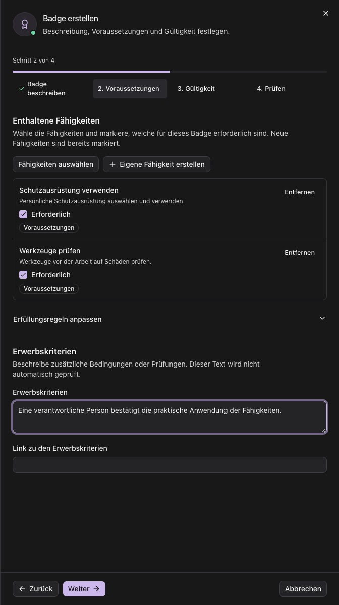
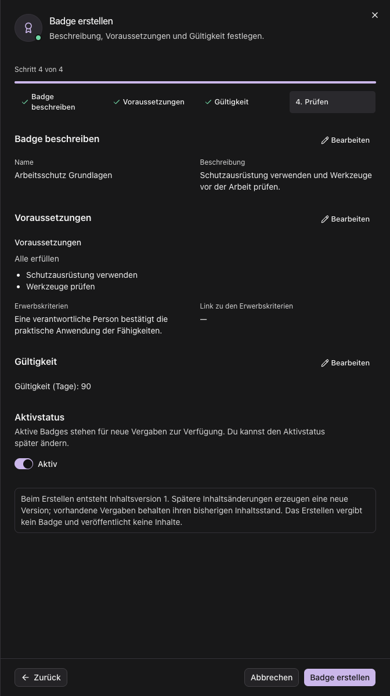
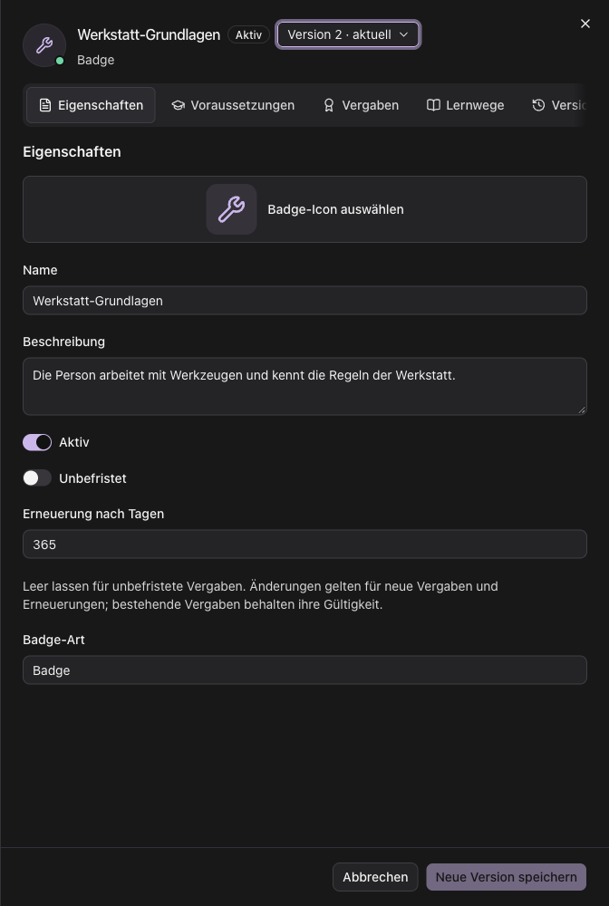
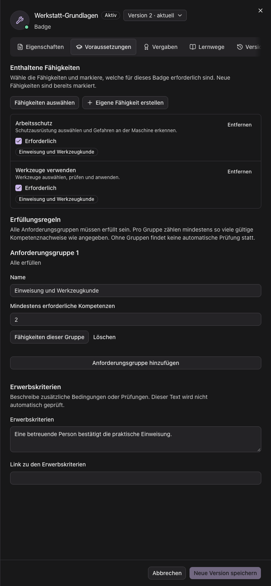
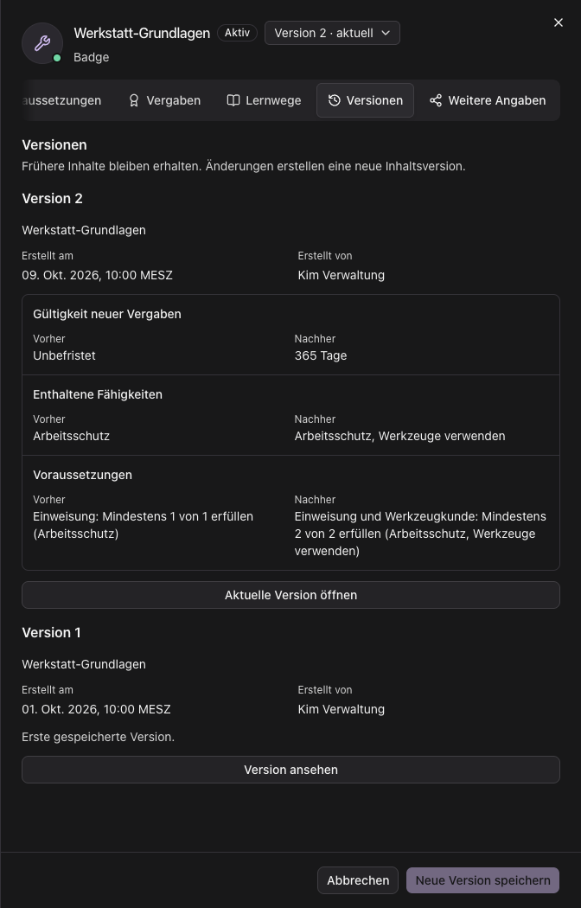
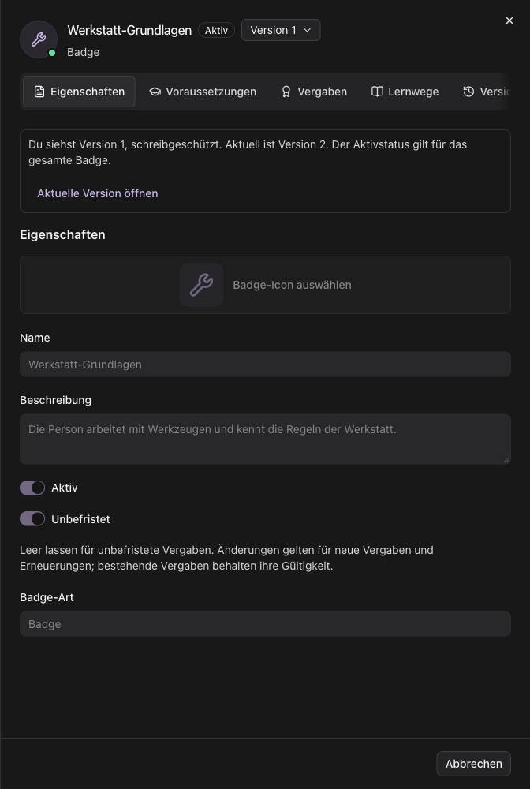

Ein Badge beschreibt Fähigkeiten und Erwerbskriterien. Seine **Definition** legt fest, was erworben
werden kann; eine **Vergabe** hält fest, welche Person es erhalten hat. Eine lokale Vergabe ist kein
signiertes Open-Badges-Credential und gewährt allein keinen Ressourcenzugriff.

## Voraussetzungen und Rechte

Du brauchst Leserechte für **Kompetenzen** und je nach Aufgabe weitere Rechte:

| Aufgabe                                                                          | Zusätzliches Recht für Kompetenzen |
| -------------------------------------------------------------------------------- | ---------------------------------- |
| Definition, Versionen und Vergaben ansehen; exportieren                          | Kein weiteres Recht                |
| Badge erstellen, Definition importieren, lokale Kopie erstellen, veröffentlichen | Anlegen                            |
| Lokale Inhalte oder Aktivstatus ändern; Veröffentlichung zurückziehen            | Bearbeiten                         |
| Lokal vergeben, erneuern oder widerrufen                                         | Genehmigen                         |

Für die Personenauswahl brauchst du außerdem Leserechte für Benutzer. Neue lokale Vergaben und
Erneuerungen setzen ein **aktives lokales Badge** und ein vorhandenes Benutzerkonto voraus.
Importierte Originale lassen sich nicht bearbeiten oder lokal vergeben; erstelle dafür eine lokale Kopie.
Fehlt eine Aktion, prüfe die Rechte sowie den Aktivstatus, die Herkunft und die angezeigte Version.

## Ein Badge erstellen

Mit dem Recht zum Anlegen von Kompetenzen öffnest du **Kompetenzen → Badges → Badge erstellen**.
Der Assistent führt durch vier Schritte:

1. **Badge beschreiben:** Gib Name und Beschreibung an und wähle ein Symbol.
2. **Voraussetzungen:** Wähle die Fähigkeiten aus, die zum Erwerb erforderlich sind.
   Neue Fähigkeiten werden als **Erforderlich** einer Anforderungsgruppe zugeordnet.
   Standardmäßig sind alle ausgewählten Fähigkeiten erforderlich. Unter **Erfüllungsregeln anpassen**
   kannst du Gruppen und deren Mindestanzahl ändern. Gib unter **Beschreibung der Erwerbskriterien**
   an, was zum Erwerb nachgewiesen werden muss, und ergänze gegebenenfalls manuelle Prüfungen.
   Der Text ist erforderlich und wird nicht automatisch ausgewertet. Ein optionaler Link führt zu ausführlichen Kriterien.
   Soll das Badge ohne Fähigkeitsvoraussetzungen auskommen, wähle ausdrücklich
   **Ohne Fähigkeitsvoraussetzungen erstellen** und gib die manuell zu prüfenden Kriterien an.
3. **Gültigkeit:** Wähle **Unbefristet** oder eine Dauer von 1 bis 36500 Tagen ab Vergabe.
   Die Dauer gilt für neue Vergaben und Erneuerungen. Beim Aus- und Einschalten von **Unbefristet**
   bleibt die zuletzt eingegebene Dauer im Entwurf erhalten.
4. **Prüfen:** Kontrolliere Beschreibung, erforderliche Fähigkeiten, Erfüllungsregeln, Kriterien
   und Gültigkeit. **Bearbeiten** führt zum jeweiligen Schritt zurück. Wähle, ob das Badge
   **Aktiv** sein soll, und bestätige mit **Badge erstellen**.

**Weiter** und spätere Schritte stehen erst nach gültigen Angaben zur Verfügung. Beim Zurückgehen
bleiben Eingaben erhalten. Im Prüfschritt steht **Badge erstellen** erst zur Verfügung, wenn alle
ausgewählten Fähigkeiten geladen und angezeigt werden können. Bei einem Ladefehler wähle **Erneut versuchen**.
**Badge erstellen** speichert die Definition mit Inhaltsversion 1;
es vergibt kein Badge und veröffentlicht keine Inhalte. Nach erfolgreicher Erstellung erscheint das Badge in der Liste. Öffne es, um weitere Angaben
zu bearbeiten. Weitere Inhaltsänderungen erzeugen neue Versionen, ohne vorhandene Vergaben zu verändern.

Ein geänderter Entwurf wird bei **Abbrechen**, **Schließen**, Escape oder einem Klick außerhalb des Sheets
nicht sofort verworfen. Du kannst **Weiter bearbeiten** oder **Änderungen verwerfen** wählen.
Beim Neuladen oder Schließen des Browser-Tabs warnt der Browser vor ungespeicherten Änderungen.
Der Entwurf bleibt bis zur Erstellung im geöffneten Formular; er wird nicht automatisch auf dem Server gespeichert.
Bei einem Fehler bleiben die Eingaben erhalten und du kannst die Erstellung erneut versuchen.

Die folgenden Screenshots zeigen den Assistenten mit fiktiven Beispieldaten.

## Ein Badge öffnen

Öffne **Kompetenzen → Badges** und wähle ein Badge aus. Das Sheet zeigt Informationen und Eingabefelder
in derselben Ansicht. Mit dem Recht zum Bearbeiten kannst du lokale Badges direkt ändern.
Importierte Originale bleiben schreibgeschützt; über **Weitere Angaben → Lokale Kopie erstellen** erstellst du
mit dem Recht zum Anlegen eine eigene Variante.

## Eigenschaften ändern

Unter **Eigenschaften** bearbeitest du Name, Beschreibung, Symbol und Gültigkeitsdauer.
Die Gültigkeitsdauer gilt für neue Vergaben und Erneuerungen. Bestehende Vergaben behalten ihre
bisherige Gültigkeit. **Unbefristet** entfernt eine geplante Ablaufzeit für neue Vergaben.
Beim Umschalten bleibt die zuletzt eingegebene Dauer im Entwurf erhalten. Ein leeres Zahlenfeld
aktiviert **Unbefristet** nicht; gib eine gültige Dauer ein oder aktiviere den Schalter.

Änderungen bleiben zunächst ungespeichert. **Neue Version speichern** speichert einen neuen Inhaltsstand
und lässt das Sheet geöffnet. Die neue Version wird zur aktuellen Version. Bei einem Fehler bleiben
Eingaben erhalten; du kannst sie korrigieren und erneut speichern.

Fehlen gültige Angaben, nennt ein Hinweis über den Tabs die betroffenen Felder. Wähle darin
**Eigenschaften** oder **Voraussetzungen**, um den passenden Tab zu öffnen. Deine Eingaben bleiben erhalten.

## Voraussetzungen und Kriterien

Unter **Voraussetzungen** wählst du Fähigkeiten einmal aus:

1. Wähle unter **Enthaltene Fähigkeiten → Fähigkeiten auswählen** die Fähigkeiten aus.
   Neu hinzugefügte Fähigkeiten sind standardmäßig **Erforderlich** und werden der ersten
   Anforderungsgruppe zugeordnet. Gibt es noch keine Gruppe, wird eine angelegt.
2. Entferne **Erforderlich**, wenn eine Fähigkeit das Badge nur beschreiben soll.
   Bereits vorhandene beschreibende Zuordnungen werden beim Öffnen nicht zu Voraussetzungen.
   Die Auswahl erhält die zugeordneten Inhaltsversionen der Fähigkeiten.
3. Stelle unter **Erfüllungsregeln** die Mindestanzahl je Gruppe ein. Mit **Fähigkeiten dieser Gruppe**
   verteilst du bereits ausgewählte Fähigkeiten auf die Gruppen. Alle Gruppen müssen erfüllt sein.
   Bei einer Mindestanzahl gleich der Anzahl der Fähigkeiten sind alle erforderlich.
   Ohne Gruppen findet keine automatische Prüfung statt.
4. Gib unter **Beschreibung der Erwerbskriterien** an, was zum Erwerb nachgewiesen werden muss.
   Ergänze gegebenenfalls manuelle Prüfungen. Der Text ist erforderlich und wird nicht automatisch ausgewertet. Der optionale Link führt zu ausführlichen
   Kriterien; Leeren entfernt ihn.

Entfernst du eine Fähigkeit aus der gemeinsamen Auswahl, wird sie auch aus den Anforderungsgruppen
entfernt. Die Mindestanzahl wird bei Bedarf auf die verbliebene Anzahl begrenzt; leere Gruppen entfallen.
Wählst du die Fähigkeit im selben Entwurf wieder an, werden die vorherigen Gruppen und Mindestzahlen
wiederhergestellt, sofern du die Regeln dazwischen nicht ausdrücklich bearbeitet hast.
Anforderungsgruppen lassen sich erst hinzufügen, wenn Fähigkeiten ausgewählt sind. Bei ungültigen
Angaben zeigt das Formular Hinweise am jeweiligen Feld und öffnet eingeklappte Erfüllungsregeln.
Änderungen werden erst mit **Neue Version speichern** übernommen.

Beispiel: Gruppe „Grundlagen“ enthält zwei Fähigkeiten und verlangt mindestens eine davon.
Gruppe „Praxis“ enthält eine weitere Fähigkeit und verlangt diese eine. Dann muss eine Fähigkeit aus
„Grundlagen“ **und** die Fähigkeit aus „Praxis“ nachgewiesen sein.

Die Auswahl durchsucht eigene Fähigkeiten und ESCO, einen externen Fähigkeitskatalog.
Bei der Auswahl einer noch nicht gespeicherten ESCO-Fähigkeit wird diese übernommen; dafür brauchst
du das Recht zum Anlegen von Kompetenzen. Ist ESCO nicht erreichbar, bleiben bereits gespeicherte
und eigene Fähigkeiten auswählbar.

Die Prüfung von Voraussetzungen vergibt kein Badge automatisch. Die lokale Vergabe ist eine
separate Entscheidung und prüft die Anforderungsgruppen nicht erneut. Prüfe deshalb Fähigkeiten
und manuelle Erwerbskriterien vor jeder Vergabe und Erneuerung selbst. Ein Lernweg enthält Badges;
er ist keine Voraussetzung für ein einzelnes Badge.

## Badge aktivieren oder deaktivieren

1. Öffne die aktuelle Version eines lokalen Badges und wähle **Eigenschaften**.
2. Speichere oder verwirf vorhandene Inhaltsänderungen.
3. Wähle unter **Aktivstatus** **Badge deaktivieren** beziehungsweise **Badge aktivieren**.
4. Bestätige die Aktion.

Der Aktivstatus gilt für das gesamte Badge und legt keine Inhaltsversion an. Ein inaktives Badge
steht nicht für neue lokale Vergaben oder Erneuerungen zur Verfügung. Vorhandene Vergaben werden
nicht widerrufen und behalten ihre Gültigkeit. Importierte Originale bleiben schreibgeschützt.

## Frühere Versionen ansehen

Die **Versionsauswahl im Header** öffnet einen früheren Inhaltsstand in denselben Tabs, schreibgeschützt.
Der Hinweis nennt die angezeigte und die aktuelle Version. **Aktuelle Version öffnen** führt zurück zum
bearbeitbaren Stand. Wenn du ungespeicherte Änderungen hast, kannst du weiterbearbeiten oder sie vor
dem Versionswechsel verwerfen.

Unter **Versionen** siehst du erhaltene Inhaltsstände und welche Inhaltsfelder sich gegenüber dem
vorherigen Stand unterscheiden, jeweils mit **Vorher** und **Nachher**. Zeitpunkt und Bearbeiter
werden angezeigt, soweit sie erfasst wurden; andernfalls steht dort **Nicht erfasst**.
Der Aktivstatus gehört zum gesamten Badge und wird nicht als historischer Aktivstatus dargestellt.

## Vergaben und Lernwege

Unter **Vergaben** siehst du Personen, Status, Gültigkeit und die Inhaltsversion ihrer Vergabe.
Eine neue Badge-Version verändert bestehende Vergaben nicht. Neue Vergaben und Erneuerungen verwenden
den aktuellen gespeicherten Stand.

Beim Ansehen einer historischen Version und während ungespeicherter Änderungen sind Vergabeaktionen
nicht verfügbar. Kehre zur aktuellen Version zurück und speichere oder verwirf deine Änderungen.

### Ein Badge vergeben

1. Prüfe, ob die Person die erforderlichen Fähigkeiten und die beschriebenen Erwerbskriterien
   erfüllt. Die lokale Vergabe bestätigt deine Entscheidung; sie führt keine automatische
   Prüfung dieser Voraussetzungen durch.
2. Öffne beim aktiven lokalen Badge **Vergaben → Badge vergeben**.
3. Wähle die Person aus. Das Badge ist bereits festgelegt. Ergänze bei Bedarf eine
   **Notiz zur Entscheidung** mit höchstens 2000 Zeichen.
4. Wähle **Vergabe bestätigen**.
5. Prüfe in der Vergabeliste Person, **Inhaltsversion**, Status **Gültig** und Ablaufdatum.
   Öffne die Vergabe, um **Vergeben am** und die Notiz zu lesen.

Die Vergabe beginnt sofort. Ihre Gültigkeit ergibt sich aus der aktuellen Badge-Version; im
Vergabeformular wählst du kein eigenes Beginn- oder Ablaufdatum. Bei **Unbefristet** hat sie kein Ablaufdatum.
Eine weitere gültige Vergabe desselben Badges an dieselbe Person wird abgelehnt.

### Eine Vergabe erneuern

Eine Erneuerung ersetzt die bisherige Vergabe. Der alte Datensatz bleibt erhalten und erscheint als
**Widerrufen oder ersetzt**. Die neue Vergabe verwendet die aktuelle Inhaltsversion und beginnt mit
einer neuen Gültigkeitsdauer ab dem Zeitpunkt der Erneuerung, nicht ab dem bisherigen Ablaufdatum.

1. Prüfe die Erwerbskriterien der aktuellen Badge-Version und die Nachweise der Person erneut.
2. Öffne unter **Vergaben** eine gültige oder abgelaufene Vergabe, die noch nicht widerrufen oder ersetzt wurde.
3. Ergänze bei Bedarf eine **Notiz zur Entscheidung** und wähle **Erneuern**.
   Die Aktion wird direkt ausgeführt.
4. Prüfe den neuen Eintrag mit Inhaltsversion und Gültigkeit sowie den erhaltenen alten Eintrag.

Eine widerrufene oder ersetzte Vergabe kann nicht erneuert werden. Nach erneuter Prüfung kannst du
**Badge vergeben** verwenden, sofern keine andere gültige Vergabe desselben Badges besteht.

### Eine Vergabe widerrufen

Ein Widerruf beendet die Gültigkeit der ausgewählten lokalen Vergabe. Er löscht den Datensatz nicht
und widerruft kein extern ausgestelltes Credential.

1. Öffne die betreffende Vergabe unter **Vergaben**.
2. Ergänze bei Bedarf eine **Notiz zur Entscheidung**. Sie ist optional und ersetzt beim Widerruf
   die bisherige Notiz dieses Eintrags.
3. Wähle **Widerrufen** und bestätige die Rückfrage.
4. Prüfe den Status **Widerrufen oder ersetzt** in der Vergabeliste.

### Zugehörige Lernwege ansehen

Unter **Lernwege** stehen Lernwege, die dieses Badge enthalten oder als Abschluss-Badge verwenden.
Die enthaltenen Badges und der Lernfortschritt sind von den Fähigkeitsvoraussetzungen eines einzelnen
Badges zu unterscheiden.

## Definition importieren, kopieren oder exportieren

Diese Aktionen betreffen Definitionen, keine persönlichen Nachweise. Für persönliche Importe nutze
[Nachweisquellen im Profil](../ueberblick/profil-nachweisquellen.mdx). Ein Import oder eine lokale Kopie
ist keine Anerkennung eines externen Nachweises.

### Eine Definition importieren

1. Öffne **Kompetenzen → Einstellungen → Kataloge & Import → Qualifikation importieren**.
2. Wähle unter **JSON-Datei auswählen (max. 2 MB)** eine Open-Badges-Achievement-Definition
   als `.json` oder `.jsonld` aus.
3. Prüfe den Namen in der Importvorschau und wähle **Importieren**.
4. Öffne das importierte Badge. Prüfe unter **Weitere Angaben** die Herkunft, die
   **Quellkennung** und **Importiert am**. Das Original bleibt schreibgeschützt.

Die Datei muss eine gültige Achievement-Definition mit Kennung, Typ, Name, Beschreibung und
Erwerbskriterien enthalten. Eine lesbare Namensvorschau bestätigt noch nicht die Gültigkeit der gesamten
Datei; der Server prüft sie beim Import. Persönliche Credential-Dateien werden hier abgelehnt.
Die Originalquelle bleibt erhalten; der Import prüft keine externen Bestätigungen und vergibt keine Badges.
Eine bereits importierte Quellkennung wird nicht erneut angelegt. Öffne bei dieser Meldung das vorhandene Badge.

### Eine lokale Kopie erstellen

Die Kopie erhält eine eigene Kennung und verweist auf die Quelle. Sie übernimmt keine persönlichen
Vergaben oder Berechtigungen und ändert das Original nicht.

1. Öffne die aktuelle Version des Quell-Badges. Speichere oder verwirf ungespeicherte Änderungen.
2. Wähle **Weitere Angaben → Lokale Kopie erstellen**.
3. Prüfe und bearbeite **Eigenschaften** sowie **Voraussetzungen**. Ergänze erforderliche Angaben,
   insbesondere die **Beschreibung der Erwerbskriterien**, falls die Quelle sie nicht enthält.
4. Bestätige mit **Lokale Kopie erstellen** im Formularfuß.
5. Prüfe bei der neuen Definition unter **Weitere Angaben** die eigene **Kennung** und **Kopiert von**.
   Kontrolliere den Aktivstatus, bevor du sie vergibst.

### Eine Definition exportieren

1. Öffne die aktuelle Version des Badges und speichere die Änderungen, die im Export enthalten sein sollen.
2. Wähle **Weitere Angaben → Als Open-Badges-Definition exportieren**.
3. Speichere die heruntergeladene JSON-Datei.

Der Export verwendet den aktuellen gespeicherten Stand, nicht ungespeicherte Eingaben oder eine
historische Version. Bei importierten Originalen wird die erhaltene Originaldefinition exportiert.
Lokale Anforderungsgruppen sind keine Open-Badges-Alignments und werden nicht als solche exportiert;
die Datei ist daher keine vollständige Sicherung aller lokalen Badge-Einstellungen.
Ein Export stellt kein persönliches Credential aus und macht die Definition nicht öffentlich abrufbar.

## Eine Definition öffentlich veröffentlichen

Eine Veröffentlichung macht eine unveränderliche Momentaufnahme der Definition ohne Anmeldung
abrufbar. Sie umfasst den angezeigten Exportinhalt samt Metadaten; persönliche Vergaben werden nicht
hinzugefügt. Prüfe deshalb auch Freitext und Links vor der Freigabe.

1. Öffne die aktuelle Version des Badges. Speichere oder verwirf ungespeicherte Änderungen.
2. Wähle **Weitere Angaben → Veröffentlichungen → Veröffentlichung vorbereiten**.
3. Öffne **Vollständigen Veröffentlichungsinhalt prüfen** und lies die Vorschau.
4. Aktiviere **Diesen Inhalt ohne Anmeldung öffentlich verfügbar machen** und wähle
   **Öffentlich veröffentlichen**.
5. Prüfe den Eintrag **Öffentlich** und den angebotenen öffentlichen Link.

Spätere Inhaltsänderungen verändern diese Momentaufnahme nicht. Für einen neuen Stand bereitest du
nach dem Speichern eine weitere Veröffentlichung vor. Hat sich der Inhalt seit der Vorschau geändert,
schließe die Vorbereitung und öffne sie erneut, prüfe den neuen Inhalt und bestätige ihn erneut.

### Eine Veröffentlichung zurückziehen

Wähle beim betreffenden Eintrag **Veröffentlichung zurückziehen** und bestätige die Rückfrage.
Der Eintrag wird als **Zurückgezogen** angezeigt; der öffentliche Link liefert danach keinen Inhalt
mehr. Bereits heruntergeladene Kopien bleiben bei den Empfängern. Ein Zurückziehen löscht weder die
Badge-Definition noch ihre Vergaben.

## Wenn eine Aktion nicht klappt

- **Aktion fehlt oder ist gesperrt:** Prüfe die benötigten Rechte, die aktuelle Version und
  ungespeicherte Änderungen. Importierte Originale bleiben schreibgeschützt. Ein inaktives Badge
  muss vor einer neuen Vergabe oder Erneuerung aktiviert werden.
- **Person hat bereits eine gültige Vergabe:** Öffne diesen Eintrag und entscheide, ob eine
  Erneuerung erforderlich ist. Abgelaufene oder widerrufene Einträge bleiben im Verlauf sichtbar.
- **Stand wurde zwischenzeitlich geändert:** Lade die betroffene Definition oder Vergabeliste neu
  und prüfe den aktuellen Stand, bevor du die Entscheidung wiederholst. Notiere ungespeicherte
  Eingaben vor dem Neuladen.
- **Ungültige Kriterien oder Fähigkeiten:** Korrigiere die markierten Felder unter
  **Voraussetzungen**. Wähle aktive Fähigkeiten, erfüllbare Mindestzahlen und einen absoluten
  Kriterienlink oder lasse den optionalen Link leer.
- **Datei wird abgelehnt:** Prüfe Format, Größe und die Fehlermeldung. Eine persönliche
  Credential-Datei gehört zum Profilimport; eine bereits importierte Definition wird nicht dupliziert.
- **ESCO nicht erreichbar:** Nutze gespeicherte oder eigene Fähigkeiten und wiederhole die Suche
  später. Ein externer Anbieter ist für eine lokale Badge-Vergabe nicht erforderlich.

## Umfang dieser Anleitung

Diese Anleitung behandelt Badge-Definitionen, Inhaltsversionen, lokale Vergaben und das Teilen von
Definitionen. Kompetenzbewertungen und die Anerkennung externer Nachweise gehören zur
[Koordination → Bewertungen](../koordination/bewertungen.mdx); Anbieter- und Ausstellereinstellungen
zur [Administration → Integrationen](./integrationen.mdx#open-badges-und-externe-anbieter).
Ein Import, eine technische Verifikation oder ein Prüfstatus ersetzt keine Anerkennungsentscheidung.
