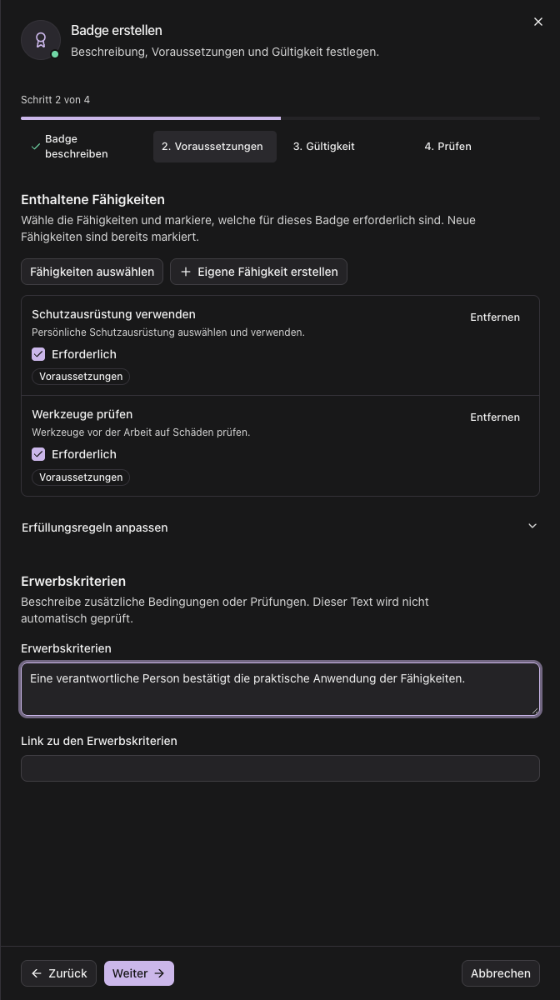
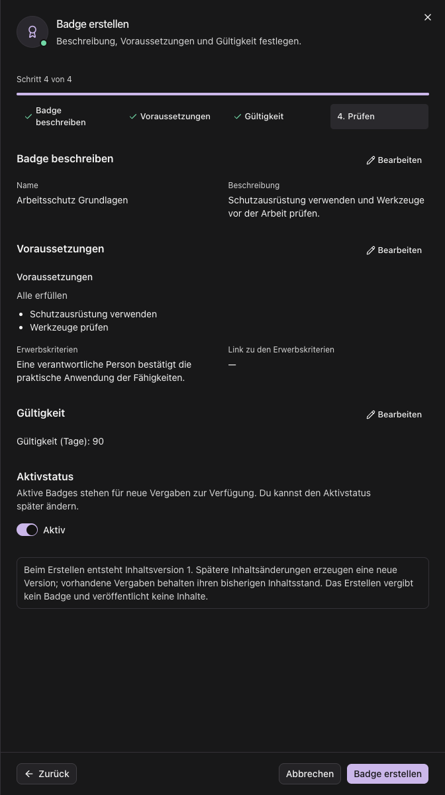
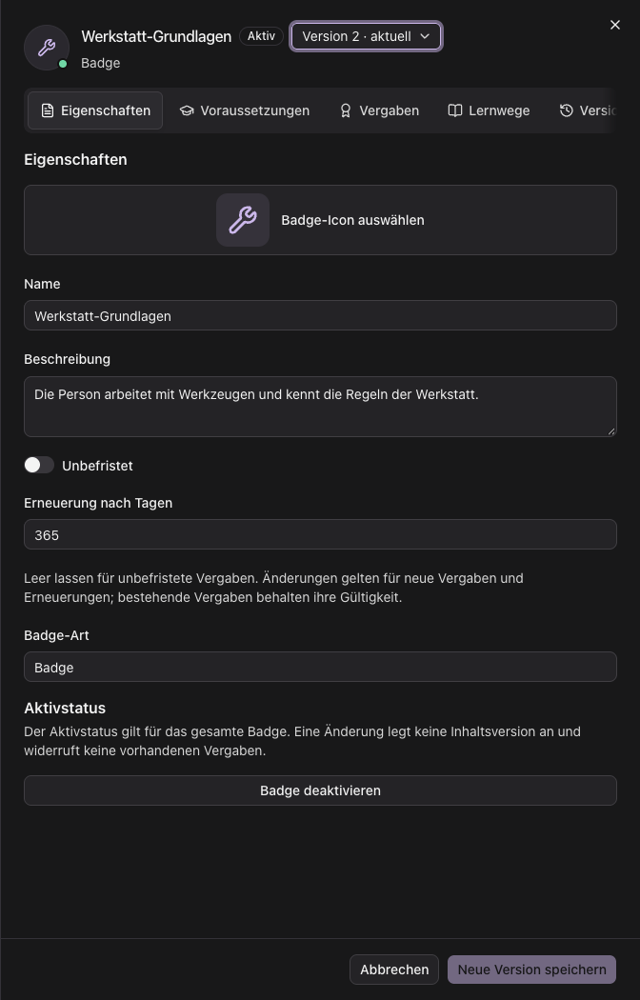
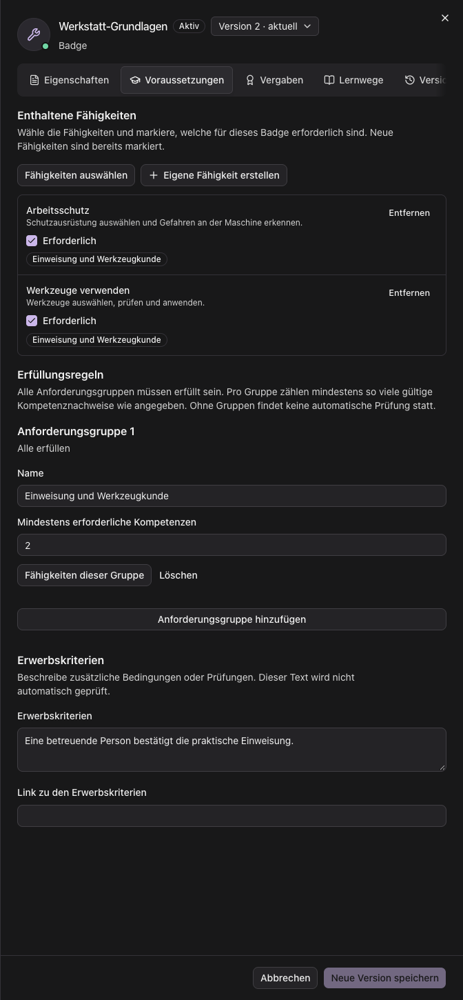
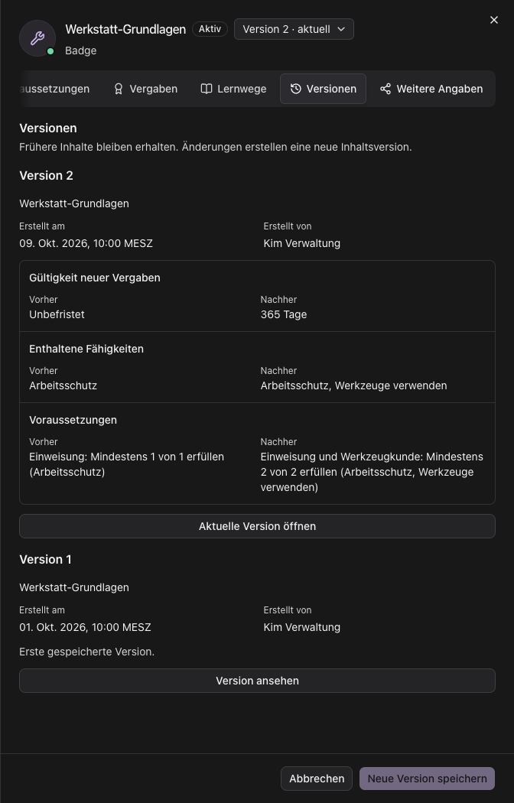
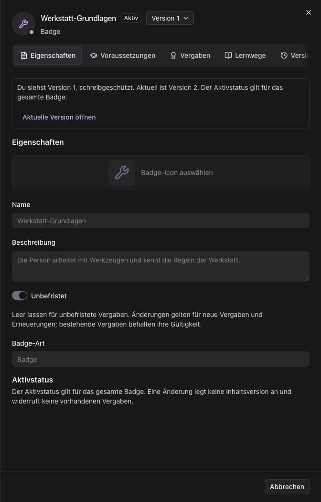

## Ein Badge erstellen

Mit dem Recht zum Anlegen von Kompetenzen öffnest du **Kompetenzen → Badges → Badge erstellen**.
Der Assistent führt durch vier Schritte:

1. **Badge beschreiben:** Gib Name und Beschreibung an und wähle ein Symbol.
2. **Voraussetzungen:** Wähle die Fähigkeiten aus, die zum Erwerb erforderlich sind.
   Neue Fähigkeiten werden als **Erforderlich** einer Anforderungsgruppe zugeordnet.
   Standardmäßig sind alle ausgewählten Fähigkeiten erforderlich. Unter **Erfüllungsregeln anpassen**
   kannst du Gruppen und deren Mindestanzahl ändern. Gib unter **Beschreibung der Erwerbskriterien**
   an, was zum Erwerb nachgewiesen werden muss, und ergänze gegebenenfalls manuelle Prüfungen.
   Der Text ist erforderlich und wird nicht automatisch ausgewertet. Ein optionaler Link führt zu ausführlichen Kriterien.
   Soll das Badge ohne Fähigkeitsvoraussetzungen auskommen, wähle ausdrücklich
   **Ohne Fähigkeitsvoraussetzungen erstellen** und gib die manuell zu prüfenden Kriterien an.
3. **Gültigkeit:** Wähle **Unbefristet** oder eine Dauer von 1 bis 36500 Tagen ab Vergabe.
   Die Dauer gilt für neue Vergaben und Erneuerungen. Beim Aus- und Einschalten von **Unbefristet**
   bleibt die zuletzt eingegebene Dauer im Entwurf erhalten.
4. **Prüfen:** Kontrolliere Beschreibung, erforderliche Fähigkeiten, Erfüllungsregeln, Kriterien
   und Gültigkeit. **Bearbeiten** führt zum jeweiligen Schritt zurück. Wähle, ob das Badge
   **Aktiv** sein soll, und bestätige mit **Badge erstellen**.

**Weiter** und spätere Schritte stehen erst nach gültigen Angaben zur Verfügung. Beim Zurückgehen
bleiben Eingaben erhalten. Im Prüfschritt steht **Badge erstellen** erst zur Verfügung, wenn alle
ausgewählten Fähigkeiten geladen und angezeigt werden können. Bei einem Ladefehler wähle **Erneut versuchen**.
**Badge erstellen** speichert die Definition mit Inhaltsversion 1;
es vergibt kein Badge und veröffentlicht keine Inhalte. Nach erfolgreicher Erstellung erscheint das Badge in der Liste. Öffne es, um weitere Angaben
zu bearbeiten. Weitere Inhaltsänderungen erzeugen neue Versionen, ohne vorhandene Vergaben zu verändern.

Ein geänderter Entwurf wird bei **Abbrechen**, **Schließen**, Escape oder einem Klick außerhalb des Sheets
nicht sofort verworfen. Du kannst **Weiter bearbeiten** oder **Änderungen verwerfen** wählen.
Beim Neuladen oder Schließen des Browser-Tabs warnt der Browser vor ungespeicherten Änderungen.
Der Entwurf bleibt bis zur Erstellung im geöffneten Formular; er wird nicht automatisch auf dem Server gespeichert.
Bei einem Fehler bleiben die Eingaben erhalten und du kannst die Erstellung erneut versuchen.

Die folgenden Screenshots zeigen den Assistenten mit fiktiven Beispieldaten.

## Ein Badge öffnen

Öffne **Kompetenzen → Badges** und wähle ein Badge aus. Das Sheet zeigt Informationen und Eingabefelder
in derselben Ansicht. Mit dem Recht zum Bearbeiten kannst du lokale Badges direkt ändern.
Importierte Originale bleiben schreibgeschützt; über **Weitere Angaben → Lokale Kopie erstellen** erstellst du
mit dem Recht zum Anlegen eine eigene Variante.

Die Screenshots zeigen die vorhandenen Oberflächenkomponenten mit fiktiven Beispieldaten.

## Eigenschaften ändern

Unter **Eigenschaften** bearbeitest du Name, Beschreibung, Symbol und Gültigkeitsdauer.
Die Gültigkeitsdauer gilt für neue Vergaben und Erneuerungen. Bestehende Vergaben behalten ihre
bisherige Gültigkeit. **Unbefristet** entfernt eine geplante Ablaufzeit für neue Vergaben.
Beim Umschalten bleibt die zuletzt eingegebene Dauer im Entwurf erhalten. Ein leeres Zahlenfeld
aktiviert **Unbefristet** nicht; gib eine gültige Dauer ein oder aktiviere den Schalter.

Änderungen bleiben zunächst ungespeichert. **Neue Version speichern** speichert einen neuen Inhaltsstand
und lässt das Sheet geöffnet. Die neue Version wird zur aktuellen Version. Bei einem Fehler bleiben
Eingaben erhalten; du kannst sie korrigieren und erneut speichern.

Fehlen gültige Angaben, nennt ein Hinweis über den Tabs die betroffenen Felder. Wähle darin
**Eigenschaften** oder **Voraussetzungen**, um den passenden Tab zu öffnen. Deine Eingaben bleiben erhalten.

## Voraussetzungen und Kriterien

Unter **Voraussetzungen** wählst du Fähigkeiten einmal aus:

1. Wähle unter **Enthaltene Fähigkeiten → Fähigkeiten auswählen** die Fähigkeiten aus.
   Neu hinzugefügte Fähigkeiten sind standardmäßig **Erforderlich** und werden der ersten
   Anforderungsgruppe zugeordnet. Gibt es noch keine Gruppe, wird eine angelegt.
2. Entferne **Erforderlich**, wenn eine Fähigkeit das Badge nur beschreiben soll.
   Bereits vorhandene beschreibende Zuordnungen werden beim Öffnen nicht zu Voraussetzungen.
   Die Auswahl erhält die zugeordneten Inhaltsversionen der Fähigkeiten.
3. Stelle unter **Erfüllungsregeln** die Mindestanzahl je Gruppe ein. Mit **Fähigkeiten dieser Gruppe**
   verteilst du bereits ausgewählte Fähigkeiten auf die Gruppen. Alle Gruppen müssen erfüllt sein.
   Bei einer Mindestanzahl gleich der Anzahl der Fähigkeiten sind alle erforderlich.
   Ohne Gruppen findet keine automatische Prüfung statt.
4. Gib unter **Beschreibung der Erwerbskriterien** an, was zum Erwerb nachgewiesen werden muss.
   Ergänze gegebenenfalls manuelle Prüfungen. Der Text ist erforderlich und wird nicht automatisch ausgewertet. Der optionale Link führt zu ausführlichen
   Kriterien; Leeren entfernt ihn.

Entfernst du eine Fähigkeit aus der gemeinsamen Auswahl, wird sie auch aus den Anforderungsgruppen
entfernt. Die Mindestanzahl wird bei Bedarf auf die verbliebene Anzahl begrenzt; leere Gruppen entfallen.
Wählst du die Fähigkeit im selben Entwurf wieder an, werden die vorherigen Gruppen und Mindestzahlen
wiederhergestellt, sofern du die Regeln dazwischen nicht ausdrücklich bearbeitet hast.
Anforderungsgruppen lassen sich erst hinzufügen, wenn Fähigkeiten ausgewählt sind. Bei ungültigen
Angaben zeigt das Formular Hinweise am jeweiligen Feld und öffnet eingeklappte Erfüllungsregeln.
Änderungen werden erst mit **Neue Version speichern** übernommen.

Die Prüfung von Voraussetzungen vergibt kein Badge automatisch. Eine administrative Vergabe ist eine
separate Aktion. Ein Lernweg enthält Badges; er ist keine Voraussetzung für ein einzelnes Badge.

## Badge aktivieren oder deaktivieren

1. Öffne die aktuelle Version eines lokalen Badges und wähle **Eigenschaften**.
2. Speichere oder verwirf vorhandene Inhaltsänderungen.
3. Wähle unter **Aktivstatus** **Badge deaktivieren** beziehungsweise **Badge aktivieren**.
4. Bestätige die Aktion.

Der Aktivstatus gilt für das gesamte Badge und legt keine Inhaltsversion an. Ein inaktives Badge
steht nicht für neue lokale Vergaben oder Erneuerungen zur Verfügung. Vorhandene Vergaben werden
nicht widerrufen und behalten ihre Gültigkeit. Importierte Originale bleiben schreibgeschützt.

## Frühere Versionen ansehen

Die **Versionsauswahl im Header** öffnet einen früheren Inhaltsstand in denselben Tabs, schreibgeschützt.
Der Hinweis nennt die angezeigte und die aktuelle Version. **Aktuelle Version öffnen** führt zurück zum
bearbeitbaren Stand. Wenn du ungespeicherte Änderungen hast, kannst du weiterbearbeiten oder sie vor
dem Versionswechsel verwerfen.

Unter **Versionen** siehst du erhaltene Inhaltsstände und welche Inhaltsfelder sich gegenüber dem
vorherigen Stand unterscheiden, jeweils mit **Vorher** und **Nachher**. Zeitpunkt und Bearbeiter
werden angezeigt, soweit sie erfasst wurden; andernfalls steht dort **Nicht erfasst**.
Der Aktivstatus gehört zum gesamten Badge und wird nicht als historischer Aktivstatus dargestellt.

## Vergaben und Lernwege

Unter **Vergaben** siehst du Personen, Status, Gültigkeit und die Inhaltsversion ihrer Vergabe.
Eine neue Badge-Version verändert bestehende Vergaben nicht. Neue Vergaben und Erneuerungen verwenden
den aktuellen gespeicherten Stand.

Mit dem Recht zur Vergabe kannst du neue Vergaben anlegen, bestehende erneuern oder widerrufen.
Beim Ansehen einer historischen Version und während ungespeicherter Änderungen sind diese Aktionen
nicht verfügbar. Kehre dafür zur aktuellen Version zurück und speichere deine Änderungen.
Eine lokale Badge-Vergabe dokumentiert einen Erwerb; sie gewährt allein keinen Ressourcenzugriff.

Unter **Lernwege** stehen Lernwege, die dieses Badge enthalten oder als Abschluss-Badge verwenden.
Unter **Weitere Angaben** findest du Herkunft, Kennung, gegebenenfalls Importangaben, Export,
lokale Kopien und Veröffentlichungen. Export und Veröffentlichungen beziehen sich auf die aktuelle
gespeicherte Version.

## Offene Dokumentationsaufgaben

Definition und Inhaltsversionen sind beschrieben. Vergabe, Veröffentlichung und
weitere Kompetenzaufgaben brauchen noch vollständige Abläufe:

- [ ] TODO: Voraussetzungen und Rechte für Anzeigen, Anlegen, Inhaltsänderung, Aktivstatus, Vergabe, Erneuerung, Widerruf und Veröffentlichung gesammelt nennen; fehlende Aktionen erklären.
- [ ] TODO: Eine Vergabe anlegen, Person und Eingaben wählen, Ergebnis mit Inhaltsversion/Gültigkeit prüfen; bestehende, abgelaufene oder widerrufene Vergabe und nicht erfüllte Voraussetzungen behandeln.
- [ ] TODO: Vergabe erneuern und widerrufen mit Bestätigung, Begründung und erhaltenem Verlauf beschreiben; lokale Vergabe von einem signierten externen Credential unterscheiden.
- [ ] TODO: Fähigkeiten aus dem vorhandenen Katalog auswählen und pflegen, lokale/importierte Definitionen unterscheiden und alternative Mindestanforderungen an einem kleinen Beispiel erklären.
- [ ] TODO: Lernweg anlegen und bearbeiten, Reihenfolge und Abschluss-Badge auswählen; Fortschritt und Voraussetzung eines einzelnen Badges unterscheiden. Diese Aufgabe beim Ausarbeiten als eigene Anleitung führen.
- [ ] TODO: Import, Export und lokale Kopie Schritt für Schritt erklären; unterstützte Formate, schreibgeschütztes Original, Quelle, Fehler und Folgen einer neuen lokalen Identität nennen.
- [ ] TODO: Öffentliche Veröffentlichung mit Vorschau, bewusstem Bestätigen, unveränderlichem Snapshot und Zurückziehen erklären; neue Version von veröffentlichtem Stand und bereits heruntergeladenen Kopien unterscheiden.
- [ ] TODO: Kompetenzstandards, Bewertungen und Anerkennung externer Nachweise unter [Bewertungen](../koordination/bewertungen.mdx) sowie Anbieter-/Ausstellereinstellungen unter [Integrationen](integrationen.mdx) verlinken.
- [ ] TODO: Veralteter Bearbeitungsstand, nicht erreichbarer Anbieter, deaktiviertes Badge und ungültige Kriterien mit konkreter Abhilfe erklären; eine geeignete angemeldete Prüfung durchführen und Fixture-Bilder kennzeichnen.
