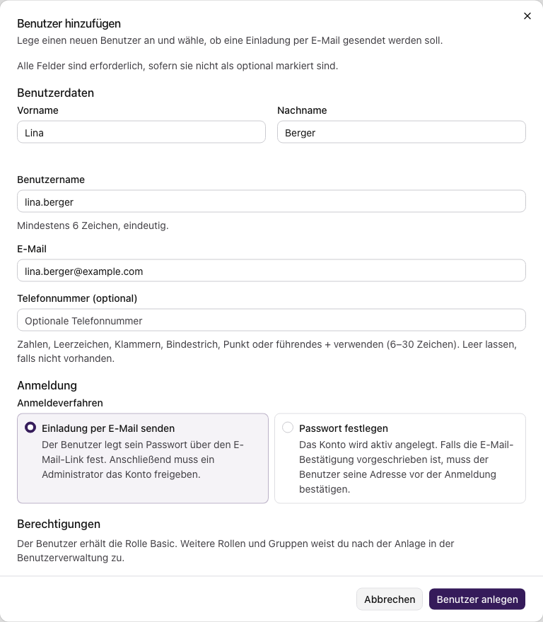
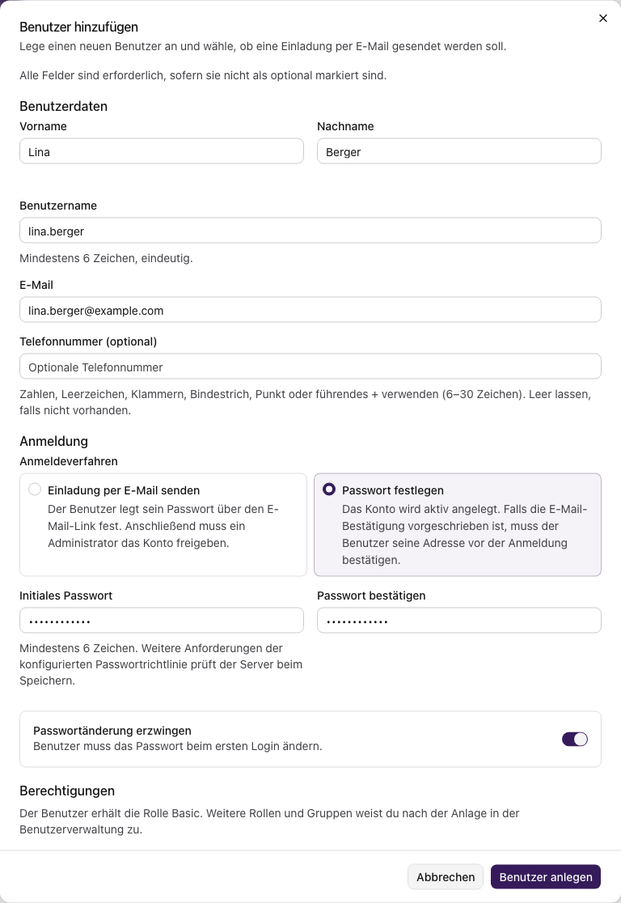
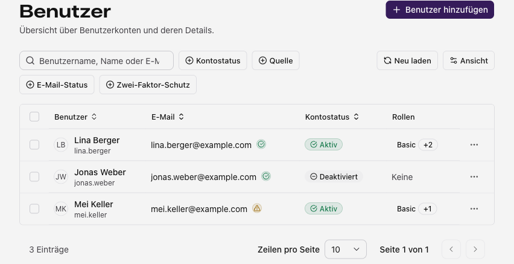
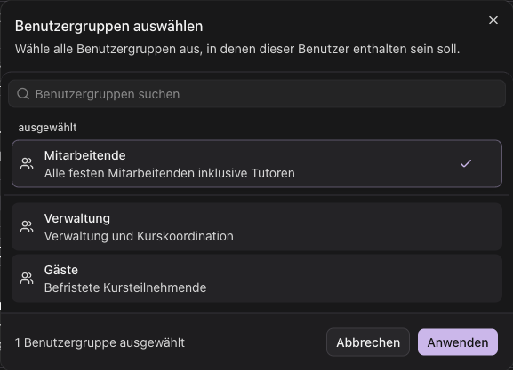

import { Accordion, Accordions } from 'fumadocs-ui/components/accordion';
import { Tab, Tabs } from 'fumadocs-ui/components/tabs';

Hier verwaltest du Benutzerkonten, ihre Rollenzuweisungen und Gruppenmitgliedschaften. Die Anleitung richtet sich an Personen, die diese Aufgaben in der Administration übernehmen.

## Was ist ein Benutzer?

Ein Benutzerkonto steht für eine Person in Mardu. Welche Funktionen sie nutzen darf, hängt von ihren Berechtigungen und den Bedingungen des jeweiligen Zugangs ab.

[Benutzerkonten, Rollen und Zugänge](../ueberblick/benutzerkonten.mdx) erklärt, wie Konten entstehen und wie Rollen, Gruppen, Badges und Tags zusammenhängen.

## Voraussetzungen

Melde dich am Dashboard an. Du brauchst die Leseberechtigung für Benutzer sowie die Rechte für die jeweilige Aufgabe:

| Aufgabe                                                                | Benötigte Rechte                                                  |
| ---------------------------------------------------------------------- | ----------------------------------------------------------------- |
| Benutzer anlegen oder einladen                                         | Benutzer anlegen                                                  |
| Profildaten ändern, Registrierungen freigeben oder Konten deaktivieren | Benutzer bearbeiten                                               |
| Direkte Rollen zuweisen                                                | Benutzerrollen ansehen und bearbeiten; Rollen ansehen             |
| Gruppenmitgliedschaften ändern                                         | Benutzergruppen ansehen; Gruppenmitglieder ansehen und bearbeiten |
| Zugangsmetriken ansehen                                                | Zugänge ansehen                                                   |
| Benutzer löschen                                                       | Benutzer löschen                                                  |

Für den E-Mail-Versand muss der Maildienst eingerichtet sein. Zusätzliche Rechte für die Übersicht aller Berechtigungen und für Änderungen an Benutzergruppen stehen beim jeweiligen Ablauf.

## Benutzer einladen und anlegen

Du legst ein Konto an, das die Person per Einladung oder mit einem von dir festgelegten Passwort nutzen kann. Die Bilder zeigen fiktive Beispielkonten.

1. Öffne **„Personen“ → „Benutzer“** und wähle **„Benutzer hinzufügen“**.
2. Trage **Vorname, Nachname, Benutzername und E-Mail** ein. Der Benutzername braucht mindestens 6 Zeichen; Benutzername und E-Mail dürfen im System noch nicht vergeben sein. Eine Telefonnummer ist optional und darf ebenfalls noch keinem anderen Konto zugeordnet sein.
3. Wähle das Anmeldeverfahren:

<Tabs items={['Mit Einladung', 'Mit Passwort']}>
  <Tab value="Mit Einladung">
    **„Einladung per E-Mail senden“** ist voreingestellt. Die Person legt ihr Passwort selbst fest;
    anschließend musst du das [Konto freigeben](#einladung-abschlie%C3%9Fen-und-konto-freigeben).

    

  </Tab>
  <Tab value="Mit Passwort">
    Wähle **„Passwort festlegen“** und trage dasselbe Passwort in beide Felder ein. Es braucht
    mindestens 6 Zeichen und muss die Passwortrichtlinie erfüllen. Mit **„Passwortänderung
    erzwingen“** muss die Person das Initialpasswort bei der ersten Anmeldung ändern. Übermittle
    es ihr über euren vorgesehenen Weg.

    Das Konto wird aktiv angelegt. Eine E-Mail-Bestätigung kann je nach Anmelderichtlinie erforderlich sein.

    

  </Tab>
</Tabs>

4. Prüfe die Angaben und wähle **„Benutzer anlegen“**.

**Ergebnis:** Das Konto erscheint in der Benutzerliste und erhält die Rolle **Basic**. Bei einer Einladung bleibt es bis zum Abschluss der Einladung und der Freigabe inaktiv. Eine erfolgreiche Anlage bestätigt nicht die Zustellung der E-Mail. Weitere Rollen und Gruppen weist du [nach der Anlage zu](#rollen-und-gruppen-zuweisen).

### Einladung abschließen und Konto freigeben

Die Einladung ist erst abgeschlossen, wenn die Person ein Passwort gesetzt hat und du das Konto freigegeben hast.

1. Die Person öffnet den Einladungslink und setzt ihr Passwort. Ihre E-Mail-Adresse ist danach bestätigt.
2. Öffne **„Personen“ → „Benutzer“**. Suche im Bereich **„Registrierungen“** das Konto mit **„Wartet auf Freigabe“**.
3. Prüfe die Angaben und wähle **„Freigeben“**. Im Bestätigungsdialog ist eine Begründung optional.
4. Bestätige mit **„Freigeben“**.

**Ergebnis:** Das Konto wird aktiv. Die Anmeldung ist möglich, wenn auch die übrigen Anmeldebedingungen erfüllt sind, etwa eine vorgeschriebene Zwei-Faktor-Authentifizierung (2FA).

Soll das Konto nicht freigegeben werden, wähle **„Ablehnen“** und bestätige im Dialog mit einer Begründung. Das Konto bleibt inaktiv; die Begründung wird der Person per E-Mail mitgeteilt. Der Bereich **„Registrierungen“** wird nur angezeigt, wenn offene Fälle vorliegen.

<Accordions>
  <Accordion title="Freigabe ansehen">
    
  </Accordion>
</Accordions>

## Benutzer verwalten

Öffne **„Personen“ → „Benutzer“**. Suche nach Name, Benutzername oder E-Mail und nutze bei Bedarf die Filter. Klicke auf eine Benutzerzeile, um die Details zu öffnen.

Standardmäßig siehst du **Benutzer, E-Mail, Kontostatus und Rollen**. Über **„Ansicht“** kannst du **Gruppen, Quelle, 2FA, Tags, letzte Anmeldung, Erstellungsdatum und ID** zusätzlich einblenden. Die Quelle nennt den Kontoanbieter, 2FA zeigt den Schutzstatus. Klicke auf Rollen oder Gruppen, um alle Zuordnungen zu sehen.

**„Aktiv“** erlaubt die Anmeldung, sofern die Anmelderichtlinie erfüllt ist. **„Deaktiviert“** sperrt neue Anmeldungen. Zugewiesene Tags bestätigen keine Zutrittsberechtigung.

Wenn nicht alle Reiter sichtbar sind, scrolle die Reiterleiste horizontal. Ein Verlauf am Rand zeigt weitere Reiter an. Mit einem Klick wird der Reiter ausgewählt und rückt möglichst in die Mitte. Das gilt auch für die Details einer Benutzergruppe.

### Benutzerdaten ändern

Der Benutzername wird nur angezeigt. E-Mail-Änderungen nimmt die Person nach Bestätigung im eigenen Profil vor, sofern das Konto dies unterstützt. Als vom **LDAP- oder OIDC-Anbieter verwaltet** gekennzeichnete Angaben sind in Mardu schreibgeschützt; Änderungen erfolgen beim Anbieter.

1. Klicke auf die Benutzerzeile und öffne **„Eigenschaften“**.
2. Ändere die benötigten Angaben oder das Profilbild. Unter **„Präferenzen“** wählst du **„Deutsch“** oder **„English“** sowie die Zeitzone. Die Zeitvorschau hilft dir, die Zeitzone zu prüfen.
3. Entferne optionale Angaben durch Leeren des Feldes. Bei Auswahlfeldern und dem Geburtsdatum wählst du **„Leeren“**.
4. Wähle **„Speichern“**.

**Ergebnis:** Die Änderungen sind am Konto gespeichert. Beim Schließen mit ungespeicherten Änderungen kannst du weiterbearbeiten oder sie verwerfen.

Änderungen an Eigenschaften, Profilbild, **„Zwei-Faktor-Authentifizierung erzwingen“**, direkten Rollen, Gruppen und deiner Metrikansicht bleiben beim Tabwechsel erhalten. **„Speichern“** unten im Benutzerfenster übernimmt die Änderungen. **„Abbrechen“** fragt bei ungespeicherten Änderungen nach, ob du sie verwerfen möchtest. Schlägt ein Teil des Speicherns fehl, bleibt das Fenster offen; bereits gespeicherte Änderungen bleiben bestehen.

Bei schmalen Benutzerfenstern stehen Bildauswahl und Vorschau untereinander.

<Accordions>
  <Accordion title="Profilbild in einem schmalen Fenster ansehen">
    

      
    

  </Accordion>
</Accordions>

### Rollen und Gruppen zuweisen

Öffne in den Benutzerdetails **„Berechtigungen“**. Für **„Effektive Berechtigungen“** brauchst du die Leserechte für Benutzerrollen, Benutzergruppen und Gruppenrollen. Die Übersicht zeigt die Rechte aus direkten Rollen und Benutzergruppen. Wenn du die Auswahl änderst, aktualisieren sich Rollen, Gruppen und Rechte als Vorschau. Diese Änderungen gelten erst nach **„Speichern“**. Klappe die Liste auf, um je Recht die zuweisende Rolle und gegebenenfalls die Gruppe zu sehen. Ein Recht kann mehrere Quellen haben; der Gruppenlink öffnet deren Rollenzuweisungen.

Unter **„Direkte Rollen“** verwaltest du Rollen für das einzelne Konto. Gruppenrollen gelten für die Mitglieder der Gruppe. Die Übersicht zeigt die aktuelle Auswahl; Zutrittsfreigaben und Anmeldebedingungen werden separat geprüft.

**Direkte Rollen ändern:**

1. Wähle **„Direkte Rollen auswählen“** und wähle Rollen an oder ab.
2. Bestätige mit **„Anwenden“**, dann mit **„Speichern“** unten in den Benutzerdetails.

**Gruppenmitgliedschaften ändern:**

1. Wähle **„Mitgliedschaften verwalten“**. Im Auswahldialog siehst du die Gruppen mit ihrer Beschreibung; nutze die Suche und wähle Gruppen an oder ab.
2. Bestätige die Auswahl mit **„Anwenden“**. Wähle danach **„Speichern“** unten in den Benutzerdetails.

<Accordions>
  <Accordion title="Gruppenauswahl im Benutzerfenster">
    Die Darstellung verwendet Beispieldaten.

    

  </Accordion>
</Accordions>

**Ergebnis:** Die gespeicherten Rollen und Mitgliedschaften bestimmen die Rechte des Kontos. **„Anwenden“ allein speichert keine Zuweisung.** Eine entfernte Rolle kann über eine andere Gruppe oder eine direkte Zuweisung weiterhin gelten. Die Admin-Rolle lässt sich nur entfernen, wenn mindestens zwei andere Administratoren verbleiben.

### Benutzergruppen verwalten

Gruppenrollen gelten für alle Mitglieder, auch für später hinzugefügte Personen. Prüfe deshalb vor einer Änderung, wen sie betrifft.

Du brauchst Leserechte für die Gruppe und die angezeigten Zuordnungen. Zum Ändern von Mitgliedern oder Rollen brauchst du die jeweiligen Bearbeitungsrechte. Für Name und Beschreibung prüft das System die Berechtigung zum Anlegen von Benutzergruppen.

1. Öffne **„Personen“ → „Benutzergruppen“** und klicke auf die Gruppe.
2. Ändere in **„Übersicht“** den Namen oder die Beschreibung.
3. Öffne **„Mitglieder“** oder **„Zugewiesene Rollen“**, ändere die Auswahl und bestätige mit **„Anwenden“**.
4. Wähle **„Speichern“** im Gruppenfenster.

**Ergebnis:** Die Gruppendaten und ausgewählten Zuordnungen werden gespeichert. Wird eine Person aus der Gruppe entfernt, entfallen die Rollen aus dieser Gruppe. Direkte Rollen und Rollen aus anderen Gruppen gelten weiterhin.

### Zugangsentscheidungen und Sitzungen prüfen

1. Öffne die Benutzerdetails und wähle **„Metriken“**.
2. Prüfe die Kennzahlen und den **„Zugangsverlauf“**. Die Karten verwenden dieselben Diagramme wie das Dashboard.
3. Vergleiche die Werte mit **„Letzte Zugänge“**. Bei Bedarf lade die Daten über **„Zugangsmetriken aktualisieren“** neu.

Die Anzeige berücksichtigt nur Zugänge, die du sehen darfst. Sie umfasst sieben Kalendertage nach koordinierter Weltzeit (UTC), einschließlich des heutigen Tages bis zum Laden der Daten. Die Tagesgrenzen können deshalb von deiner lokalen Zeitzone abweichen; der heutige Tag ist noch unvollständig.

| Anzeige                  | Bedeutung                                                                                                   |
| ------------------------ | ----------------------------------------------------------------------------------------------------------- |
| Zugangsentscheidungen    | Alle gespeicherten erlaubten und abgelehnten Entscheidungen im Zeitraum.                                    |
| Anteil erlaubter Zugänge | Erlaubte Entscheidungen geteilt durch alle Entscheidungen. Ohne Entscheidungen steht hier **„–“**.          |
| Abgelehnt                | Anzahl abgelehnter Entscheidungen im Zeitraum.                                                              |
| Aktuell aktive Sitzungen | Offene Zutrittssitzungen, unabhängig vom Startdatum. Dies sind keine Anmeldesitzungen am Dashboard.         |
| Zugangsverlauf           | Entscheidungen pro UTC-Kalendertag.                                                                         |
| Letzte Zugänge           | Bis zu fünf neueste Entscheidungen im Zeitraum; die Kennzahlen sind nicht auf diese fünf Einträge begrenzt. |

**Ansicht anpassen:** Mit den Lese- und Bearbeitungsrechten für Dashboards kannst du **„Ansicht bearbeiten“** wählen. Verschiebe oder vergrößere Karten, entferne nicht benötigte Anzeigen und füge sie über **„Kennzahl hinzufügen“** wieder hinzu. Sind alle Kennzahlen enthalten, ist **„Alle Kennzahlen hinzugefügt“** deaktiviert. Nach dem Entfernen einer Karte kannst du sie wieder hinzufügen. In den Karteneinstellungen kannst du beim Zugangsverlauf zwischen Balken, Linien und Fläche wählen. Bestätige deine Änderungen mit **„Speichern“** unten im Benutzerfenster.

Du hast **eine eigene Metrikansicht für alle Benutzer**. Öffnest du ein anderes Konto, bleibt die Anordnung erhalten und es werden dessen Werte angezeigt. Andere Administratoren haben ihre eigene Ansicht. Ohne Dashboard-Leserecht siehst du die Standardanzeige, sofern du Zugänge lesen darfst. Wurde deine Ansicht zwischenzeitlich in einem anderen Fenster geändert, wird das Speichern abgelehnt. Verwirf deinen Entwurf und lade die Ansicht über **„Zugangsmetriken aktualisieren“** neu.

<Accordions>
  <Accordion title="Metrikansicht ansehen">
    
  </Accordion>
</Accordions>

**Ergebnis:** Du kannst die gespeicherten Zugangsentscheidungen der Person nachvollziehen. Diese Anzeige prüft keine zukünftige Zutrittsberechtigung.

### Konten deaktivieren und reaktivieren

Eine Deaktivierung sperrt neue Anmeldungen. Bestehende Zugriffe enden nicht sofort. Rollen, Gruppen und Zutrittszuweisungen bleiben erhalten. **Administrator-Konten können nicht deaktiviert werden.** Für offene Registrierungen gilt der [Freigabeablauf](#einladung-abschlie%C3%9Fen-und-konto-freigeben).

1. Öffne in den Benutzerdetails **„Sicherheit“ → „Gefahrenbereich“**.
2. Wähle **„Benutzer deaktivieren“**.
3. Prüfe das Konto im Bestätigungsdialog und bestätige mit **„Benutzer deaktivieren“**.

**Ergebnis:** Der Kontostatus lautet **„Deaktiviert“**.

Zum Reaktivieren prüfst du zuerst die erhaltenen Rollen, Gruppen und Zutrittszuweisungen. Wähle danach **„Benutzer aktivieren“** und bestätige. Der Status lautet anschließend **„Aktiv“**; die übrigen Anmeldebedingungen gelten weiter. Beide Aktionen findest du auch im Dreipunktmenü der Benutzerzeile, jeweils mit Bestätigung.

<Accordions>
  <Accordion title="Deaktivierung ansehen">
    

      
    

  </Accordion>
</Accordions>

### Benutzer löschen

Die Löschung kann nicht rückgängig gemacht werden. Soll das Konto erhalten bleiben, [deaktiviere es](#konten-deaktivieren-und-reaktivieren). Für Administrator-Konten und dein eigenes Konto bietet die Oberfläche keine Löschaktion an.

1. Öffne in den Benutzerdetails **„Sicherheit“ → „Gefahrenbereich“ → „Benutzer löschen“**.
2. Prüfe das angezeigte Konto und die Vorschau der Löschfolgen. Die betroffenen Einträge hängen von den Zuordnungen des Kontos ab.
3. Bestätige mit **„Löschen“**.

**Ergebnis:** Das Benutzerkonto wird gelöscht. Für mehrere Konten nutzt du die Kontrollkästchen in der Benutzerliste und die gemeinsame Löschaktion; prüfe vor der Bestätigung die gesamte Auswahl.

<Accordions>
  <Accordion title="Löschbestätigung ansehen">
    

      
    

  </Accordion>
</Accordions>

Bestätigte Sicherheitsaktionen werden sofort ausgeführt. Das Verwerfen ungespeicherter Profiländerungen macht sie nicht rückgängig.

## Wenn etwas nicht klappt

| Problem                                             | Nächster Schritt                                                                                                         |
| --------------------------------------------------- | ------------------------------------------------------------------------------------------------------------------------ |
| Eine Aktion fehlt                                   | Lass deine Berechtigungen für diese Aktion prüfen.                                                                       |
| Eine Angabe ist bereits vergeben                    | Suche nach dem vorhandenen Konto.                                                                                        |
| Die Einladung fehlt                                 | Prüfe Spam-Ordner, gespeicherte Adresse und E-Mail-Versand. Eine Erfolgsmeldung bestätigt keine Zustellung.              |
| Die Anmeldung klappt nicht                          | Prüfe Kontostatus, E-Mail-Bestätigung, 2FA und eine noch offene Freigabe.                                                |
| Eine entfernte Rolle gilt weiterhin                 | Prüfe unter **„Effektive Berechtigungen“**, ob eine andere Gruppe oder direkte Zuweisung dieselbe Rolle gewährt.         |
| Änderungen an Rollen oder Gruppen fehlen            | Prüfe, ob du nach **„Anwenden“** auch **„Speichern“** unten in den Benutzerdetails gewählt hast.                         |
| Die Berechtigungsübersicht oder die Metriken fehlen | Lass die zusätzlichen Leserechte für die [Berechtigungsübersicht](#rollen-und-gruppen-zuweisen) oder für Zugänge prüfen. |

Bei Eingabefehlern bleiben die Angaben erhalten. Korrigiere die markierten Felder entsprechend der Meldung und speichere erneut.

<Accordions>
  <Accordion title="Fehlerbeispiel ansehen">
    
  </Accordion>
</Accordions>

## Offene Dokumentationsaufgaben

Die Kontoverwaltung oben ist beschrieben. Für eine vollständige
Administrator-Anleitung fehlen noch folgende Aufgaben:

- [ ] TODO: Rollen anlegen, bearbeiten und löschen sowie ihre Berechtigungen auswählen; Rechte für Rollen und Rollenberechtigungen, geschützte Rollen und Auswirkung auf alle zugeordneten Konten erklären.
- [ ] TODO: Benutzergruppen anlegen und löschen ergänzen; Namensprüfung, Mitglieder, Gruppenrollen, benötigte Rechte und erhaltene direkte Zuweisungen erklären.
- [ ] TODO: Sicherheitsreiter vervollständigen: kontobezogene 2FA-Vorgabe, sofortiges Deaktivieren von 2FA/Passkeys, Anmeldehistorie und passwortlose administrative Hilfe; Bestätigung und Wirkung von gewöhnlichem Speichern unterscheiden.
- [ ] TODO: Kontoquellen und Schreibhoheit für lokale, LDAP- und OIDC-Konten mit passenden Fehlern zeigen; Verfügbarkeit und Folgen einer Kontozusammenführung in UI und API prüfen.
- [ ] TODO: Mehrfachaktionen, Registrierungsfilter, Fehler beim Versand, erneut versendbare Einladung und abgelaufenen Link anhand vorhandener Funktionen ergänzen; fehlende Bedienwege nennen.
- [ ] TODO: Rechteangaben, Schutz der Administratorrolle und Lösch-/Deaktivierungsfolgen am aktuellen Backendstand prüfen; gespeicherte Rechte von der Entwurfsvorschau unterscheiden.
- [ ] TODO: Sofortige Sicherheitsaktionen und mögliche Teilfehler beim gemeinsamen Speichern mit einem Beispiel erklären; ungespeicherte Änderungen nicht als rückgängig machbare Sicherheitsaktion darstellen.
- [ ] TODO: Komplette Abläufe mit angemeldeter Sitzung prüfen; vorhandene Screenshots auf aktuelle UI, fiktive Daten und Lesbarkeit prüfen. Rollen- und Gruppenreferenz bei der Ausarbeitung von den Kontoanleitungen trennen.
