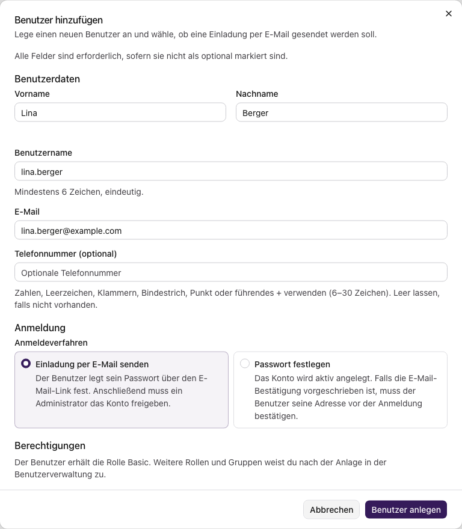
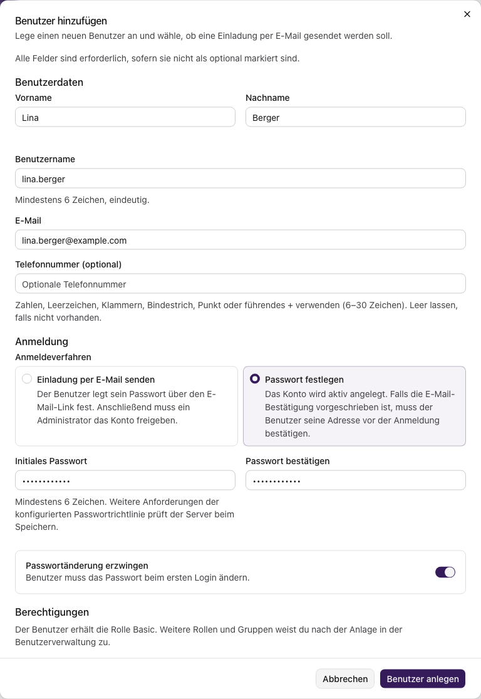
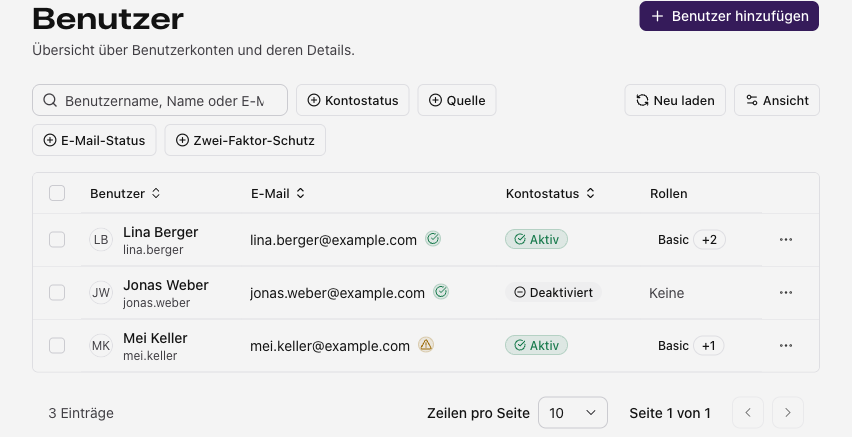
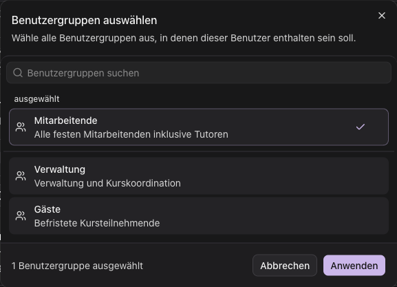

import { ImageZoom } from 'fumadocs-ui/components/image-zoom';
import metrikAnsicht from './bilder/personen-technik-benutzermetriken-2026-11-03.png';

import { Step, Steps } from 'fumadocs-ui/components/steps';
import { Tab, Tabs } from 'fumadocs-ui/components/tabs';

Öffne **Personen → Benutzer**, um ein Konto einzuladen, seine Rechte zu ändern oder
bei Anmeldeproblemen zu helfen. Benutzergruppen findest du unter **Personen →
Benutzergruppen**.

## Was ist ein Benutzer?

[Benutzerkonten, Rollen und Zugänge](../ueberblick/benutzerkonten.mdx) erklärt, wie Konten entstehen und wie Rollen, Gruppen, Badges und Tags zusammenhängen.

## Voraussetzungen

Du brauchst die Leseberechtigung für Benutzer und folgende aufgabenbezogene Rechte:

| Aufgabe                                                                | Benötigte Rechte                                                  |
| ---------------------------------------------------------------------- | ----------------------------------------------------------------- |
| Benutzer anlegen oder einladen                                         | Benutzer anlegen                                                  |
| Profildaten ändern, Registrierungen freigeben oder Konten deaktivieren | Benutzer bearbeiten                                               |
| Direkte Rollen zuweisen                                                | Benutzerrollen ansehen und bearbeiten; Rollen ansehen             |
| Gruppenmitgliedschaften ändern                                         | Benutzergruppen ansehen; Gruppenmitglieder ansehen und bearbeiten |
| 2FA-Vorgabe ändern, 2FA oder einen Passkey deaktivieren                | Benutzer bearbeiten                                               |
| Zugangsmetriken ansehen                                                | Zugänge ansehen                                                   |
| Benutzer löschen                                                       | Benutzer löschen                                                  |

Für Einladungen und andere E-Mails muss der Maildienst eingerichtet sein. Zusätzliche Rechte für die Übersicht aller Berechtigungen stehen beim jeweiligen Ablauf.

## Benutzer einladen und anlegen

Das Beispiel zeigt das fiktive Konto **Lina Berger**. Du kannst eine Einladung
senden oder ein Initialpasswort vergeben.

<Steps>
  <Step>
    ### Benutzer hinzufügen

    Öffne **Personen → Benutzer** und wähle **Benutzer hinzufügen**.

  </Step>
  <Step>
    ### Kontodaten eingeben

    Trage **Vorname**, **Nachname**, **Benutzername** und **E-Mail** ein.
    Der Benutzername braucht mindestens 6 Zeichen. Benutzername und E-Mail
    dürfen noch keinem anderen Konto zugeordnet sein.

    Eine optionale **Telefonnummer** darf ebenfalls noch keinem anderen Konto zugeordnet sein.

  </Step>
  <Step>
    ### Anmeldeverfahren wählen

    <Tabs items={['Mit Einladung', 'Mit Passwort']}>
      <Tab value="Mit Einladung">
        **Einladung per E-Mail senden** ist voreingestellt. Die Person legt ihr Passwort selbst fest;
        anschließend musst du das [Konto freigeben](#einladung-abschlie%C3%9Fen-und-konto-freigeben).

        

      </Tab>
      <Tab value="Mit Passwort">
        Wähle **Passwort festlegen** und trage dasselbe Passwort in beide Felder ein. Es braucht
        mindestens 6 Zeichen und muss die Passwortrichtlinie erfüllen. Mit **Passwortänderung
        erzwingen** muss die Person das Initialpasswort bei der ersten Anmeldung ändern. Übermittle
        es ihr über euren vorgesehenen Weg.

        Das Konto wird aktiv angelegt. Eine E-Mail-Bestätigung kann je nach Anmelderichtlinie erforderlich sein.

        

      </Tab>
    </Tabs>

  </Step>
  <Step>
    ### Konto anlegen

    Prüfe die Angaben und wähle **Benutzer anlegen**.

  </Step>
</Steps>

**Ergebnis:** Das Konto erscheint in der Benutzerliste und erhält die Rolle **Basic**. Bei einer Einladung bleibt es bis zum Abschluss der Einladung und der Freigabe inaktiv. Eine erfolgreiche Anlage bestätigt nicht die Zustellung der E-Mail. Weitere Rollen und Gruppen weist du [nach der Anlage zu](#rollen-und-gruppen-zuweisen).

### Einladung abschließen und Konto freigeben

1. Die Person öffnet den Einladungslink und setzt ihr Passwort. Ihre E-Mail-Adresse ist danach bestätigt.
2. Öffne **Personen → Benutzer**. Suche im Bereich **Registrierungen** das Konto mit **Wartet auf Freigabe**.
3. Prüfe die Angaben und wähle **Freigeben**. Im Bestätigungsdialog ist eine Begründung optional.
4. Bestätige mit **Freigeben**.

**Ergebnis:** Das Konto wird aktiv. Die Anmeldung ist möglich, wenn auch die übrigen Anmeldebedingungen erfüllt sind, etwa eine vorgeschriebene Zwei-Faktor-Authentifizierung (2FA).

Soll das Konto nicht freigegeben werden, wähle **Ablehnen** und bestätige im Dialog mit einer Begründung. Das Konto bleibt inaktiv; die Begründung wird der Person per E-Mail mitgeteilt. Der Bereich **Registrierungen** wird nur angezeigt, wenn offene Fälle vorliegen.

## Benutzer verwalten

Öffne **Personen → Benutzer**. Suche nach Name, Benutzername oder E-Mail und nutze bei Bedarf die Filter. Klicke auf eine Benutzerzeile, um die Details zu öffnen.

Standardmäßig siehst du **Benutzer, E-Mail, Kontostatus und Rollen**. Unter **Ansicht** blendest du weitere Spalten ein, darunter **Gruppen**, **Quelle** (Kontoanbieter) und **2FA** (Schutzstatus). Ein Klick auf Rollen oder Gruppen zeigt alle Zuordnungen.

Zugewiesene Tags bestätigen keine Zutrittsberechtigung. Zum Kontostatus siehe
[Konten deaktivieren und reaktivieren](#konten-deaktivieren-und-reaktivieren).

Sind nicht alle Reiter sichtbar, scrolle die Reiterleiste horizontal.
Das gilt auch für die Details einer Benutzergruppe.

### Benutzerdaten ändern

Der Benutzername ist schreibgeschützt. Die E-Mail-Adresse ändert die Person nach
Bestätigung im eigenen Profil, sofern das Konto dies unterstützt. Als vom Anbieter
verwaltet gekennzeichnete Angaben aus **LDAP** oder **OpenID Connect (OIDC)**
änderst du beim Anbieter.

1. Klicke auf die Benutzerzeile und öffne **Eigenschaften**.
2. Ändere die benötigten Angaben oder das Profilbild. Unter **Präferenzen** wählst du **Deutsch** oder **English** sowie die Zeitzone. Die Zeitvorschau hilft dir, die Zeitzone zu prüfen.
3. Entferne optionale Angaben durch Leeren des Feldes. Bei Auswahlfeldern und dem Geburtsdatum wählst du **Leeren**.
4. Wähle **Speichern**.

#### Änderungen speichern oder verwerfen

Eigenschaften, Profilbild, die Vorgabe **Zwei-Faktor-Authentifizierung erzwingen**,
direkte Rollen, Gruppen und deine Metrikansicht bleiben beim Tabwechsel als
Entwurf erhalten. **Speichern** unten im Benutzerfenster übernimmt sie.
Mit **Abbrechen** kannst du ungespeicherte Änderungen nach Rückfrage verwerfen.

Schlägt ein Teil des Speicherns fehl, bleibt das Fenster offen. Bereits
übernommene Änderungen bleiben gespeichert; prüfe die Meldung, bevor du es
erneut versuchst.

Bestätigte Sicherheitsaktionen wie Deaktivieren oder Löschen und die Aktion
**Ansicht speichern** bei Metriken werden sofort ausgeführt. Das Verwerfen von
Profiländerungen macht sie nicht rückgängig.

### Rollen und Gruppen zuweisen

Öffne in den Benutzerdetails **Berechtigungen**. Die Übersicht
**Effektive Berechtigungen** zeigt die Rechte aus direkten Rollen und
Benutzergruppen. Dafür brauchst du die Leserechte für Benutzerrollen,
Benutzergruppen und Gruppenrollen.

Klappe ein Recht auf, um die zuweisenden Rollen und Gruppen zu sehen. Der
Gruppenlink öffnet die Rollenzuweisungen dieser Gruppe. Änderungen erscheinen
zunächst als Vorschau; **Anwenden** allein speichert sie noch nicht.

Zutrittsfreigaben und Anmeldebedingungen werden separat geprüft. Die
Admin-Rolle kannst du nur entfernen, wenn mindestens zwei andere
Administratoren verbleiben.

#### Direkte Rollen ändern

1. Wähle **Direkte Rollen auswählen** und wähle Rollen an oder ab.
2. Bestätige mit **Anwenden**, dann mit **Speichern** unten in den Benutzerdetails.

#### Gruppenmitgliedschaften ändern

1. Wähle **Mitgliedschaften verwalten**. Suche nach der Gruppe, prüfe ihre Beschreibung und wähle sie an oder ab.
2. Bestätige mit **Anwenden**, dann mit **Speichern** unten in den Benutzerdetails.

Eine entfernte Rolle kann über eine andere Gruppe oder eine direkte Zuweisung
weiterhin gelten.

Gruppen anlegen, ihre Mitglieder und Rollen ändern oder Gruppen löschen
beschreibt [Rollen und Gruppen verwalten](./rollen-gruppen.mdx#benutzergruppe-erstellen).

### Zugangs-Tags prüfen und benennen

Öffne im Benutzerkonto **Tags**. Die Anleitung
[Zugangs-Tags verwalten](./tags-verwalten.mdx) führt durch das Anmelden,
Zuweisen und Umbenennen einer Karte.

Bei Verlust folge [Verlorenen Tag dauerhaft sperren](./tags-verwalten.mdx#verlorenen-tag-sperren).
Zum Entfernen eines Datensatzes folge [Tag-Datensatz löschen](./tags-verwalten.mdx#tag-datensatz-löschen).

### Zugangsentscheidungen und Sitzungen prüfen

Öffne im Benutzerkonto **Metriken**, um gespeicherte Entscheidungen und aktive
Sitzungen zu sehen. [Zugangsmetriken lesen](./zutritt-verwalten.mdx) erklärt die
Kennzahlen, den Zeitraum, Aktualisieren und die Grenzen deiner Sicht.

#### Metrikansicht anpassen

Du brauchst Lese- und Bearbeitungsrechte für Dashboards.

1. Wähle **Ansicht bearbeiten**.
2. Verschiebe oder vergrößere Karten. Entferne nicht benötigte Anzeigen und
   füge sie bei Bedarf über **Widget hinzufügen** wieder hinzu.
3. Wähle **Ansicht speichern** im Metrikbereich. Alternativ übernimmt
   **Speichern** unten im Benutzerfenster den Entwurf mit den übrigen Änderungen.

Sind alle Kennzahlen enthalten, ist **Alle Widgets hinzugefügt** deaktiviert.
Für den Zugangsverlauf kannst du in den Karteneinstellungen Balken, Linien
oder Fläche wählen.

Deine **Metrikansicht gilt für alle Benutzer**: Beim Kontowechsel ändern sich die
Werte, die Anordnung bleibt. Andere Administratoren haben eigene Ansichten.
Bei einer zwischenzeitlichen Änderung in einem anderen Fenster wird das Speichern
abgelehnt. Wähle **Änderungen verwerfen**, dann **Messwerte aktualisieren**.

<ImageZoom
  src={metrikAnsicht}
  alt="Benutzermetriken von Jonas Sommer im Bearbeitungsmodus mit Ansicht speichern, null Zugangsereignissen und Alle Widgets hinzugefügt."
/>

### Bei Anmeldeproblemen helfen

Öffne das Konto unter **Personen → Benutzer** und wähle **Sicherheit**.
Prüfe den Kontostatus und die E-Mail-Bestätigung, bevor du Anmeldeverfahren änderst.

#### Passwort zurücksetzen lassen

Der Link wird an die gespeicherte E-Mail-Adresse gesendet. Diese muss bestätigt
sein. Bei einem externen Konto ändert der lokale Link kein Passwort beim
Anbieter; beachte den Hinweis zum Kontoanbieter im Benutzerfenster.
Setzt die Person ihr Passwort zurück, können ihre bisherigen Anmeldesitzungen
nicht mehr erneuert werden.

1. Prüfe die angezeigte Zieladresse.
2. Wähle **Link zum Zurücksetzen senden**.
3. Die Person öffnet den Link und legt selbst ein neues Passwort fest.

Eine Erfolgsmeldung bestätigt nicht den Empfang der E-Mail. Das Anfordern des
Links ändert das Passwort noch nicht.

#### Passwortlosen Zugang ermöglichen

Der Standort muss die passwortlose Anmeldung erlauben. Bei Konten mit
eingerichteter oder vorgeschriebener 2FA wird sie abgewiesen; verwende dort das
vorgesehene Anmeldeverfahren.

- Unter **Passwortloser Zugang → Einmalcode per E-Mail** fordert **Code senden**
  einen Code für die bestätigte E-Mail-Adresse des Kontos an. Die Erfolgsmeldung
  bestätigt keinen Versand oder Empfang.
- Für einen Administrationslink brauchst du das Recht zum Anfordern eines
  passwortlosen Administrationszugangs; eine andere Person braucht das Recht
  zur Freigabe. Wähle **Freigabecode erstellen** und gib den **Freigabecode** an
  diese Person weiter. Sie öffnet denselben Bereich, fügt ihn unter **Als zweite
  Administration freigeben** ein und wählt **Anfrage freigeben**.

Die freigebende Person kopiert den danach angezeigten **Anmeldelink** und gibt
ihn ausschließlich an die vorgesehene Person weiter. **Öffne den Link nicht in
deiner Administrationssitzung.** Er ist einmalig verwendbar; abgelaufene Codes
müssen neu angefordert werden. Die anfragende Person kann ihre eigene Anfrage
nicht freigeben.

#### Zwei-Faktor-Authentifizierung verwalten

**Zwei-Faktor-Authentifizierung erzwingen** verlangt 2FA, richtet sie aber nicht
ein. Prüfe vor dem Einschalten, ob die Person 2FA eingerichtet hat; andernfalls
wird ihre Passwortanmeldung abgewiesen.

- Um die Vorgabe zu ändern, schalte **Zwei-Faktor-Authentifizierung erzwingen**
  ein oder aus und wähle **Speichern** unten im Benutzerfenster.
- Um eingerichtete 2FA zu entfernen, wähle **2FA deaktivieren** und bestätige im
  Dialog mit **2FA deaktivieren**. Diese Aktion wird sofort gespeichert und
  entfernt die bisherige Authenticator-Einrichtung. Bestehende Sitzungen bleiben
  bestehen.

Das Deaktivieren von 2FA entfernt die Vorgabe nicht. Eine weiterhin gesetzte
Vorgabe kann die nächste Passwortanmeldung blockieren. Verlangt die
Serverrichtlinie 2FA für Administratoren, wird das Deaktivieren bei diesen
Konten abgelehnt.

Die Einrichtung im eigenen Konto ist unter
[Zwei-Faktor-Anmeldung einrichten](../ueberblick/profil-sicherheit.mdx#zwei-faktor-anmeldung-einrichten)
beschrieben.

#### Einen Passkey deaktivieren

Ein deaktivierter Passkey kann nicht mehr für neue Anmeldungen verwendet werden.
Neue Passkeys registriert die Person selbst nach einer Anmeldung. Verlangt die
Serverrichtlinie Passkeys für Administratoren, muss mindestens ein aktiver
Passkey am Konto verbleiben.

1. Suche unter **Passkeys** den betroffenen Eintrag.
2. Wähle **Deaktivieren** und bestätige im Dialog mit **Bestätigen**.

Der Status **Deaktiviert** ist sofort gespeichert. Ein Anmeldezähler über null
belegt eine Nutzung; null schließt sie nicht aus, da manche Authenticatoren
nicht zählen.

### Konten deaktivieren und reaktivieren

Eine Deaktivierung sperrt neue Anmeldungen. Bestehende Zugriffe enden nicht sofort. Rollen, Gruppen und Zutrittszuweisungen bleiben erhalten. **Administrator-Konten können nicht deaktiviert werden.** Für dein eigenes Konto bietet die Oberfläche keine Statusänderung an. Für offene Registrierungen gilt der [Freigabeablauf](#einladung-abschlie%C3%9Fen-und-konto-freigeben).

1. Öffne in den Benutzerdetails **Sicherheit → Gefahrenbereich**.
2. Wähle **Benutzer deaktivieren**.
3. Prüfe das Konto im Bestätigungsdialog und bestätige mit **Benutzer deaktivieren**.

**Ergebnis:** Der Kontostatus lautet **Deaktiviert**.

Zum Reaktivieren prüfst du zuerst die erhaltenen Rollen, Gruppen und Zutrittszuweisungen. Wähle danach **Benutzer aktivieren** und bestätige. Der Status lautet anschließend **Aktiv**; die übrigen Anmeldebedingungen gelten weiter. Beide Aktionen findest du auch im Dreipunktmenü der Benutzerzeile, jeweils mit Bestätigung.

### Benutzer löschen

Die Löschung kann nicht rückgängig gemacht werden. Soll das Konto erhalten bleiben, [deaktiviere es](#konten-deaktivieren-und-reaktivieren). Für Administrator-Konten und dein eigenes Konto bietet die Oberfläche keine Löschaktion an.

Bearbeite zuerst die Hindernisse der Löschvorschau, etwa bestätigte Buchungen,
laufende Zugangssitzungen oder ausstehende Zugangsanträge. Abgeschlossene
Buchungs- und Zutrittshistorie sowie Anmeldeereignisse bleiben nach der Löschung erhalten.

1. Öffne in den Benutzerdetails **Sicherheit → Gefahrenbereich → Benutzer löschen**.
2. Prüfe das angezeigte Konto und die Vorschau der Löschfolgen. Die betroffenen Einträge hängen von den Zuordnungen des Kontos ab.
3. Bestätige mit **Löschen**.

**Ergebnis:** Das Benutzerkonto wird gelöscht. Für mehrere Konten nutzt du die Kontrollkästchen in der Benutzerliste und die gemeinsame Löschaktion; prüfe vor der Bestätigung die gesamte Auswahl.

## Wenn etwas nicht klappt

| Problem                                             | Nächster Schritt                                                                                                         |
| --------------------------------------------------- | ------------------------------------------------------------------------------------------------------------------------ |
| Eine Aktion fehlt                                   | Lass deine Berechtigungen für diese Aktion prüfen.                                                                       |
| Eine Angabe ist bereits vergeben                    | Suche nach dem vorhandenen Konto.                                                                                        |
| Die Einladung fehlt                                 | Prüfe Spam-Ordner, gespeicherte Adresse und E-Mail-Versand. Eine Erfolgsmeldung bestätigt keine Zustellung.              |
| Die Anmeldung klappt nicht                          | Prüfe Kontostatus, E-Mail-Bestätigung, 2FA und eine noch offene Freigabe.                                                |
| Die Löschung wird verhindert                        | Bearbeite die in der Löschvorschau genannten offenen Vorgänge oder Zuständigkeiten und lade die Vorschau danach neu.     |
| Die Berechtigungsübersicht oder die Metriken fehlen | Lass die zusätzlichen Leserechte für die [Berechtigungsübersicht](#rollen-und-gruppen-zuweisen) oder für Zugänge prüfen. |

Bei Eingabefehlern bleiben die Angaben erhalten. Korrigiere die markierten Felder entsprechend der Meldung und speichere erneut.

## Weitere Verwaltung

Rollenpflege sowie Gruppenanlage und -löschung beschreibt
[Rollen und Gruppen verwalten](./rollen-gruppen.mdx).
