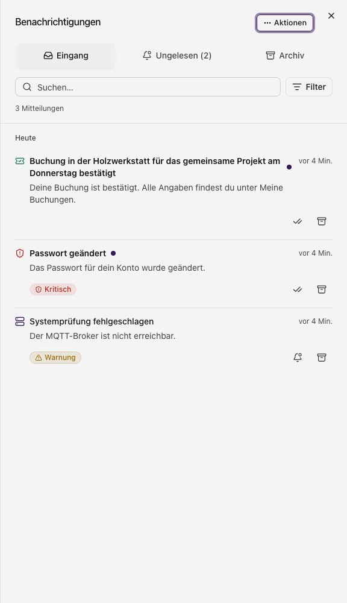

Die Glocke öffnet deinen Posteingang; ihre Zahl zählt ungelesene Mitteilungen.
Ein Mondsymbol an der Glocke zeigt aktive Ruhezeiten an. Der Hinweis erscheint
auch beim Zeigen auf die Glocke oder beim Fokussieren mit der Tastatur.
Zum Lesen brauchst du Profil-Leserechte, für Änderungen Profil-Änderungsrechte.

## Mitteilung finden und lesen

1. Öffne die Glocke oder drücke **Umschalt + N**.
2. Wähle **Eingang**, **Ungelesen** oder **Archiv**.
3. Suche nach einer Meldung. Öffne **Filter**, um Priorität und Kategorie
   auszuwählen. Die Zahl am Schalter zeigt, wie viele dieser Filter aktiv sind.
4. Öffne einen Eintrag für Details. **Weitere laden** erweitert die Liste.

Beispiel mit fiktiven Meldungen. Betriebsmeldungen hängen von deinen Rechten ab.

## Lesen, archivieren und rückgängig machen

Die Aktionen am Eintrag ändern den Lesestatus oder archivieren die Mitteilung.
Im Archiv kannst du sie zurückholen. Unter **Aktionen** kannst du alle als gelesen
markieren oder gelesene Mitteilungen archivieren. **Rückgängig** nimmt eine angebotene
Archivierung zurück. Die zugehörige Buchung oder Freigabe bleibt unverändert.

Während eine Änderung gespeichert wird, sind weitere Lese- und Archivaktionen
deaktiviert. Du kannst den Posteingang weiterhin durchsuchen und Meldungen öffnen.

In der Verwaltung kannst du in den Mitteilungsdetails **Technische Details**
aufklappen, um Ereignis- und Mitteilungskennung nachzusehen.

## Welche Meldungen du bekommst

Du erhältst persönliche Buchungs-, Nachweis- und Sicherheitsmeldungen.
Betriebsmeldungen benötigen passende Rechte oder Zuständigkeiten. Entfallen diese,
können auch frühere Meldungen aus der Ansicht verschwinden.

Die [Benachrichtigungseinstellungen](../ueberblick/profil-benachrichtigungen.mdx)
regeln Kanäle und Ruhezeiten. Sie erweitern nicht deine Empfangsrechte;
Pflichtmeldungen lassen sich nicht abschalten.

## Keine Einträge oder ein Fehler?

Prüfe Reiter und Filter. Bei einem Ladefehler verwende die Wiederholung.
Bei fehlgeschlagenen Änderungen lade den Stand neu, bevor du erneut handelst.
