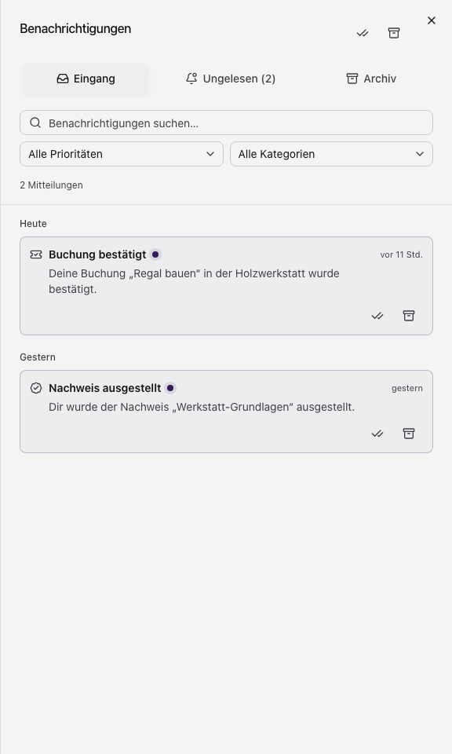

Die Glocke oben in der Benutzeransicht öffnet deinen persönlichen Posteingang.
Die Zahl daneben zählt ungelesene Mitteilungen. Lesen erfordert Profil-Leserechte;
Lesestatus und Archiv verändern benötigt Profil-Änderungsrechte. Ohne diese
Änderungsrechte kannst du angebotene Mitteilungen lesen, aber nicht bearbeiten.

## Mitteilung finden und lesen

1. Öffne die Glocke oder verwende **Umschalt + N**.
2. Wähle **Eingang**, **Ungelesen** oder **Archiv**.
3. Grenze die Liste mit Suche, Priorität oder Kategorie ein.
4. Öffne einen Eintrag, um den vollständigen Text und seine Details zu lesen.

**Eingang** enthält nicht archivierte Mitteilungen, **Ungelesen** die ungelesenen
Einträge und **Archiv** die archivierten. **Weitere laden** beziehungsweise die
angebotene Fortsetzung erweitert die Liste. Ein vorhandener Ziel-Link wird nur
angeboten, wenn die Benutzeransicht die passende Seite unterstützt und du sie
öffnen darfst.

Die vorhandene Postfachdarstellung wird gemeinsam mit der Verwaltung verwendet;
das bedeutet nicht, dass du alle Betriebsmeldungen des Servers erhältst.

Beispiel mit fiktiven persönlichen Meldungen. Die Ansicht enthält keine Betriebsalarme anderer Zuständigkeiten.

## Lesen, archivieren und rückgängig machen

Verwende die beschrifteten Aktionen am Eintrag, um ihn als gelesen oder ungelesen
zu markieren oder zu archivieren. Im Archiv kannst du einen Eintrag in den Eingang
zurückholen. Die Sammelaktionen markieren alle Mitteilungen als gelesen oder
archivieren gelesene Mitteilungen. Nach einer Archivierung kann die angebotene
Aktion **Rückgängig** die Änderung zurücknehmen.

Archivieren beendet kein Ereignis, storniert keine Buchung und entzieht keine
Freigabe. Ein Lesestatus bestätigt nur das Lesen, keine fachliche Genehmigung.
Wenn eine Aktion scheitert, bleibt ihre Fehlermeldung maßgeblich; lade den Stand
neu, bevor du aus einer alten Anzeige auf eine erfolgreiche Änderung schließt.

## Welche Meldungen du bekommst

Persönliche Buchungs-, Nachweis- und Sicherheitsmeldungen beziehen sich auf dein
Konto. Betriebsmeldungen hängen zusätzlich von aktuellen Verwaltungsrechten oder
Zuständigkeiten ab. Eine Ressourcenfreigabe oder Qualifikation macht dich allein
nicht zum Empfänger von Betriebsalarmen.

Bei einem Rechte- oder Zuständigkeitswechsel können frühere Betriebsmeldungen aus
der persönlichen Ansicht verschwinden. Eine Einstellung kann den Versand
begrenzen, aber keine Empfängerberechtigung erzeugen. Pflichtmeldungen und
Sicherheitsausnahmen lassen sich nicht beliebig abschalten.

Die [Benachrichtigungseinstellungen](../ueberblick/profil-benachrichtigungen.mdx)
regeln Kanäle, Ruhezeiten und angebotene Ereignisoptionen.

## Keine Einträge oder ein Fehler?

Prüfe zuerst Reiter und Filter. Eine leere gefilterte Liste bedeutet nicht, dass
keine ungelesene Mitteilung in einem anderen Filter existiert. Ein Ladefehler
bietet Wiederholung und darf nicht als leeres Postfach verstanden werden. Beim
Wechsel von Konto oder Projekt wird der bisherige Posteingang geschlossen, damit
keine Details aus dem alten Kontext weiterverwendet werden.
