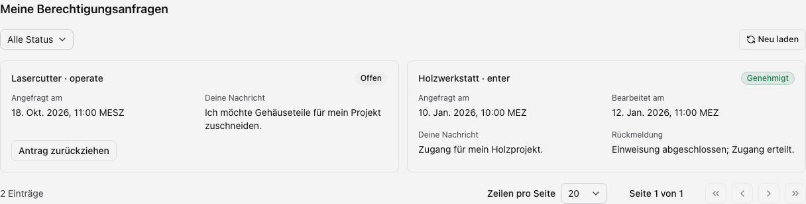

Unter **Zugänge & Ressourcen → Meine Berechtigungsanfragen** stehen deine eigenen
Anträge. Stellen und Zurückziehen benötigen zusätzlich die Anfragerechte.

## Zugriff anfragen

1. Suche die Ressource im [Katalog](./zutritt.mdx) und lies die Voraussetzungen.
2. Wähle **Zugriff anfragen** und gib deine Begründung ein.
3. Sende den Antrag und prüfe seinen Status.

Ein offener Antrag kann weitere Anfragen verhindern. Der Antrag selbst erteilt
noch keinen Zugang.

## Bearbeitungsstatus verfolgen

Nutze Statusfilter und Seitennavigation. Ohne Filter bleiben auch abgeschlossene
Anfragen mit ihrer Rückmeldung sichtbar.

| Status        | Bedeutung                                                          |
| ------------- | ------------------------------------------------------------------ |
| Offen         | Wartet auf Bearbeitung; Rücknahme möglich, soweit angeboten.       |
| Genehmigt     | Prüfe die erteilte [Freigabe und ihre Bedingungen](./zutritt.mdx). |
| Abgelehnt     | Keine Freigabe aus diesem Antrag; lies die Rückmeldung.            |
| Zurückgezogen | Zurückgenommen, bleibt im Verlauf sichtbar.                        |

Beispiel mit fiktiven Daten.

## Offenen Antrag zurückziehen

Wähle am offenen Antrag **Antrag zurückziehen** und bestätige die Rücknahme.
Abgeschlossene Anträge lassen sich so nicht ändern. Bestehende Freigaben bleiben erhalten.

## Fehler und ungespeicherter Text

Bei einem Sendefehler bleibt die Begründung erhalten. Korrigiere den Fehler und
versuche erneut. Beim Schließen kannst du weiterarbeiten oder verwerfen.
Wurde der Antrag inzwischen bearbeitet, lade seinen Status vor einem weiteren Versuch neu.
