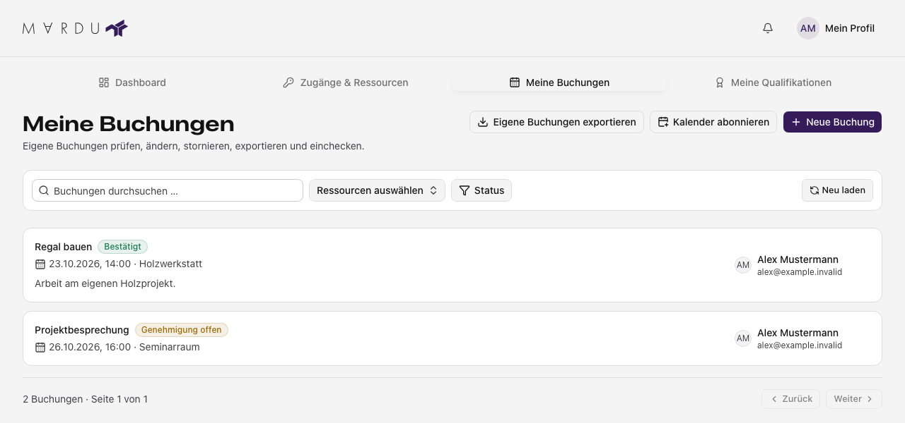
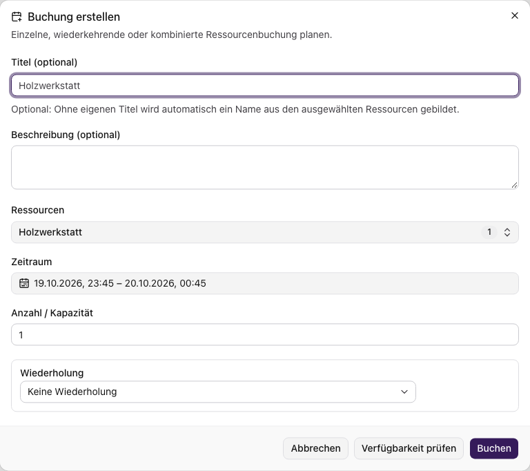
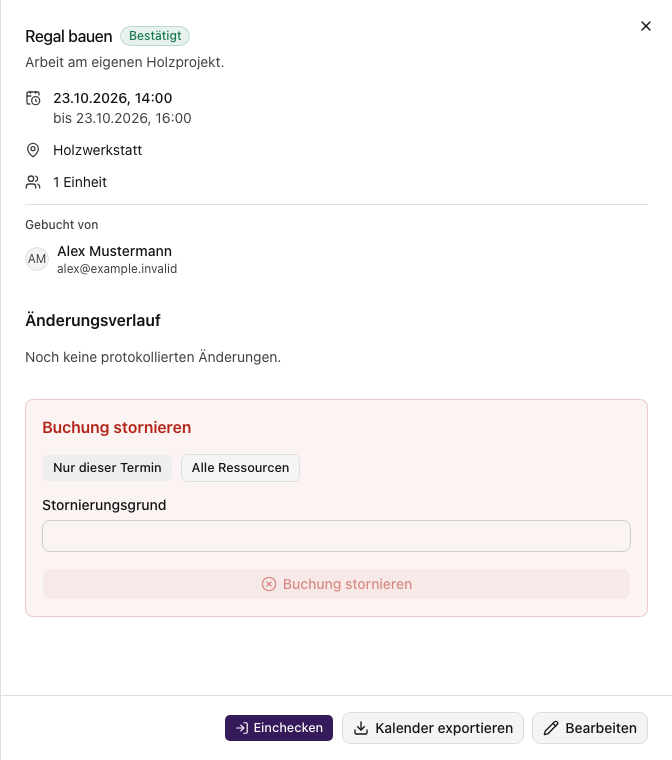

**Meine Buchungen** zeigt deine eigenen Reservierungen, auch mit Verwaltungsrechten.
Du brauchst Leserechte für Buchungen. Zum Erstellen brauchst du Erstellrechte;
Bearbeiten, Stornieren und Anwesenheitsaktionen benötigen Änderungsrechte für Buchungen.
Ressourcenauswahl und Verfügbarkeitsprüfung benötigen zusätzlich Leserechte für
Buchungsressourcen.

## Buchung oder freien Zeitraum finden

Öffne **Meine Buchungen**, auf dem Handy **Buchungen**. Nutze Suche, Ressourcen-
und Statusfilter, um eine eigene Buchung zu finden. Einen neuen Zeitraum prüfst du
im Buchungsformular mit **Verfügbarkeit prüfen**. Beachte dort auch
**Buchbare Zeiten und Regeln**.

Beispiel mit fiktiven Daten.

## Neue Buchung erstellen

1. Wähle **Neue Buchung** und die benötigten Ressourcen. Wähle für eine Serie
   eine einzelne Ressource.
2. Lege unter **Zeitraum** Datum und Uhrzeit für Beginn und Ende fest.
   Gib **Anzahl / Kapazität** an, beispielsweise die Zahl benötigter Plätze.
   Ergänze bei Bedarf Titel und Beschreibung; ohne Titel entsteht ein Name aus
   den ausgewählten Ressourcen.
3. Wähle für eine Serie unter **Wiederholung** täglich, wöchentlich oder monatlich.
   Lege Intervall und Ende nach Anzahl oder Datum fest; bei wöchentlichen Terminen
   zusätzlich die Wochentage. Eine Serie kann höchstens 200 Termine enthalten.
4. Wähle **Verfügbarkeit prüfen**, beachte die Rückmeldung und wähle **Buchen**.
5. Öffne die Buchung und prüfe ihren Status.

Öffnungszeiten, Dauer, Vorlauf, Kapazität und Freigabepflicht können die Buchung
begrenzen. Die Verfügbarkeitsprüfung reserviert noch nichts; die Belegung kann
sich bis zum Buchen ändern. Bei Serien prüft die Vorabprüfung nur den ersten
Termin; die weiteren Termine werden beim Buchen geprüft.

Die Zeiteingabe verwendet die Zeitzone deines Browsers. Die Wochenzeiten der
Ressource werden mit ihrer eigenen Zeitzone angezeigt. Prüfe besonders bei Serien
über eine Zeitumstellung die gespeicherten Termine.

Mehrere Ressourcen werden gemeinsam gebucht. Ist eine davon nicht verfügbar,
wird die kombinierte Buchung nicht angelegt.

Formular mit fiktiver Ressource.

## Status und Details lesen

| Status            | Bedeutung                                             |
| ----------------- | ----------------------------------------------------- |
| Genehmigung offen | Wartet auf eine Entscheidung; noch nicht freigegeben. |
| Bestätigt         | Reservierung bestätigt.                               |
| Abgelehnt         | Nicht genehmigt.                                      |
| Storniert         | Aufgehoben; ein angegebener Grund bleibt sichtbar.    |
| Abgeschlossen     | Buchung abgeschlossen.                                |
| Nicht erschienen  | Als nicht wahrgenommen eingeordnet.                   |

Die Details zeigen Zeitraum, Ressourcen, Anzahl und Änderungsverlauf.
Eine bestätigte Buchung ersetzt keine sonstigen [Zutrittsbedingungen](./zutritt.mdx).

## Ändern und stornieren

Öffne die Details und wähle **Bearbeiten**, soweit angeboten. Bei einer Serie
änderst du zunächst nur den geöffneten Termin. Mit
**Diesen und alle folgenden Termine der Serie ändern** änderst du bei bestätigten
Serienbuchungen auch die späteren bestätigten Termine. Bei kombinierten Buchungen
bearbeitest du die Ressourcen gemeinsam.

Beim **Speichern** werden Verfügbarkeit und Regeln erneut geprüft. Prüfe danach
den Status: Eine Änderung kann wieder eine Genehmigung benötigen.

Wähle vor dem Stornieren den Umfang: **Nur dieser Termin** oder, soweit angeboten,
**Ganze Serie** für alle noch bestätigten oder auf Genehmigung wartenden Termine.
Kombinierte Buchungen stornierst du mit **Alle Ressourcen**; einzelne Ressourcen
lassen sich hier nicht separat stornieren. Gib den **Stornierungsgrund** ein und
bestätige **Buchung stornieren**. Prüfe anschließend den Status für den gewählten Umfang.

Beispiel mit fiktiven Daten.

## Einchecken und Auschecken

Bei Ressourcen mit verpflichtendem Check-in erscheint bei bestätigten Buchungen
unten neben **Kalender exportieren** die Aktion **Einchecken**. Sie funktioniert
nur innerhalb des für die Ressource festgelegten Zeitfensters. Nach erfolgreichem
Check-in zeigen die Details **Eingecheckt**.

Ist die Freigabe bei Nichterscheinen eingerichtet, wird eine Buchung ohne Check-in
nach Ablauf der Nachfrist als **Nicht erschienen** markiert und die Ressource
wieder freigegeben.

Nach dem Check-in kannst du **Auschecken** wählen. Damit wird die Buchung
**Abgeschlossen**: Die verbleibende Kapazität wird sofort freigegeben; die Buchung
zählt nicht mehr als Zutrittsnachweis. Check-in und Check-out betätigen selbst
keine Türen oder Maschinen.

## Fehler und Entwürfe

Bei Konflikten prüfe Zeitraum, Anzahl, aktuellen Status und Verfügbarkeit erneut.
Fehlende Aktionen können an deinen Rechten oder am Buchungsstatus liegen.
**Abgeschlossen**, **Storniert**, **Abgelehnt** und **Nicht erschienen** lassen
sich nicht mehr bearbeiten oder stornieren. Speicherfehler
lassen deine Eingaben bestehen. Beim Schließen kannst du weiterarbeiten oder
verwerfen; eine laufende Speicherung muss erst enden. Ladefehler bieten **Erneut laden**.

[Kalender verwenden](./kalender.mdx) erklärt Export und Kalenderabo.
