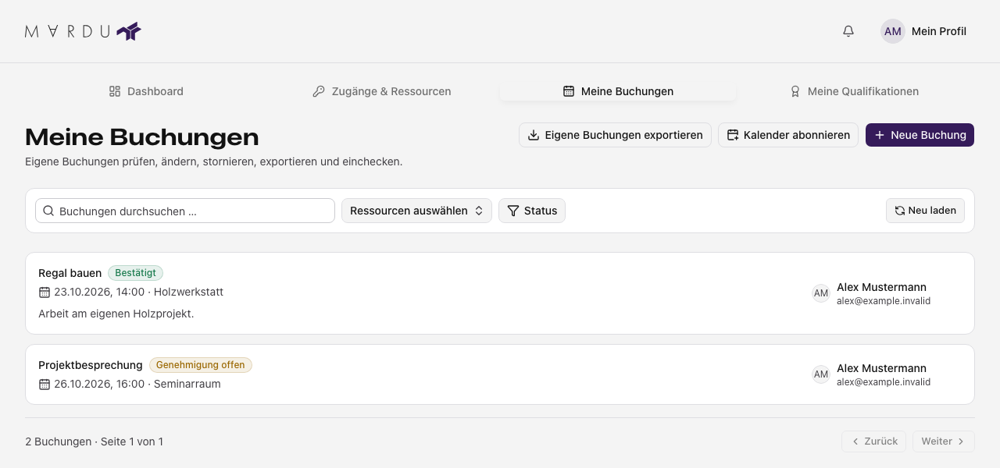
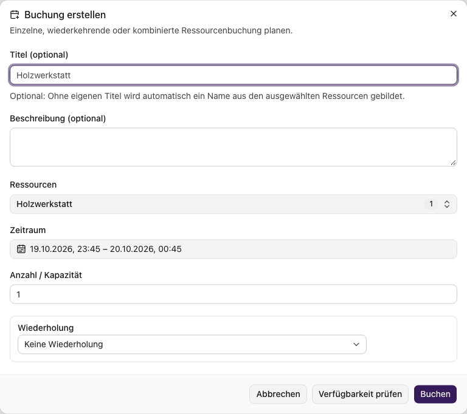
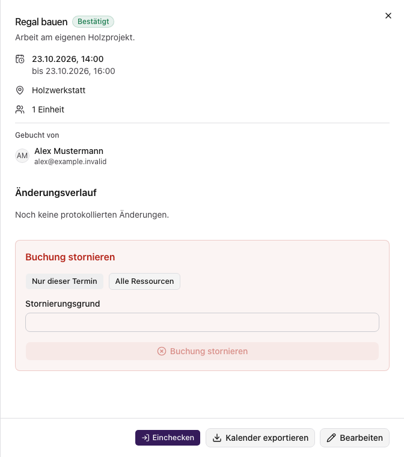

**Meine Buchungen** zeigt deine eigenen Reservierungen, auch wenn du zusätzlich
Buchungen anderer Personen verwalten darfst. Lesen, Erstellen, Ändern und
Stornieren hängen von deinen jeweiligen Rechten ab. Die Ressourcenauswahl benötigt
zusätzlich Zugriff auf die angebotenen Buchungsressourcen.

## Buchung oder freien Zeitraum finden

Öffne **Meine Buchungen** beziehungsweise **Buchungen** auf dem Handy. Nutze
Suche, Ressourcen- und Statusfilter sowie die Seitennavigation. In der
Kalenderansicht wechselst du Zeitraum und Ansicht; die Belegung hilft bei der
Terminwahl. Belegungen anderer Personen werden ohne deren persönliche Details
angezeigt. Sichtbarkeit im Kalender bedeutet noch keine Buchbarkeit für dich.

Beispiel mit fiktiven Daten: eine bestätigte Buchung und eine Buchung mit offener Genehmigung.

## Neue Buchung erstellen

1. Wähle **Neue Buchung**.
2. Wähle die benötigte Ressource oder die angebotene Kombination von Ressourcen.
3. Gib Beginn, Ende, Zeitzone und die benötigte Anzahl beziehungsweise Kapazität
   an. Ergänze Titel und Beschreibung, soweit benötigt.
4. Wähle bei einem wiederkehrenden Termin **Wiederholung** und lege Intervall
   sowie Ende der Wiederholung fest. Die angebotenen Varianten umfassen tägliche,
   wöchentliche, monatliche und jährliche Wiederholung.
5. Prüfe die Verfügbarkeit und die angezeigten Regeln; speichere die Buchung.
6. Öffne die entstandene Buchung und prüfe ihren Status.

Formular der vorhandenen Oberfläche mit einer fiktiven Ressource; noch nicht gespeichert.

Die Regeln der Ressource können Öffnungszeiten, Dauer, Vorlauf,
Vorausbuchungsgrenze, Kapazität und Freigabepflicht einschränken. Eine positive
Verfügbarkeitsprüfung reserviert den Zeitraum noch nicht; bis zum Speichern kann
sich die Belegung ändern. Die eigene Buchung braucht keine Auswahl einer anderen
buchenden Person.

Eine Serie enthält mehrere Termine; prüfe deren Zeitzone und Zeitraum besonders
bei Zeitumstellungen. Eine gemeinsame Buchung mehrerer Ressourcen kann mehrere
zugehörige Belegungen erzeugen. Die angebotene Ressourcenzahl und Terminzahl sind
begrenzt; die Eingabe nennt den jeweiligen Fehler.

## Status und Details lesen

| Status            | Bedeutung                                                                        |
| ----------------- | -------------------------------------------------------------------------------- |
| Genehmigung offen | Die Reservierung wartet auf eine Entscheidung.                                   |
| Bestätigt         | Die Buchung wurde bestätigt; weitere Nutzungsbedingungen gelten weiterhin.       |
| Abgelehnt         | Die Anfrage wurde nicht genehmigt. Lies die angezeigte Rückmeldung.              |
| Storniert         | Die Buchung wurde aufgehoben; ein vorhandener Stornierungsgrund bleibt sichtbar. |
| Abgeschlossen     | Die Buchung ist abgeschlossen.                                                   |
| Nicht erschienen  | Die Buchung wurde als nicht wahrgenommen eingeordnet.                            |

Die Details zeigen Zeitraum, Ressourcen, Anzahl und verfügbaren Änderungsverlauf.
Eine bestätigte Buchung ist nicht automatisch eine allgemeine
[Zutrittsfreigabe](./zutritt.mdx).
Buchungsentscheidungen anderer Personen gehören zur [Koordination](../koordination/buchungen-verwalten.mdx).

## Ändern und stornieren

Öffne die Details und verwende **Bearbeiten**, wenn die Buchung und deine Rechte
dies erlauben. Prüfe die Verfügbarkeit nach einer Änderung erneut. Eine geänderte
oder inzwischen nicht mehr verfügbare Buchung kann einen neuen Ladeversuch erfordern.

Vor einer Stornierung wählst du bewusst den Umfang: **Nur dieser Termin**,
gegebenenfalls **Ganze Serie** oder **Alle Ressourcen** einer gemeinsamen Buchung.
Gib einen **Stornierungsgrund** ein und bestätige **Buchung stornieren**.
Die bestätigte Stornierung wirkt auf den ausgewählten Umfang; sie ist keine reine
Entfernung einer Anzeige. Prüfe danach den Status.

Beispiel mit fiktiven Daten. Eine Stornierung muss mit Grund und gewähltem Umfang bestätigt werden.

## Einchecken und Auschecken

Bei einer bestätigten Buchung und passenden Änderungsrechten können die Details
unten neben **Kalender exportieren** die Aktionen **Einchecken** oder
**Auschecken** anbieten. Verwende sie zum Erfassen deiner Anwesenheit und prüfe
den aktualisierten Stand. Der Server prüft die Buchungsregeln; ein Einchecken ist
kein Befehl zum Öffnen einer Tür oder Freischalten einer Maschine.

## Fehler und Entwürfe

Bei einem Konflikt prüfe Zeitraum, Anzahl und aktuelle Verfügbarkeit. Fehlgeschlagene
Speicheraktionen erhalten deine Eingaben. Ein neu angezeigter Konflikt ersetzt eine
vorherige positive Verfügbarkeitsmeldung. Beim Schließen kannst du weiterarbeiten
oder den Entwurf verwerfen; laufende Speicherung muss erst abgeschlossen werden.
Ein Ladefehler ist keine leere Buchungsliste. Verwende **Erneut laden** und prüfe
bei fehlenden Ergebnissen auch Filter und Zeitraum.

[Kalender verwenden](./kalender.mdx) erklärt Export und persönliches Kalenderabo.
