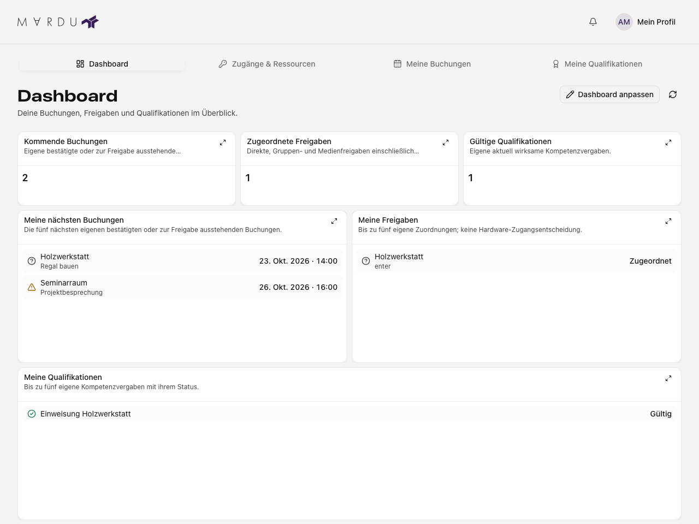

Das **Dashboard** fasst deine persönlichen Daten zusammen. Auf dem Handy öffnest
du es über **Start**. Es ist von den Verwaltungsdashboards getrennt und zeigt
auch bei Verwaltungsrechten keine Daten anderer Mitglieder.

## Anzeigen lesen

Das Standardlayout enthält Kennzahlen und Listen für kommende Buchungen,
zugeordnete Freigaben und gültige Qualifikationen. Eine weitere Kennzahl für
Qualifikationen, die innerhalb von 30 Tagen ablaufen, kannst du hinzufügen.

| Anzeige                 | Bedeutung                                                                        |
| ----------------------- | -------------------------------------------------------------------------------- |
| Kommende Buchungen      | Eigene bevorstehende bestätigte oder noch freizugebende Buchungen.               |
| Zugeordnete Freigaben   | Gespeicherte eigene Zuordnungen; keine bestätigte Hardware-Zutrittsentscheidung. |
| Gültige Qualifikationen | Aktuell wirksame eigene Einweisungen; keine automatische Ressourcenfreigabe.     |
| Listen                  | Eine begrenzte Auswahl; die Fachbereiche zeigen die ausführlichen Daten.         |

Öffne [Meine Buchungen](./buchungen.mdx), [Zugänge & Ressourcen](./zutritt.mdx) oder
[Meine Qualifikationen](./kompetenzen.mdx), um Gültigkeit, Einschränkungen oder
Einzelheiten zu prüfen. Eine Null ist ein geladener Zahlenwert; ein Fehlerhinweis
bedeutet, dass keine verlässliche aktuelle Zahl vorliegt. Ein leerer Listenhinweis ist keine
fehlgeschlagene Abfrage.

Beispiel mit fiktiven Daten. Kennzahlen und Listen beziehen sich auf dasselbe Mitglied.

## Dashboard anpassen

1. Wähle **Dashboard anpassen**.
2. Füge ein verfügbares Widget hinzu oder öffne die Konfiguration eines vorhandenen
   Widgets. Der Katalog enthält nur die für diese Ansicht angebotenen Anzeigen.
3. Verschiebe das Widget am Griff und passe seine Größe an. Auf Touchgeräten
   erreichst du Konfiguration und Entfernen über das beschriftete Widget-Menü.
   Der Griff unterstützt auch Tastaturbedienung.
4. Speichere die Anordnung. Erst die erfolgreiche Speicherung übernimmt sie für
   einen späteren Besuch.

Auf schmalen Bildschirmen ordnet die Oberfläche die Widgets untereinander an.
Über das Vergrößern-Symbol öffnest du Details. Das Entfernen eines Widgets entfernt
nur die Anzeige aus deinem Dashboard, keine Buchungen oder Nachweise.

## Änderungen und Fehler

Beim Verlassen eines bearbeiteten Dashboards kannst du weiterarbeiten oder den
Entwurf verwerfen. Wenn inzwischen ein anderer gespeicherter Stand vorliegt,
bleibt dein Entwurf bei einem Konflikt erhalten. Lade den gespeicherten Stand nur,
wenn du deine eigenen Änderungen verwerfen möchtest.

Bei einem Datenfehler lade die betroffene Anzeige erneut. Bei einem Speicherfehler
bleibt die Änderung ungespeichert; wiederhole die Speicherung nach der angezeigten
Fehlerhilfe. Ein Projekt- oder Kontowechsel lädt einen anderen persönlichen Kontext.

System-, Datenbank- und Gerätebetriebsmetriken gehören zur
[Übersicht und zum Systemstatus](./uebersicht-monitoring.mdx) und benötigen die
entsprechenden Verwaltungsrechte.
