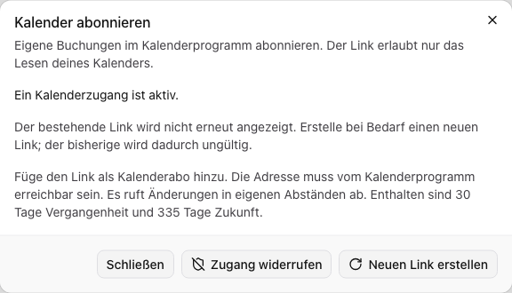

Mit einem Kalenderabo kann dein Kalenderprogramm deine eigenen Buchungen erneut
abrufen. Ein Dateiexport ist eine einmalige Kopie. Beide Funktionen übertragen
Termine zum Lesen; Änderungen in einem fremden Kalenderprogramm ändern keine
Buchung in Mardu.

## Einmalig exportieren

Öffne eine Buchung und wähle **Kalender exportieren** beziehungsweise die angebotene
Exportaktion der Buchungsansicht. Öffne oder importiere die heruntergeladene
ICS-Datei in deinem Kalenderprogramm. Eine importierte Datei aktualisiert sich
nicht automatisch. Exportierte Serien enthalten die gespeicherten Termine mit
ihren Änderungs- und Stornierungsständen.

## Persönliches Kalenderabo einrichten

Du benötigst Zugriff auf deinen eigenen Kalender. Das Lesen des Abo-Status,
Erstellen eines Links und sein Widerruf können unterschiedliche Rechte erfordern.

1. Öffne **Meine Buchungen → Kalender abonnieren**.
2. Wähle **Link erstellen**, wenn noch kein Zugang aktiv ist.
3. Kopiere den **Persönlichen Kalenderlink**. Er wird nur in diesem Vorgang angezeigt.
4. Füge ihn im Kalenderprogramm als Internetkalender beziehungsweise Kalenderabo
   hinzu. Die genaue Bezeichnung hängt vom Programm ab.

Der Link erlaubt ohne deine Webanmeldung das Lesen des Kalenders. Behandle ihn
wie ein Passwort und gib ihn nicht in öffentliche Dokumente oder Screenshots.
Die Serveradresse muss vom abrufenden Gerät oder Kalenderdienst erreichbar sein.
`localhost` auf deinem Handy bezeichnet dein Handy, nicht den Standortserver.
Verwende für produktive Zugriffe eine erreichbare HTTPS-Adresse.

## Welche Änderungen erscheinen?

Der Abruf umfasst einen mitwandernden Zeitraum von 30 Tagen Vergangenheit und
335 Tagen Zukunft. Neu angelegte, geänderte und stornierte eigene Buchungen
werden bei einem folgenden Abruf berücksichtigt. Das Kalenderprogramm bestimmt
das Abrufintervall; die Anzeige ist keine sofortige Live-Verbindung. Lade bei
Bedarf im Kalenderprogramm neu, soweit es dies anbietet.

## Link ersetzen oder Zugang widerrufen

Ein vorhandener Link wird später nicht erneut angezeigt. Wenn du ihn verloren
hast, wähle **Neuen Link erstellen** und bestätige die Ersetzung. Der bisherige
Link wird sofort ungültig. Bestehende Kalenderabos müssen danach den neuen Link
verwenden.

Mit **Zugang widerrufen** und der Bestätigung beendest du weitere Abrufe mit dem
Link. Bereits heruntergeladene Termine werden nicht aus fremden Kalenderprogrammen
entfernt. Eine Ersetzung oder ein Widerruf storniert keine Mardu-Buchung.

Beispiel mit fiktivem Abo-Status. Die spätere Ansicht zeigt den persönlichen Link nicht erneut.

## Wenn der Kalender nicht aktualisiert wird

Prüfe zuerst, ob du ein Abo oder eine Datei importiert hast. Prüfe anschließend
Erreichbarkeit, aktiven Zugang und Zeitraum. Ein ersetzter oder widerrufener Link
funktioniert nicht weiter. Veröffentliche den Link bei einer Supportanfrage nicht.
Die [Fehlerhilfe](../ueberblick/fehlersuche.mdx) erklärt weitere Grenzen der Selbsthilfe.
