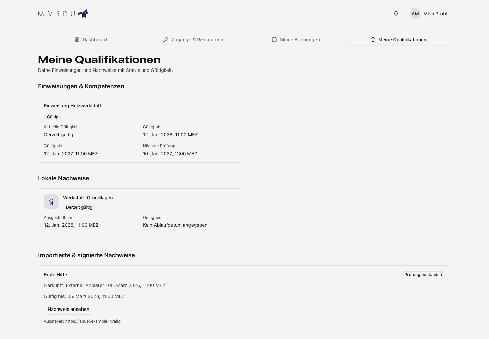
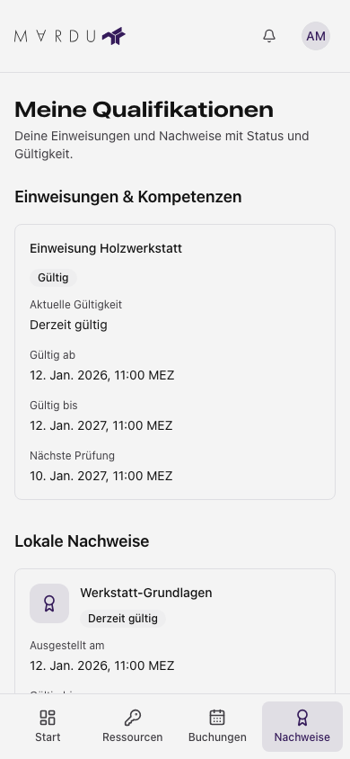

**Meine Qualifikationen**, auf dem Handy **Nachweise**, zeigt deine Einweisungen
und Nachweise aus drei Quellen. Du benötigst Profil-Leserechte.

## Einweisungen & Kompetenzen

Prüfe Status, aktuelle Wirksamkeit, Gültigkeitszeitraum und nächste Prüfung.

| Anzeige                                           | Bedeutung                                                            |
| ------------------------------------------------- | -------------------------------------------------------------------- |
| Ausstehend                                        | Noch nicht als wirksam bestätigt.                                    |
| Gültig                                            | Aktuell wirksam.                                                     |
| Erneute Prüfung erforderlich                      | Weitere Prüfung vorgesehen; aktuelle Wirksamkeit gesondert beachten. |
| Ausgesetzt, widerrufen, abgelaufen oder abgelehnt | Nicht als gültige Einweisung verwendbar.                             |
| Derzeit nicht gültig                              | Aktuell unwirksam, etwa vor Gültigkeitsbeginn.                       |
| Unbekannter Zustand                               | Keine verlässliche Bestätigung verfügbar.                            |

**Kein Ablaufdatum angegeben** bedeutet, dass kein Ende hinterlegt ist.
Die nächste Prüfung kann vom Gültigkeitsende abweichen.

## Lokale Nachweise

Hier stehen lokale Vergaben mit Name, Symbol, Ausstellungsdatum, Gültigkeit und
Widerrufsstatus. Auch frühere Vergaben bleiben sichtbar. Die Seitennavigation
zeigt jeweils 20 Einträge.

## Importierte & signierte Nachweise

1. Prüfe Name, Aussteller und Prüfstatus.
2. Prüfe das Ablaufdatum gesondert; eine gültige Signatur bestätigt nicht den Zeitraum.
3. Öffne **Nachweis ansehen** für Details oder lade das Original herunter.

Ein unbekannter Prüfstatus bestätigt keine Gültigkeit. Weitere Einträge erreichst
du über die Seitennavigation; fehlgeschlagene Downloads kannst du wiederholen.

## Grenzen und Korrekturen

Gültige Nachweise gewähren nicht automatisch [Ressourcenzugang](./zutritt.mdx).
Fehlende oder falsche Einweisungen klärst du mit der zuständigen Stelle.
Importe und Verbindungen verwaltest du unter
[Nachweisquellen](../ueberblick/profil-nachweisquellen.mdx).

Bei einem Ladefehler wiederhole die betroffene Abfrage. Die drei Quellen werden
getrennt geladen; andere bereits geladene Nachweise bleiben sichtbar.

## Ansicht am Desktop und Handy

Die Abbildungen zeigen dieselben drei Bereiche mit fiktiven Mitgliedsdaten.

