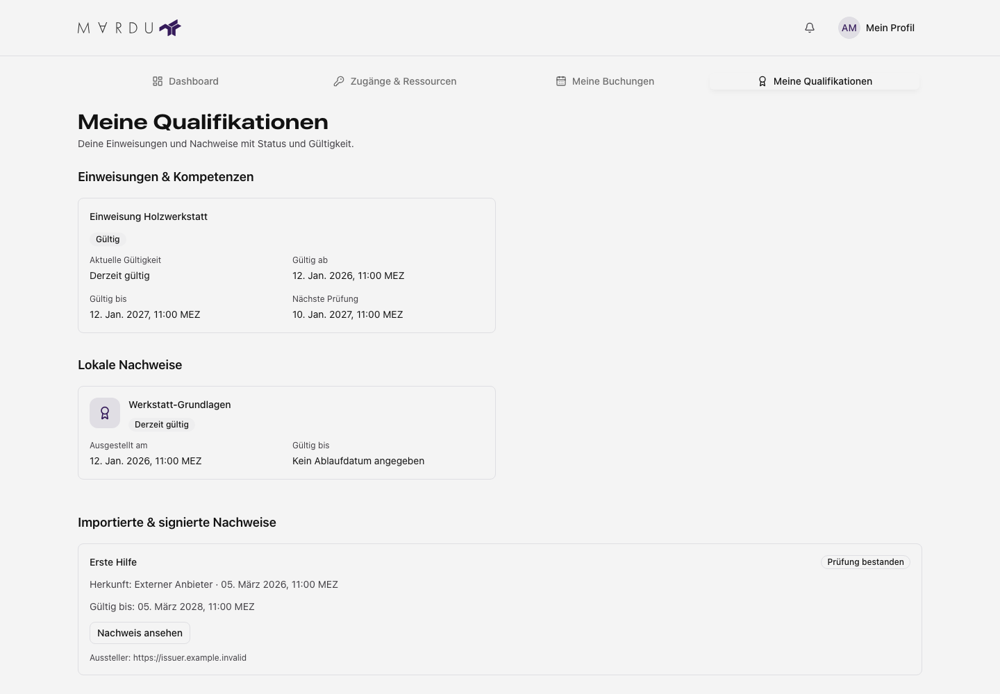
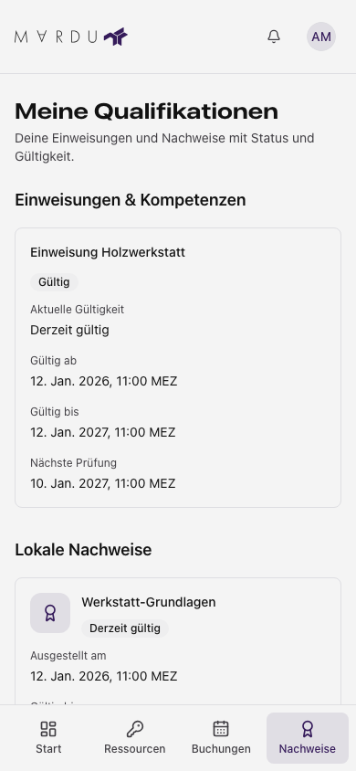

Öffne im Portal **Meine Qualifikationen**, auf dem Handy **Nachweise**. Die Ansicht
zeigt ausschließlich deine eigenen Einweisungen und Nachweise in drei Bereichen.
Du benötigst Profil-Leserechte.

## Einweisungen & Kompetenzen

Hier stehen die für dich erfassten Kompetenzanerkennungen. Prüfe den Status und
**Aktuelle Gültigkeit** sowie **Gültig ab**, **Gültig bis** und **Nächste Prüfung**.

| Anzeige                                           | Bedeutung                                                            |
| ------------------------------------------------- | -------------------------------------------------------------------- |
| Ausstehend                                        | Noch nicht als wirksam bestätigt.                                    |
| Gültig                                            | Aktuell wirksam.                                                     |
| Erneute Prüfung erforderlich                      | Weitere Prüfung vorgesehen; aktuelle Wirksamkeit gesondert beachten. |
| Ausgesetzt, widerrufen, abgelaufen oder abgelehnt | Nicht als gültige Einweisung verwendbar.                             |
| Derzeit nicht gültig                              | Aktuell unwirksam, etwa vor Gültigkeitsbeginn.                       |
| Status nicht geliefert                            | Keine verlässliche Statusangabe verfügbar.                           |

**Kein Ablaufdatum angegeben** bedeutet, dass kein Ende hinterlegt ist.
Die nächste Prüfung kann vom Gültigkeitsende abweichen.

## Lokale Nachweise

Hier stehen in Mardu vergebene Badges mit Name, Symbol, Ausstellungsdatum,
Gültigkeit und Widerrufsstatus. Auch frühere Vergaben bleiben sichtbar.
Mit **Weitere Nachweise** und **Vorherige Nachweise** wechselst du zwischen
Seiten mit jeweils bis zu 20 Einträgen.

## Importierte & signierte Nachweise

1. Prüfe Name, Aussteller und Prüfstatus.
2. Prüfe **Gültig bis** gesondert. Auch neben **Prüfung bestanden** kann
   **Abgelaufen** stehen.
3. Öffne **Nachweis ansehen** für Details. Dort kannst du mit
   **Original herunterladen** den gespeicherten Nachweis als Datei herunterladen.

**Noch nicht geprüft** und **Prüfstatus unbekannt** bestätigen keine Gültigkeit.
Auch eine bestandene Prüfung ist für sich noch keine lokale Kompetenzanerkennung:
Dafür gelten die Zuordnungen und Anerkennungsregeln des Standorts.
Weitere Einträge erreichst du über **Weitere Nachweise** und
**Vorherige Nachweise**. Nach einem fehlgeschlagenen Download bleibt die
Detailansicht geöffnet; wähle **Original herunterladen** erneut.

## Grenzen und Korrekturen

Gültige Nachweise gewähren nicht automatisch [Ressourcenzugang](./zutritt.mdx).
Welche Einweisungen eine Ressource verlangt, liest du dort im Ressourcenkatalog
unter **Details**. Vergleiche sie mit deinen aktuell gültigen Einweisungen;
die Qualifikationsansicht bestätigt keine erfüllten Anforderungen für eine
bestimmte Ressource.
Fehlende oder falsche Einweisungen klärst du mit der zuständigen Stelle.
Importe und Verbindungen verwaltest du unter
[Nachweisquellen](../ueberblick/profil-nachweisquellen.mdx).

Bei einem Ladefehler wiederhole die betroffene Abfrage. Die drei Quellen werden
getrennt geladen; andere bereits geladene Nachweise bleiben sichtbar.

## Ansicht am Desktop und Handy

Die Beispiele verwenden fiktive Mitgliedsdaten. Am Handy stehen die Angaben
untereinander.

