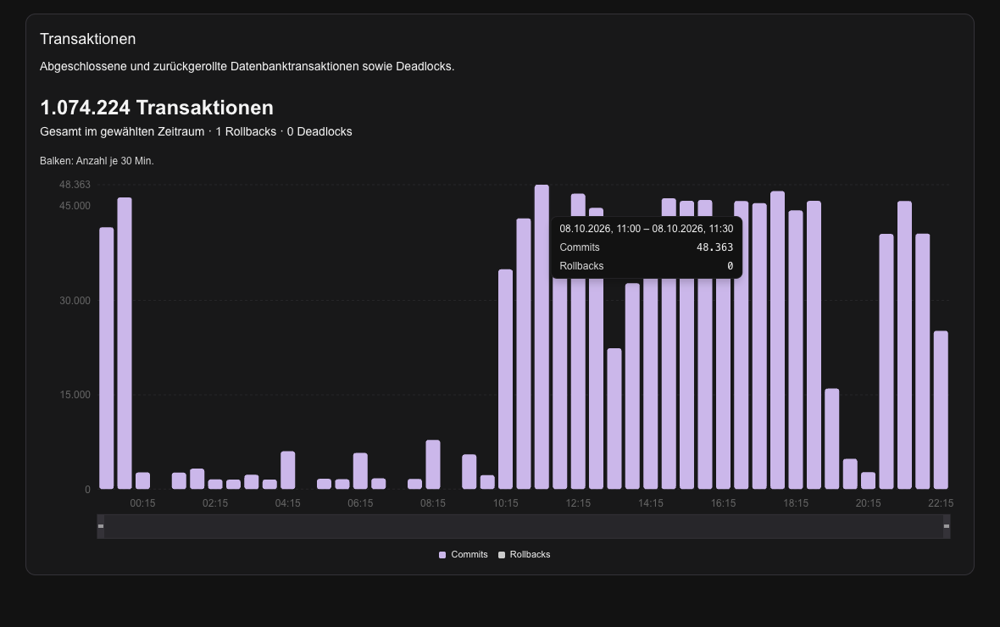
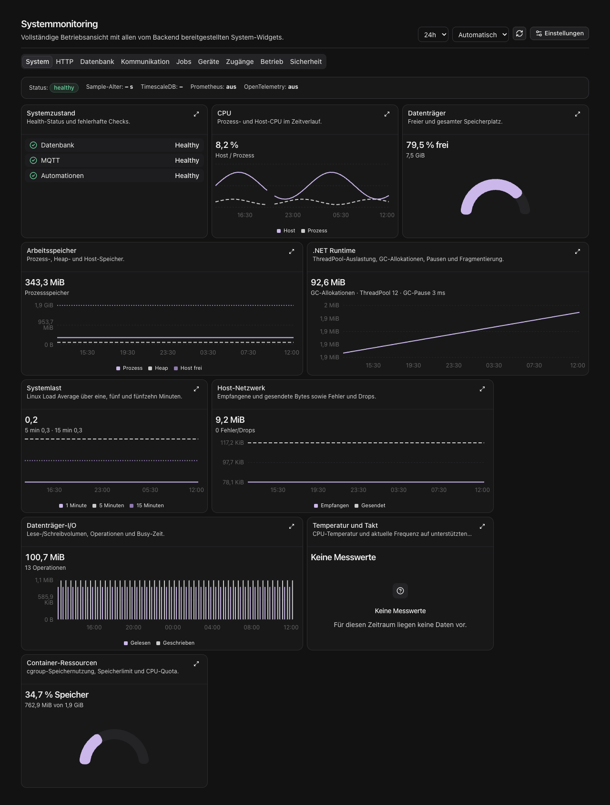

Diese Anleitung beschreibt Verwaltungs- und Betriebsmetriken und setzt die
entsprechenden Leserechte voraus. Das Dashboard der persönlichen Benutzeransicht
ist separat unter [Persönliches Dashboard](./dashboard.mdx) beschrieben.

Die **Übersicht** zeigt dein ausgewähltes **Betriebsdashboard**. Unter
**Betrieb → Systemstatus** findest du die Systemmetriken nach Bereichen, etwa
**System**, **HTTP** und **Datenbank**. Diese Ansicht hat eine vorgegebene Anordnung.
Eigene Betriebsdashboards speichern dagegen deine Auswahl und Anordnung von Widgets.

## Rechte und Datenquellen

| Aufgabe                                                       | Benötigtes Recht                                                         |
| ------------------------------------------------------------- | ------------------------------------------------------------------------ |
| Betriebsdashboards und Systemstatus lesen                     | Dashboards anzeigen (`Dashboard.View`)                                   |
| Eigenes Betriebsdashboard anlegen                             | Dashboards erstellen (`Dashboard.Create`)                                |
| Name, Widgets und Anordnung speichern oder Standard festlegen | Dashboards ändern (`Dashboard.Update`)                                   |
| Eigenes Betriebsdashboard löschen                             | Dashboards löschen (`Dashboard.Delete`)                                  |
| Gerätedaten und Geräteereignisse in Widgets lesen             | Zusätzlich Geräte anzeigen (`Devices.View`)                              |
| Erfassung und Aufbewahrung einsehen oder ändern               | Einstellungen anzeigen bzw. ändern (`Settings.View` / `Settings.Update`) |

Die Widget-Auswahl berücksichtigt deine Datenquellenrechte. Ein fehlendes
Gerätewidget kann daher an fehlenden Geräteleserechten liegen. **Keine Messwerte**
in einer vorhandenen Anzeige bedeutet dagegen, dass kein passender Messwert
vorliegt; das ist kein Berechtigungshinweis.

## Systemstatus öffnen

1. Öffne **Betrieb → Systemstatus**.
2. Wähle den Bereich und anschließend **Zeitraum** und **Auflösung**.
3. Prüfe über den Karten den Erfassungsstatus und das **Sample-Alter**. Das ist das
   Alter des zuletzt erfassten Messpunkts. Ein aktueller Seitenaufruf allein
   bestätigt keine aktuelle Messung.
4. Öffne bei Bedarf über das Vergrößern-Symbol die Detailansicht eines Widgets.
   Mit **Monitoring aktualisieren** fragst du die Daten erneut ab.

Die Ansicht lädt regelmäßig neue Daten. **Einstellungen** öffnet die Erfassung,
Aufbewahrung und Alarmgrenzen; dafür gelten die gesonderten Einstellungsrechte.

## Zeitraum und Diagramme

Wähle den Zeitraum und die Auflösung oberhalb der Karten. Zur Auswahl stehen
**Letzte Stunde**, **Letzte 24 Stunden**, **Letzte 7 Tage**, **Letzte 30 Tage** und
**Letztes Jahr**. Die Zeitfenster reichen jeweils vom Abfragezeitpunkt zurück;
„Letztes Jahr“ umfasst die letzten 365 Tage.

| Auflösung   | Verhalten                                                                |
| ----------- | ------------------------------------------------------------------------ |
| Automatisch | Bis 48 Stunden die fein aufgelösten Messpunkte, darüber Stundenwerte.    |
| Minute      | Fein aufgelöste Messpunkte; nur für Zeiträume bis sieben Tage verfügbar. |
| Stunde      | Gespeicherte Stundenaggregate. Nicht jedes Feld ist darin verfügbar.     |

Beim Wechsel auf 30 Tage oder ein Jahr wird eine gewählte Minutenauflösung auf
**Automatisch** zurückgesetzt. Die Auflösung bestimmt die abgefragten Daten;
**Refresh (s)** im Dashboardeditor bestimmt, wie oft die Ansicht sie neu abfragt.
Häufigeres Aktualisieren erzeugt keine zusätzlichen Messpunkte.

Linien zeigen den Verlauf, Balken Messwerte je Intervall und Ringdiagramme die
Verteilung, beispielsweise gewährt gegenüber abgelehnt. Die Beschriftung nennt
die Einheit. Bei Zählwerten addiert **Summe** die gelieferten Intervalle;
**Rate** zeigt einen Wert pro Sekunde. Bei Dauerwerten zeigt ein Durchschnitt die
mittlere Dauer; ein Maximum den höchsten gemessenen Wert. Perzentile wie p95
beschreiben das jeweilige Messintervall und sind keine Summe über den Zeitraum.

Die Hauptzahl kann einen Zeitraum zusammenfassen. Angaben wie aktuell aktive Sitzungen oder belegte Verbindungen beschreiben dagegen den zuletzt erfassten Zustand. Bei einem Wechsel von Zeitraum, Bereich oder Gerät werden die passenden Daten neu geladen.

Bei **Datenbank → Transaktionen** nennt die Hauptzahl die Summe im gewählten Zeitraum oder die durchschnittlichen Transaktionen pro Sekunde. Die Balken zeigen die Summe aus Commits und Rollbacks je Zeitabschnitt; dessen Dauer steht über dem Diagramm. Beim Darüberfahren siehst du den Beginn und das Ende des Abschnitts sowie die Commits und Rollbacks. Deadlocks sind eine separate Ereigniszahl über dem Diagramm. Die Balken summieren alle gelieferten Messwerte, statt einzelne Messpunkte auszuwählen. Rollbacks und Deadlocks unter der Hauptzahl beziehen sich ebenfalls auf den gewählten Zeitraum.

Diese Zahlen zählen Transaktionen der Anwendungsdatenbank, einschließlich Hintergrundabfragen und Monitoring. Sie entsprechen keiner Anzahl von Benutzeraktionen.

## Fehlende und begrenzte Messwerte

**Keine Messwerte** bedeutet, dass keine passende Messung verfügbar ist. Ein
vorhandener Messpunkt mit Wert 0 ist etwas anderes als eine fehlende Messung.
Lücken im Diagramm werden nicht als Null aufgefüllt. Eine angezeigte 0 allein
belegt keine vollständig erfasste Historie: Prüfe auch Erfassungsstatus,
Sample-Alter und Verlauf. Manche Hostwerte, etwa Temperatur oder Containergrenzen,
sind auf dem jeweiligen System nicht verfügbar.

Ein Hinweis oberhalb der Karten nennt begrenzte Historien. Bei einem Antwortlimit
werden die neuesten verfügbaren Messpunkte angezeigt; Summen beziehen sich auf
diese Punkte. Die Systemhistorie liefert höchstens 2.000 Punkte pro Abfrage.
Wähle einen kürzeren Zeitraum oder eine gröbere Auflösung, um das Limit zu vermeiden.
Auch Aufbewahrungsgrenzen und die Anzahl der Felder, die in der gewählten Auflösung
fehlen, werden angezeigt. Die Auswahl eines Jahres garantiert keine vollständige
Jahreshistorie.

Standardmäßig werden Rohmessungen 30 Tage und Stundenaggregate 365 Tage
aufbewahrt. Die tatsächlich eingestellten Fristen stehen unter **Einstellungen**
im Systemstatus. Eine längere Aufbewahrung stellt bereits entfernte Messpunkte
nicht wieder her. Ist die Erfassung deaktiviert, entstehen keine neuen Messpunkte.

Ein Fehlerhinweis bedeutet, dass die Quelle oder Abfrage fehlgeschlagen ist. Lade erneut. Eine unveränderte ältere Anzeige ist keine neue Messung.

## Eigenes Betriebsdashboard

### Auswählen und anlegen

Wähle in der Kopfzeile unter **Dashboard** eine deiner gespeicherten Ansichten.
Ein Stern kennzeichnet das Standarddashboard. **Als Standard** legt die gewählte
Ansicht für dein Konto als Standard fest. Ohne ausdrückliche Auswahl in der
Seitenadresse wird dieses Dashboard beim Öffnen geladen.

1. Wähle **Neu** oder **Neues Dashboard anlegen** in der Dashboard-Auswahl.
   Ohne vorhandene Ansicht heißt die Aktion **Dashboard erstellen**.
2. Gib einen Namen mit höchstens 100 Zeichen ein. Der Name muss innerhalb deiner
   Betriebsdashboards eindeutig sein, auch unabhängig von Groß-/Kleinschreibung.
3. Wähle **Dashboard erstellen**. Das Dashboard wird mit einer Startauswahl von
   Systemwidgets angelegt und im Bearbeitungsmodus geöffnet. Das erste Dashboard
   wird automatisch zum Standard.

Mit **Abbrechen** schließt du den Erstellungsdialog, ohne ein Dashboard anzulegen.
Eine separate Vorlagenauswahl gibt es dort nicht. Du kannst bis zu 20 eigene
Betriebsdashboards speichern.

### Widgets und Anordnung ändern

1. Wähle **Bearbeiten**. Im Feld **Name** kannst du das Dashboard umbenennen.
2. Wähle **Widget** und anschließend die gewünschte Anzeige. Für Gerätewidgets
   wählst du mindestens ein und höchstens zehn Geräte. Wähle **Hinzufügen**.
3. Über **Widget konfigurieren** an der Karte änderst du Titel, Darstellung und
   die angebotene **Zusammenfassung**. Je nach Darstellung kannst du die Legende
   und Schwellenwerte einstellen. Eine als **Beispieldaten** markierte Vorschau
   belegt keine Messung aus deiner Installation. Schließe den Dialog mit
   **Anwenden**; die Änderungen gehören weiterhin zum ungespeicherten Entwurf.
4. Verschiebe die Karten am Griff neben dem Titel und ändere ihre Größe an der
   rechten unteren Ecke. Am fokussierten Griff verschieben Pfeiltasten die Karte;
   **Umschalt + Pfeiltasten** ändern ihre Größe. Auf dem Handy stehen Konfigurieren
   und Entfernen im Drei-Punkte-Menü.
5. Wähle **Speichern**, um Name und Ansicht für dein Konto zu übernehmen.

Die Warnschwellen markieren nur die Anzeige in der angegebenen Einheit. Sie lösen
keine Alarme aus und ändern keine Ressourcenregeln. Das Entfernen eines Widgets
entfernt keine Messungen oder Geräte. Ein Dashboard kann bis zu 40 Widgets enthalten.

Neue Karten erhalten eine zur Darstellung passende Standardgröße. Breitere Diagramme haben mehr Platz als einzelne Kennzahlen; auf schmalen Bildschirmen stehen die Karten untereinander. Bereits gespeicherte eigene Größen bleiben erhalten. Über das Vergrößern-Symbol einer Karte öffnest du die Detailansicht.

Desktop, Tablet und Handy haben getrennte Anordnungen. Wenn du im Bearbeitungsmodus
den Zeitraum änderst, wird dieser mit **Speichern** zum Startzeitraum des Dashboards.
Die Auflösung ist eine Auswahl für die aktuelle Anzeige.

### Vorschau, Speichern und Konflikte

**Vorschau** beendet den Bearbeitungsmodus, ohne den Entwurf zu speichern oder zu
verwerfen. Kehre über **Bearbeiten** zurück und speichere deine Änderungen.
Beim Wechsel zu einem anderen gespeicherten Dashboard fragt die Oberfläche, ob
du ungespeicherte Änderungen verwerfen möchtest. Beim Neuladen können diese
Änderungen ebenfalls verloren gehen.

Bei einem gewöhnlichen Speicherfehler bleibt der Entwurf erhalten. Prüfe auch,
ob der Name bereits für ein anderes deiner Dashboards verwendet wird.
Wurde das Dashboard zwischenzeitlich in einer anderen Sitzung geändert, erscheint
**Das Dashboard wurde zwischenzeitlich geändert. Lade die aktuelle Version neu.**
Mit **Neu laden** übernimmst du den gespeicherten Stand; ungespeicherte Änderungen
werden dabei verworfen. Übertrage benötigte Änderungen anschließend erneut.

**Dashboard löschen** im Bearbeitungsmodus löscht nach Bestätigung diese eigene
Ansicht. Messungen und Geräte bleiben erhalten. Wird das Standarddashboard
gelöscht, wird eine verbleibende Ansicht zum Standard.

## Zutrittsmetriken

Die [Zugangsmetriken](../administration/zutritt-verwalten.mdx#zugangsmetriken)
in Benutzer- und Zutrittspunktdetails haben einen eigenen Zeitraum.
Dort sind Kennzahlen, aktuelle Sitzungen und die Grenzen der Anzeige erklärt.
Sie sind von den erfassten Systemmetriken im Bereich **Zugänge** des Systemstatus
zu unterscheiden.

Gerätemesswerte findest du unter **Geräte → Gerät öffnen → Diagnose**. Die
Monitoring-Ansicht dort verwendet den gewählten Zeitraum und die Auflösung für
dieses Gerät. Eine gespeicherte Widget-Anordnung gilt für alle Geräte, die du mit
deinem Konto öffnest. Sie wird getrennt von deinen Betriebsdashboards gespeichert.

## Benachrichtigungen

Die Glocke öffnet den [persönlichen Posteingang](./benachrichtigungen.mdx).
Versandoptionen änderst du im Profil unter **Benachrichtigungen**.

Für den Betrieb zeigen die verfügbaren Benachrichtigungsmetriken unter anderem
ausstehende, geplante und laufende Zustellungen, Wiederholungen und Versandfehler.
Wartende Zustellungen beschreiben einen Zustand; erfolgreiche Zustellungen und
Versandversuche beziehen sich auf das Messintervall. Ein erfolgreicher Versand
belegt keine gelesene Nachricht im Zielpostfach. Eine Mitteilung kann Zustellungen
über mehrere Kanäle auslösen. Fehlende Messwerte sind kein
Nachweis, dass keine Mitteilungen anstehen.

Die [administrative Anleitung](../administration/benachrichtigungen-verwalten.mdx#fehlende-oder-verzögerte-zustellung-untersuchen)
verbindet diese Anzeige mit SMTP-Test, persönlichen Voraussetzungen und
Serverdiagnose.

## Umfang dieser Anleitung

Die Anleitung beschreibt die Bedienung von Betriebsdashboards und Systemstatus.
Die Verfügbarkeit einzelner Host- und Gerätemesswerte hängt von der Installation
und den angeschlossenen Geräten ab. Eigene Buchungen und Qualifikationen gehören
zum [persönlichen Dashboard im Benutzerbereich](./dashboard.mdx).
