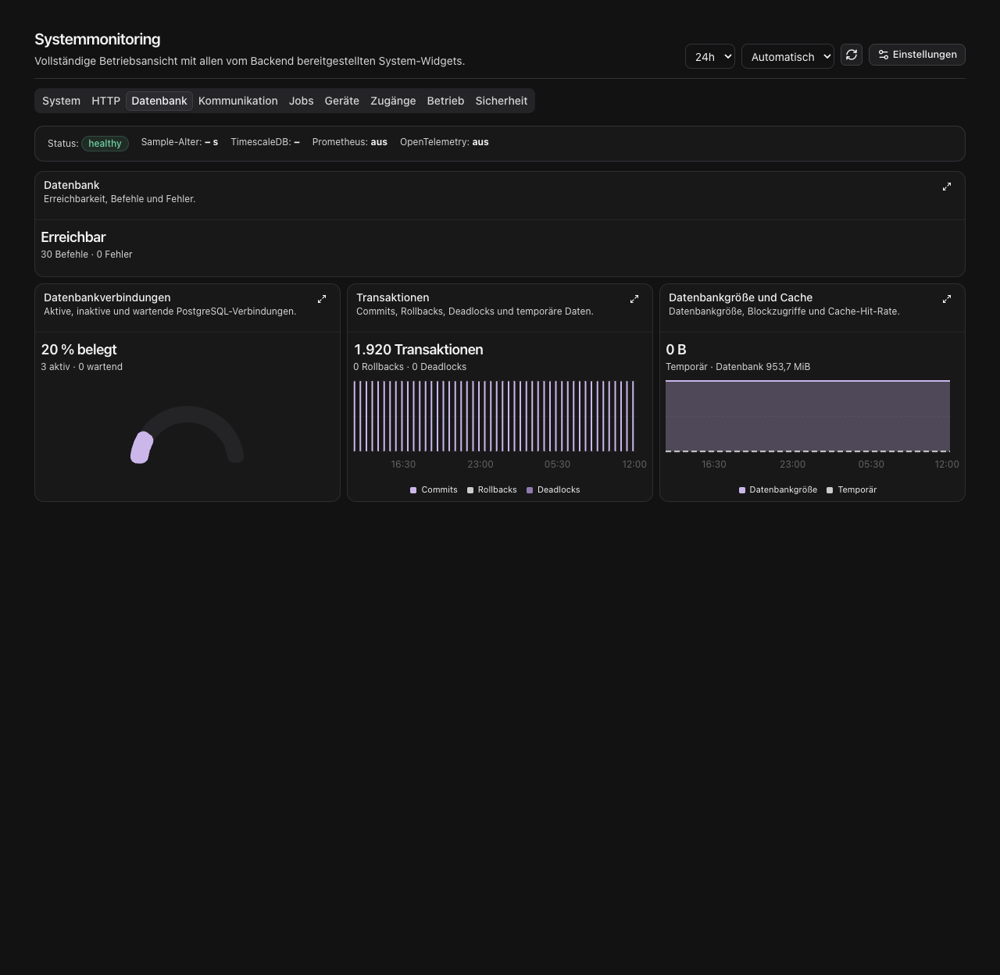

Diese Anleitung beschreibt Verwaltungs- und Betriebsmetriken und setzt die
entsprechenden Leserechte voraus. Das Dashboard der persönlichen Benutzeransicht
ist separat unter [Persönliches Dashboard](./dashboard.mdx) beschrieben.

Die **Übersicht** zeigt dein ausgewähltes Dashboard. Unter **Betrieb → Systemstatus** findest du die freigegebenen Systemmetriken nach Bereichen. In den Gerätedetails zeigt **Metriken** Messwerte für dieses Gerät.

## Zeitraum und Diagramme

Wähle den Zeitraum und die Auflösung oberhalb der Karten. Linien zeigen den Verlauf, Balken Messwerte je Intervall und Ringdiagramme die Verteilung, beispielsweise gewährt gegenüber abgelehnt. Die Beschriftung nennt die Einheit. Bei Dauerwerten zeigt ein Durchschnitt die mittlere Dauer; ein Maximum den höchsten gemessenen Wert. Perzentile wie p95 beschreiben das jeweilige Messintervall und sind keine Summe über den Zeitraum.

Die Hauptzahl kann einen Zeitraum zusammenfassen. Angaben wie aktuell aktive Sitzungen oder belegte Verbindungen beschreiben dagegen den zuletzt erfassten Zustand. Bei einem Wechsel von Zeitraum, Bereich oder Gerät werden die passenden Daten neu geladen.

Bei **Datenbank → Transaktionen** nennt die Hauptzahl die Summe im gewählten Zeitraum oder die durchschnittlichen Transaktionen pro Sekunde. Die Balken zeigen die Summe aus Commits und Rollbacks je Zeitabschnitt; dessen Dauer steht über dem Diagramm. Beim Darüberfahren siehst du den Beginn und das Ende des Abschnitts sowie die Commits und Rollbacks. Deadlocks sind eine separate Ereigniszahl über dem Diagramm. Die Balken summieren alle gelieferten Messwerte, statt einzelne Messpunkte auszuwählen. Rollbacks und Deadlocks unter der Hauptzahl beziehen sich ebenfalls auf den gewählten Zeitraum.

Diese Zahlen zählen Transaktionen der Anwendungsdatenbank, einschließlich Hintergrundabfragen und Monitoring. Sie entsprechen keiner Anzahl von Benutzeraktionen.

## Fehlende und begrenzte Messwerte

**Keine Messwerte** bedeutet, dass keine passende Messung verfügbar ist. Eine Null bedeutet einen gemessenen Wert von null. Lücken im Diagramm werden nicht als Null aufgefüllt. Manche Hostwerte, etwa Temperatur oder Containergrenzen, sind auf dem jeweiligen System nicht verfügbar.

Ein Hinweis oberhalb der Karten nennt begrenzte Historien. Bei einem Antwortlimit werden die neuesten zusammenhängenden Messpunkte angezeigt; Summen beziehen sich auf diese Punkte. Für mehr Übersicht kannst du einen kürzeren Zeitraum oder eine gröbere Auflösung wählen. Auch Aufbewahrungsgrenzen und Felder, die in der gewählten Auflösung fehlen, werden angezeigt.

Ein Fehlerhinweis bedeutet, dass die Quelle oder Abfrage fehlgeschlagen ist. Lade erneut. Eine unveränderte ältere Anzeige ist keine neue Messung.

## Persönliches Dashboard

Über **Bearbeiten** fügst du Karten hinzu, änderst ihre Darstellung und ordnest sie an. Die verfügbaren Karten richten sich nach deinen Berechtigungen. Speichere die Änderungen, damit die Anordnung beim nächsten Öffnen erhalten bleibt.

Neue Karten erhalten eine zur Darstellung passende Standardgröße. Breitere Diagramme haben mehr Platz als einzelne Kennzahlen; auf schmalen Bildschirmen stehen die Karten untereinander. Bereits gespeicherte eigene Größen bleiben erhalten. Über das Vergrößern-Symbol einer Karte öffnest du die Detailansicht.

## Zutrittsmetriken

Die [Zugangsmetriken](../administration/zutritt-verwalten.mdx#zugangsmetriken)
in Benutzer-, Geräte- und Zutrittspunktdetails haben einen eigenen Zeitraum.
Dort sind Kennzahlen, aktuelle Sitzungen und die Grenzen der Anzeige erklärt.

## Benachrichtigungen

Die Glocke öffnet den [persönlichen Posteingang](./benachrichtigungen.mdx).
Versandoptionen änderst du im Profil unter **Benachrichtigungen**.

Für den Betrieb zeigen die verfügbaren Benachrichtigungsmetriken unter anderem
ausstehende, geplante und laufende Zustellungen, Wiederholungen und Versandfehler.
Wartende Zustellungen beschreiben einen Zustand; erfolgreiche Zustellungen und
Versandversuche beziehen sich auf das Messintervall. Ein erfolgreicher Versand
belegt keine gelesene Nachricht im Zielpostfach. Eine Mitteilung kann Zustellungen
über mehrere Kanäle auslösen. Fehlende Messwerte sind kein
Nachweis, dass keine Mitteilungen anstehen.

Die [administrative Anleitung](../administration/benachrichtigungen-verwalten.mdx#fehlende-oder-verzögerte-zustellung-untersuchen)
verbindet diese Anzeige mit SMTP-Test, persönlichen Voraussetzungen und
Serverdiagnose.

## Umfang dieser Anleitung

Die Anleitung erklärt die Anzeigen. Die vollständige Einrichtung eigener Dashboards und die Prüfung aller Datenquellen sind noch nicht dokumentiert.
