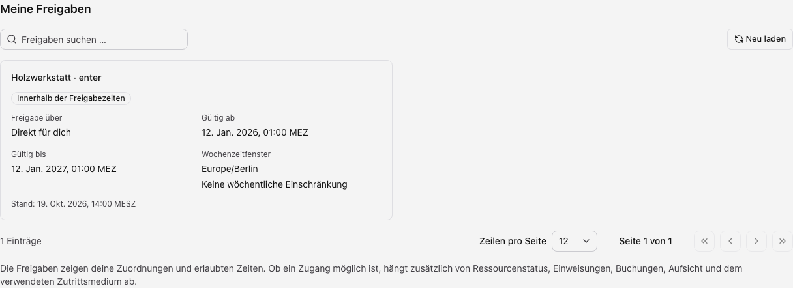
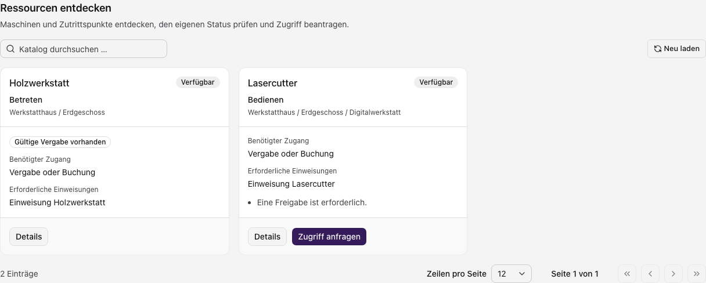
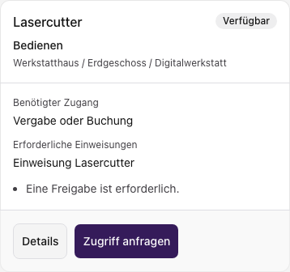

Unter **Zugänge & Ressourcen** findest du deine Freigaben und den persönlichen
Ressourcenkatalog. Beides wird getrennt geladen: Eine Freigabe kann sichtbar sein,
auch wenn ihre Ressource im Katalog nicht angeboten wird. Verwaltungsrechte
machen diese persönliche Ansicht nicht zu einer Liste fremder Freigaben.

## Eigene Freigaben prüfen

1. Öffne **Zugänge & Ressourcen** beziehungsweise **Ressourcen** auf dem Handy.
2. Suche im Bereich **Meine Freigaben** nach Ressource oder Zuordnung und blättere
   bei Bedarf weiter.
3. Prüfe Herkunft, Zeitraum und Nutzungszeiten der passenden Freigabe.

| Angabe              | So liest du sie                                                                                                 |
| ------------------- | --------------------------------------------------------------------------------------------------------------- |
| Herkunft            | Direkte Zuordnung, Zuordnung über eine aktuelle Gruppe oder über ein eigenes Zutrittsmedium.                    |
| Gültigkeit          | Beginn und gegebenenfalls Ende der Freigabe; zukünftige und abgelaufene Zuordnungen bleiben sichtbar.           |
| Wochenzeitfenster   | Zulässige Wochentage und Uhrzeiten in der angegebenen Zeitzone. Ein Nachtfenster kann über Mitternacht reichen. |
| Zeitstatus          | Zum angezeigten Auswertungszeitpunkt innerhalb oder außerhalb der Bedingungen.                                  |
| Bereich oder Medium | Ein deaktivierter Bereich oder ein nicht nutzbares Medium kann die Verwendung weiterhin verhindern.             |

Beispiel mit fiktiven Daten. Die zeitliche Freigabe und die endgültige Zugangsentscheidung sind getrennt.

**Innerhalb der Freigabezeiten** beschreibt die zeitliche Zuordnung. Die
abschließende Zutrittsentscheidung kann zusätzlich Handlungsregeln, Buchungen,
Kompetenzen, Medien und Hardwarezustand berücksichtigen. Eine Freigabeanzeige
ist deshalb kein Beleg, dass sich eine Tür gerade öffnen lässt.

## Ressource im Katalog finden

1. Suche im Ressourcenkatalog nach der benötigten Ressource.
2. Prüfe Name, Nutzungsart, Ort und die angezeigten Voraussetzungen.
3. Öffne **Details**, um Regeln, erforderliche Einweisungen und vorhandene
   Freigaben, Buchungen oder Anfragen zu lesen.
4. Verwende **Zugriff anfragen**, wenn die Ressource diese Aktion anbietet und du
   die Anfragefunktion nutzen darfst.

Beispiel mit fiktiven Ressourcen. Eine vorhandene Einweisung ersetzt keine Freigabe.

Ausschnitt derselben Oberfläche auf dem Handy mit fiktiven Daten.

Der Katalog nennt erforderliche Einweisungen auch dann, wenn du diese noch nicht
besitzt. Eine Qualifikation und eine Ressourcenfreigabe erfüllen unterschiedliche
Bedingungen. Der Katalogstatus ist keine zugesicherte Live-Hardwaremeldung.

Den Antrag und seine Bearbeitung erklärt [Meine Berechtigungsanfragen](./berechtigungsanfragen.mdx).
Deine Karten und Transponder findest du im
[Profil unter Meine Zutrittsmedien](../ueberblick/profil-zutrittsmedien.mdx).

## Wenn etwas fehlt

Eine leere Suche kann an Filtern oder daran liegen, dass keine Ressource für dich
sichtbar ist. Eine fehlende Anfrageaktion kann eine nicht anforderbare Ressource,
einen bereits offenen Antrag oder fehlende Rechte bedeuten. Bei einem Ladefehler
verwende die Wiederholung im betroffenen Bereich. Fehler beim Nachladen eines
Mediums machen eine angezeigte Freigabe nicht automatisch ungültig.

Fehlende oder falsche Zuordnungen muss die zuständige Verwaltung prüfen. Du
kannst hier keine Freigaben vergeben, ändern oder löschen. Bei verweigerter Nutzung
notiere Ressource, Zeitpunkt und Meldung; siehe [Fehlerhilfe](../ueberblick/fehlersuche.mdx).
