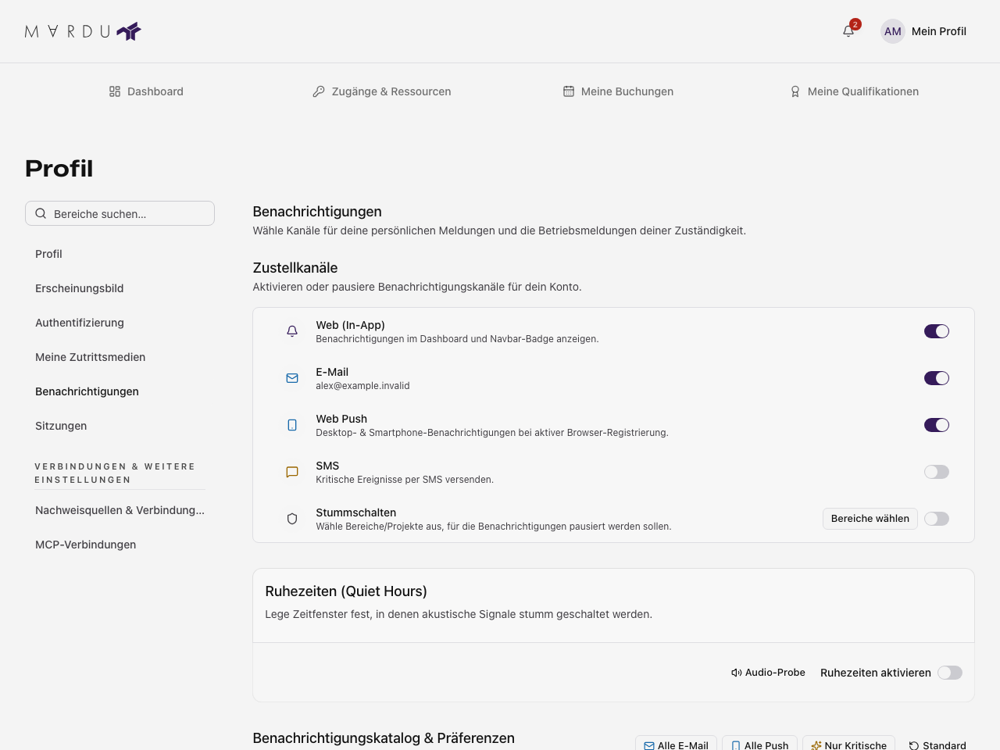

Öffne im Profil **Benachrichtigungen**. Zum Lesen brauchst du Profil-Leserechte,
zum Speichern Änderungsrechte.

## Kanäle und Ereignisse auswählen

1. Prüfe nach dem Laden die angebotenen Kanäle.
2. Suche das Ereignis und aktiviere oder deaktiviere die erlaubten Kanäle.
3. Speichere die Änderungen über die Speicherleiste.

Gesperrte Auswahlen nennen den Grund. Pflichtkanäle bleiben aktiv. E-Mail und SMS
benötigen die Serveranbindung und passende Kontaktdaten; Web-Push zusätzlich
Browserunterstützung, Erlaubnis und Registrierung. Eine gespeicherte Auswahl
bestätigt noch keine Zustellung.

Beispiel mit fiktivem Konto; Kanäle hängen von der Serverkonfiguration ab.

## Ruhezeiten und Stummschaltung

Aktiviere Ruhezeiten, wähle Beginn und Ende und speichere. Es gilt die
[Kontozeitzone](./profil.mdx#kontodaten). Für Stummschaltungen wählst du die
angebotenen Bereiche. Sicherheitsereignisse können diese Einstellungen umgehen;
die Ereignisanzeige kennzeichnet die Ausnahmen.

## Verwerfen, Fehler und neue Berechtigungen

Suche und Seitennavigation erhalten deine Eingaben. Beim Verlassen mit Änderungen
kannst du weiterarbeiten oder verwerfen. Ladefehler bieten Wiederholung;
Speicherfehler lassen den Entwurf bestehen. Ein neuer geladener Stand kann ihn
verwerfen – lies die Bestätigung.

Welche Ereignisse du siehst, hängt von deinen Rechten und Zuständigkeiten ab.
Die Regeln erklärt der [Posteingang](../benutzer/benachrichtigungen.mdx#welche-meldungen-du-bekommst).
