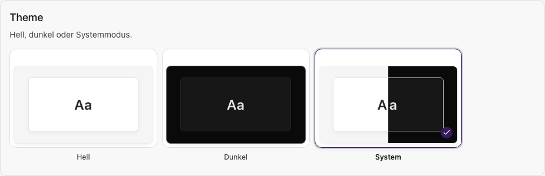

Öffne im Profil **Erscheinungsbild**.

## Hell, Dunkel oder System

Wähle **Hell**, **Dunkel** oder **System**. System folgt dem Farbschema des Geräts.
Die Auswahl wirkt sofort.

## Zeitzone und Formate

Wähle Anzeigezeitzone, Datums-, Uhrzeit- und Zahlenformat und prüfe die Vorschau.
**Systemeinstellungen** übernimmt die Vorgaben deines Browsers oder Geräts.

| Einstellung | Geltung |
| --- | --- |
| Anzeigezeitzone und Formate | Nur in diesem Browser gespeichert. |
| Kontozeitzone | Im [Profil](./profil.mdx#kontodaten) gespeichert, etwa für Benachrichtigungen. |
| Buchungszeitzone | Im jeweiligen Termin hinterlegt. |

Die Anzeigeformate verschieben keine gespeicherten Termine.

## Bedienhilfen

Aktiviere bei Bedarf **Hoher Kontrast** oder **Reduzierte Animation**.
Text vergrößerst du über Browserzoom oder die Geräteeinstellungen.
