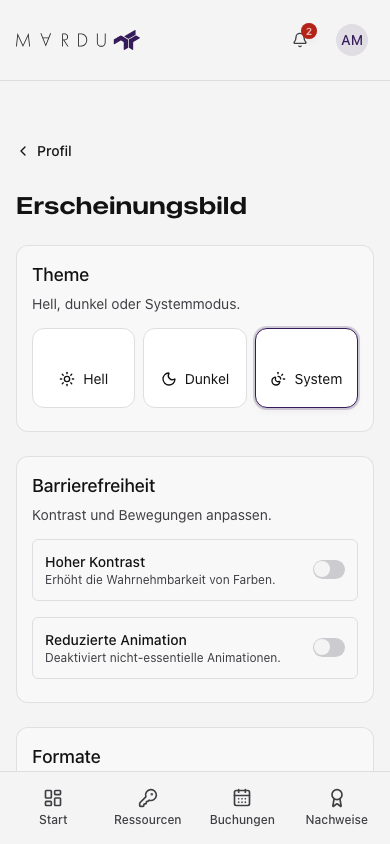

Öffne im Profil **Erscheinungsbild**. Die Einstellungen für die Browseranzeige sind
von deinen gespeicherten Kontodaten und der persönlichen Dashboard-Anordnung
getrennt.

## Hell, Dunkel oder System

Wähle **Hell**, **Dunkel** oder **System**. System richtet sich nach dem
Farbschema des Geräts. Auf dem Handy sind die drei Optionen kompakt dargestellt;
größere Bildschirme zeigen Vorschauen. Die Auswahl wirkt unmittelbar und ist
keine ungespeicherte Änderung einer Kontodatenkarte.

Die mobile Ansicht zeigt kompakte Auswahlfelder und den Rückweg zur Profilübersicht.

## Zeitzone und Formate

Wähle die Anzeigezeitzone sowie die angebotenen Datums-, Uhrzeit- und Zahlenformate.
Die Vorschau zeigt, wie Werte in diesem Browser dargestellt werden. Die
Systemvorgabe verwendet die ermittelten Einstellungen des Browsers oder Geräts.

| Einstellung                        | Geltung                                                                                                    |
| ---------------------------------- | ---------------------------------------------------------------------------------------------------------- |
| Anzeigezeitzone und Anzeigeformate | In diesem Browser gespeichert; andere Browser können andere Werte verwenden.                               |
| Kontozeitzone                      | Im [Profil](./profil.mdx#kontodaten) gespeichert; für serverseitige Abläufe und Benachrichtigungen relevant. |
| Zeitzone einer Buchung             | Teil des jeweiligen Termin- und Wiederholungsablaufs; im Buchungsformular prüfen.                          |
| Dashboard-Anordnung                | Separat im [persönlichen Dashboard](../benutzer/dashboard.mdx) gespeichert.                                |

Eine andere Darstellung verschiebt keinen gespeicherten Termin. Beim Vergleich
von Buchung, Kalenderprogramm und Freigabefenster prüfe jeweils die Zeitzone.

## Bedienhilfen

Die vorhandenen Schalter für stärkeren Kontrast und reduzierte Bewegung verändern
die Darstellung. Prüfe das Ergebnis mit den für dich passenden Systemeinstellungen.
Browserzoom und die Textvergrößerung des Geräts können ergänzend helfen; eine eigene
Schriftgrößeneinstellung wird hier nicht angeboten.

Nutze bei Tastaturbedienung den sichtbaren Fokus.
