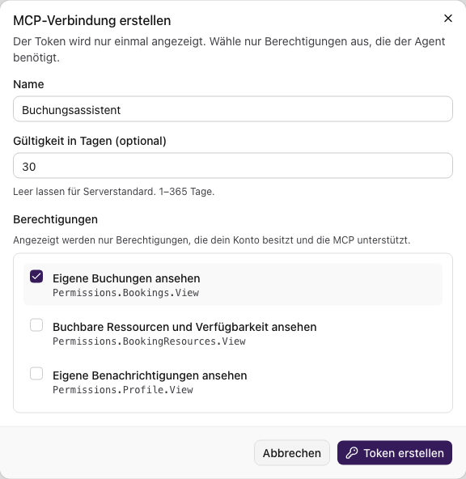
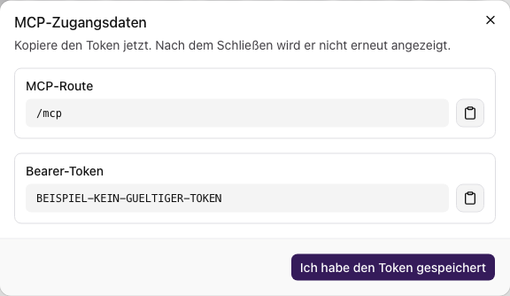
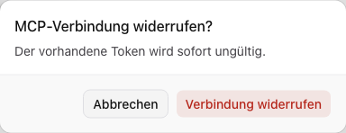

Über **MCP-Verbindungen** im Profil verbindest du kompatible Agenten mit Mardu.
MCP steht für Model Context Protocol. Der Standort muss MCP und persönliche
Verbindungen freigeben. Zum Lesen brauchst du Profil-Leserechte, für Änderungen
Profil-Änderungsrechte.

Die Abbildungen zeigen die vorhandene Oberfläche mit fiktiven Daten bei
aktiviertem MCP. Der abgebildete Token ist ein ungültiges Dokumentationsbeispiel.

## Verbindung erstellen

1. Öffne **Mein Profil → Profil → MCP-Verbindungen**.
2. Wähle **Verbindung erstellen**.
3. Fülle die Angaben aus und wähle nur die benötigten Berechtigungen.
4. Wähle **Token erstellen**.

| Feld                           | Eingabe                                                                                                               |
| ------------------------------ | --------------------------------------------------------------------------------------------------------------------- |
| Name                           | Wiedererkennbarer Name mit höchstens 128 Zeichen, etwa „Buchungsassistent“.                                           |
| Gültigkeit in Tagen (optional) | Leer für den Serverstandard oder eine kürzere Laufzeit. Die Servergrenze kann unter den angezeigten 365 Tagen liegen. |
| Berechtigungen                 | Mindestens eine auswählen. Angeboten werden nur eigene, von MCP unterstützte und am Standort freigegebene Rechte.     |

Nach dem Erstellen erscheinen **MCP-Route** und **Bearer-Token** genau einmal.
Kopiere sie, bevor du **Ich habe den Token gespeichert** wählst. Behandle echte
Tokens wie Passwörter und teile sie nicht in Bildern oder Supportnachrichten.

## Zugang im Client eintragen

1. Wähle im kompatiblen Client eine MCP-Verbindung über **Streamable HTTP**.
2. Ergänze die angezeigte **MCP-Route** um die erreichbare HTTPS-Adresse deines
   Servers. Beispiel: `https://mardu.example.invalid` und `/mcp` ergeben
   `https://mardu.example.invalid/mcp`; ersetze die Beispieladresse durch deinen Server.
3. Hinterlege den **Bearer-Token** im Authentifizierungsfeld des Clients.
   Falls der Client Header verlangt, verwende `Authorization: Bearer <dein-token>`.
4. Prüfe die Verbindung mit einer erlaubten lesenden Aktion.

Die ausgewählten Rechte gelten zusätzlich zu deinen aktuellen Kontorechten und
der Serverrichtlinie. Eine Verbindung erweitert deine eigenen Rechte nicht.

## Zugang ersetzen oder widerrufen

Die Übersicht zeigt Name, Status, Ablaufdatum und ausgewählte Berechtigungen.
Weitere Verbindungen erreichst du über die Seitennavigation.

### Token erneuern

**Token erneuern** macht den bisherigen Token sofort ungültig. Kopiere den neu
angezeigten Token und ersetze ihn in deinem Client. Das Ablaufdatum der Verbindung
bleibt dabei unverändert. Nach Ablauf benötigst du eine neue Verbindung.

### Verbindung widerrufen

Wähle **Widerrufen** und bestätige **Verbindung widerrufen**. Der Token wird sofort
und dauerhaft ungültig; die Verbindung bleibt als **Inaktiv** sichtbar.

## Deaktiviert, leer oder fehlerhaft

- **Deaktiviert:** Die Administration muss MCP beziehungsweise persönliche Verbindungen freigeben.
- **Nur Lesezugriff:** Du benötigst Profil-Änderungsrechte zum Erstellen, Erneuern und Widerrufen.
- **Keine Berechtigungen angeboten:** Für dein Konto sind keine delegierbaren MCP-Rechte freigegeben.
- **Erstellen abgelehnt:** Prüfe Laufzeit und Meldung. Die Zahl aktiver Verbindungen ist am Standort begrenzt.
- **Ladefehler:** Verwende **Neu laden**. Bei Speicherfehlern bleiben Formulareingaben bis zum Verwerfen erhalten.

Ist der Token verloren, erneuere ihn. Ist die Verbindung abgelaufen oder widerrufen,
erstelle eine neue. Prüfe bei Verbindungsfehlern auch Serveradresse und Client-Einstellungen.
