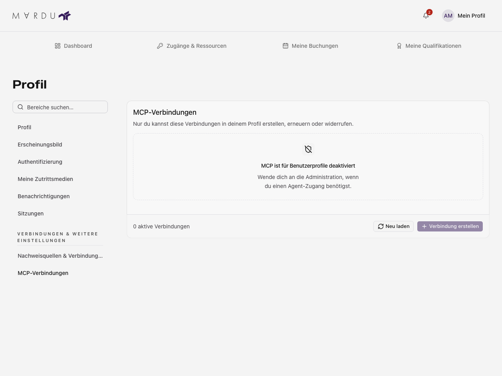

**MCP-Verbindungen** im Profil richtet sich an Personen, die einen kompatiblen
Agenten mit Mardu verbinden möchten. MCP steht für Model Context Protocol. Der
Bereich ist optional und kann auf dem Server deaktiviert sein. Ein sichtbarer
Profileintrag bedeutet nicht, dass bereits ein Agentenzugang freigegeben ist.

Zum Anzeigen brauchst du Profil-Leserechte; Erstellen, Ersetzen und Widerrufen
benötigen Änderungsrechte. Der Server begrenzt die angebotenen Fähigkeiten.
Eine Verbindung erhält nicht automatisch alle Rechte deines Kontos.

## Verbindung erstellen

1. Öffne **MCP-Verbindungen** und warte auf den geladenen Funktionsstatus.
2. Wenn die Funktion aktiviert ist, starte die angebotene neue Verbindung.
3. Gib einen Namen ein, wähle die erforderlichen Fähigkeiten und bei Bedarf die
   angebotene Laufzeit in Tagen.
4. Bestätige die Erstellung und übernimm den angezeigten Zugang in deinen
   kompatiblen Client.
5. Sichere die Zugangsdaten vor dem Verlassen der einmaligen Anzeige.

Vergib nur die für den vorgesehenen Auftrag benötigten Fähigkeiten. Eine
deaktivierte Funktion, fehlende Fähigkeiten oder ein nur lesender Zugriff können
die Erstellung verhindern. Die Anleitung zum tatsächlichen Client-Anschluss steht
unter [MCP-Anbindung](../entwickeln/mcp-anbindung.mdx); hier richtest du keine
serverweite MCP-Richtlinie ein.

## Zugang ersetzen oder widerrufen

Prüfe Name, Status, Berechtigungen und Laufzeit der vorhandenen Verbindung.
Die angebotene Ersetzung erzeugt neue Zugangsdaten; übernimm sie im Client.
Die bisherigen Zugangsdaten dürfen danach nicht weiter verwendet werden.

Widerrufe eine nicht mehr benötigte Verbindung mit der angebotenen Bestätigung.
Ein Widerruf beendet diesen Agentenzugang, nicht dein Benutzerkonto und keine
anderen unabhängigen Verbindungen. Behandle die einmal angezeigten Daten wie ein
Passwort und teile sie nicht in Bildern oder Supportnachrichten.

## Deaktiviert, leer oder fehlerhaft

**Deaktiviert** ist eine Serverentscheidung und kein Ladefehler. Eine erfolgreich
geladene leere Liste bedeutet, dass keine Verbindung angezeigt wird. Bei einem
Abfragefehler verwende **Neu laden**. Eine fehlgeschlagene Mutation braucht eine
neue Prüfung des Stands; eine alte Anzeige beweist keinen erfolgreichen Widerruf.

Beispiel aus der Testumgebung: Die deaktivierte Funktion bietet keine Erstellung an.

Laufende Änderungen und noch nicht gesicherte einmalige Zugangsdaten sind vor
unbeabsichtigtem Verlassen geschützt. Ohne nutzbaren Zugang oder ausreichende
Fähigkeiten kann der Client keine entsprechende Aktion ausführen.
