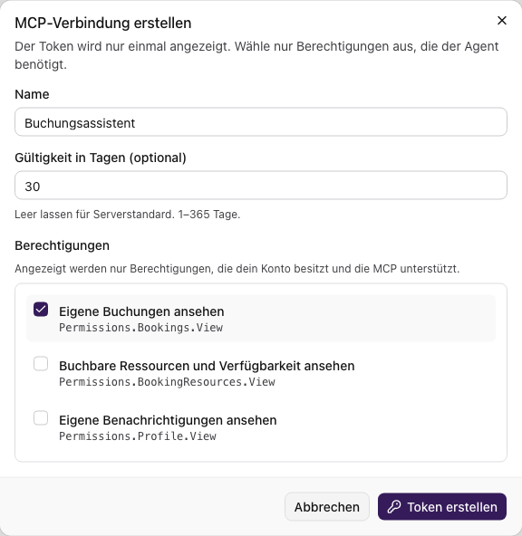
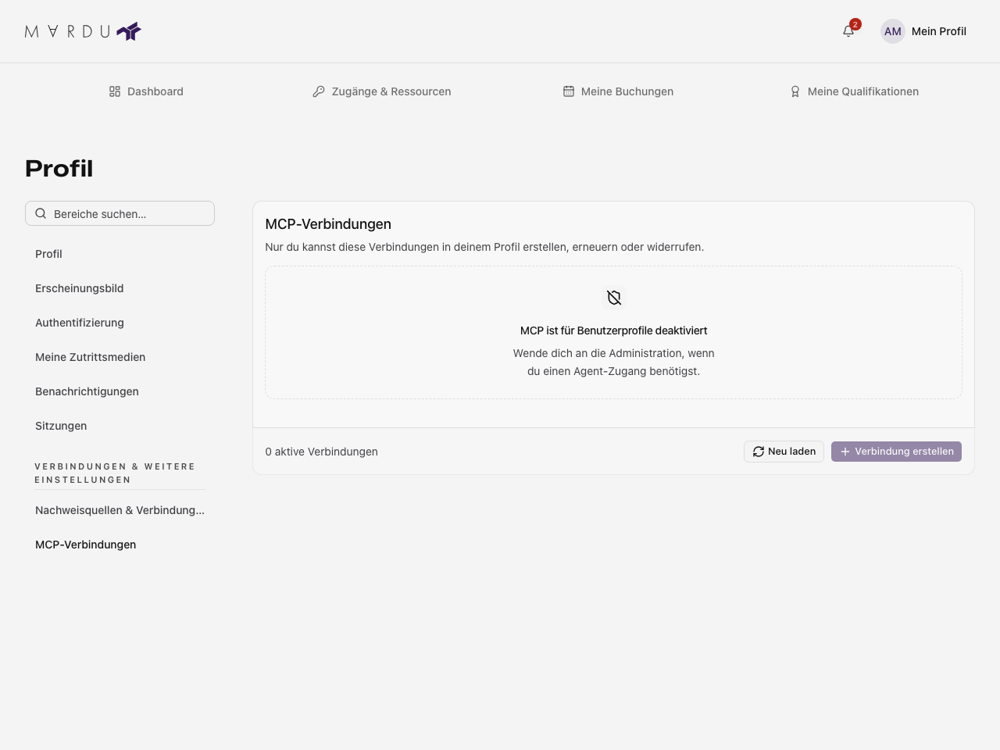

Mit **MCP (Model Context Protocol)** verbindest du einen kompatiblen Agenten mit
deinem Konto. Die Administration muss [MCP und persönliche Verbindungen freigeben](../administration/mcp-verwalten.mdx).
Zum Ansehen brauchst du Profil-Leserechte, zum Erstellen, Erneuern und Widerrufen
Profil-Änderungsrechte.

## Verbindung erstellen

Der Token wird nur einmal angezeigt. Teile ihn nicht in Screenshots oder Nachrichten.

1. Öffne im Kontomenü **Kontoeinstellungen → MCP-Verbindungen** und wähle **Verbindung erstellen**.
2. Fülle die Angaben aus und wähle nur die benötigten Berechtigungen.
3. Wähle **Token erstellen**.
4. Kopiere **MCP-Route** und **Bearer-Token**, bevor du **Ich habe den Token gespeichert** wählst.

| Feld                           | Eingabe                                                                                       |
| ------------------------------ | --------------------------------------------------------------------------------------------- |
| Name                           | Höchstens 128 Zeichen, etwa „Buchungsassistent“.                                              |
| Gültigkeit in Tagen (optional) | Leer für den Serverstandard oder kürzer wählen. Die Servergrenze kann unter 365 Tagen liegen. |
| Berechtigungen                 | Mindestens eine der angebotenen Berechtigungen auswählen.                                     |

Abbildungen mit fiktiven Daten.

## Zugang im Client eintragen

1. Wähle im Client den Transport **Streamable HTTP**.
2. Trage die HTTPS-Adresse deines Servers mit der angezeigten **MCP-Route** ein,
   etwa `https://mardu.example.invalid/mcp`. Ersetze die Beispieladresse und
   gegebenenfalls `/mcp`.
3. Hinterlege den **Bearer-Token**. Falls der Client Header verlangt, verwende
   `Authorization: Bearer <dein-token>`.
4. Prüfe die Verbindung mit einer erlaubten lesenden Aktion.

Der Agent kann nur ausgewählte Rechte nutzen, die dein Konto und die
Serverrichtlinie weiterhin erlauben.

## Zugang ersetzen oder widerrufen

### Token erneuern

**Token erneuern** macht den bisherigen Token sofort ungültig. Ersetze ihn im
Client durch den neu angezeigten Token. Das Ablaufdatum bleibt unverändert.

### Verbindung widerrufen

Wähle **Widerrufen** und bestätige **Verbindung widerrufen**. Der Token wird
sofort und dauerhaft ungültig; die Verbindung bleibt als **Inaktiv** sichtbar.

## Deaktiviert, leer oder fehlerhaft

- **Deaktiviert:** Die Administration muss MCP und persönliche Verbindungen freigeben.
- **Nur Lesezugriff:** Zum Erstellen, Erneuern und Widerrufen fehlen Profil-Änderungsrechte.
- **Keine Berechtigungen angeboten:** Für dein Konto sind keine delegierbaren MCP-Rechte freigegeben.
- **Erstellen abgelehnt:** Prüfe die Laufzeit und die Zahl aktiver Verbindungen.
- **Ladefehler:** Wähle **Neu laden**.
- **Client verbindet sich nicht:** Prüfe Serveradresse, Route, Token und Client-Einstellungen.

Ist der Token verloren, wähle **Token erneuern**. Nach Ablauf oder Widerruf
[erstelle eine neue Verbindung](#verbindung-erstellen).
