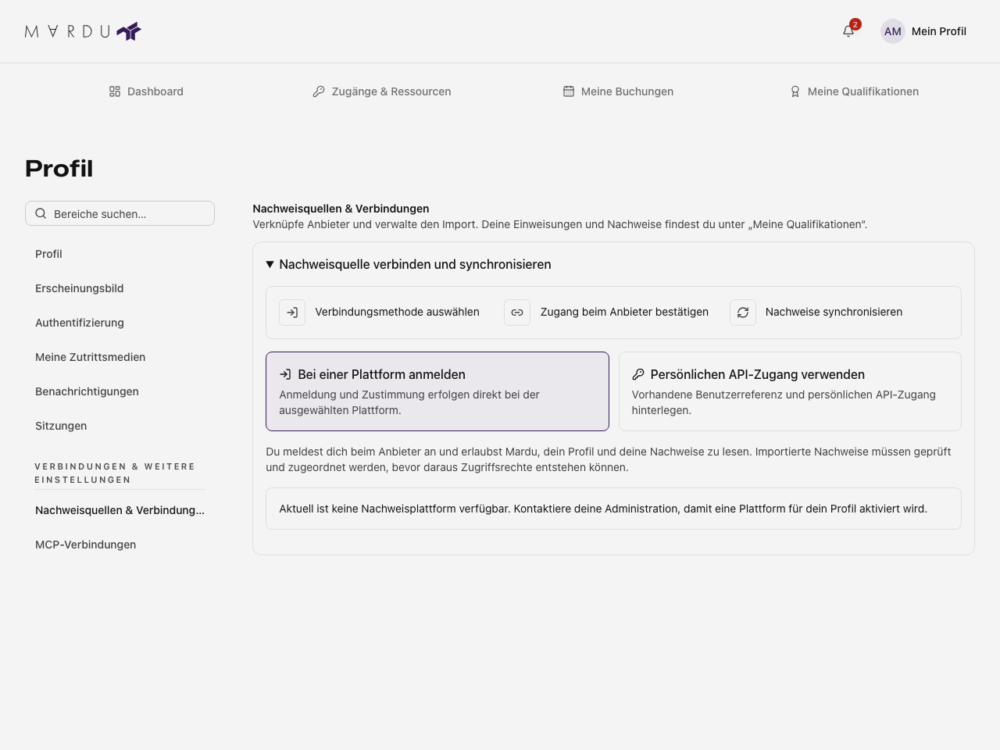

Öffne im Profil **Nachweisquellen & Verbindungen**. Dieser Bereich verwaltet Verbindungen und
Importe. Deine Einweisungen und Nachweise liest du dagegen unter
[Meine Qualifikationen](../benutzer/kompetenzen.mdx).
Lesen und Verwalten richten sich nach deinen Profilrechten und den freigegebenen
Anbietern des Standorts. Anbieter werden nicht in deinem Profil administrativ eingerichtet.

## Einen angebotenen Anbieter verbinden

1. Öffne die Verbindungsverwaltung und wähle den angebotenen Anbieterweg.
2. Lies Anbietername und aktuellen Verbindungsstatus.
3. Starte die Verbindung. Du wirst zur Autorisierung beim Anbieter weitergeleitet.
4. Prüfe nach der Rückkehr, ob die Verbindung bestätigt wurde.
5. Starte den angebotenen Import beziehungsweise die Synchronisierung und lies
   das Ergebnis sowie den Zeitpunkt des letzten Imports.

Ein abgebrochener oder abgelehnter Anbieterablauf bestätigt keine Verbindung.
Ein erfolgreicher Import kann trotzdem einzelne abgelehnte Einträge enthalten.
Prüfe die Fehlermeldungen statt die Gesamtmeldung als Anerkennung aller Nachweise
zu verstehen.

Beispiel ohne hinterlegte persönliche Zugangsdaten. Welche Anbieter angeboten werden, legt der Standort fest.

## Persönlichen Zugang verwenden

Wenn der Standort den persönlichen Zugangsweg anbietet, gib die verlangte
Benutzerreferenz und den persönlichen Anbieter-Token ein. Bestätige die Prüfung
und Verknüpfung. Ein bereits gespeicherter Token wird nicht offen angezeigt;
ein leer gelassenes Tokenfeld kann den vorhandenen Zugang beibehalten, wenn die
Oberfläche dies so beschreibt. Verwende zum Löschen die dafür angebotene
Trennungsaktion statt einen unbekannten Wert einzutragen.

Teile Tokens nicht in Screenshots, Supportmeldungen oder öffentlichen Dokumenten.
Sie sind Zugangsdaten zum Anbieter, keine Mardu-Passwörter.

## Trennen und Fehler behandeln

Prüfe vor **Trennen** die Bestätigung und ihre Wirkung. Eine getrennte Verbindung
kann nicht mehr für weitere Importe verwendet werden. Bereits importierte Einträge
sind gesonderte Nachweisdaten; die Aktion ist keine pauschale Löschung oder ein
Widerruf aller Nachweise. Beachte den anschließend geladenen Stand.

Bei Ladefehlern wiederhole die Abfrage. Bei einer fehlgeschlagenen Verknüpfung
bleiben bearbeitete Eingaben bis zum Verwerfen erhalten. Schließt du einen
bearbeiteten Vorgang, prüft die Oberfläche ungespeicherte Änderungen.

Import, technische Prüfung, Anerkennung und Ressourcenfreigabe sind verschiedene
Vorgänge. Ein erfolgreicher Import erzeugt keine automatische Maschineneinweisung
oder Zutrittserlaubnis. Für eine fehlende Anerkennung ist die zuständige Stelle
des Standorts verantwortlich.
