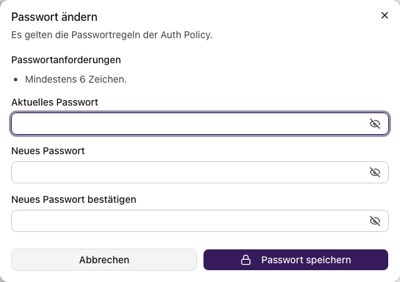
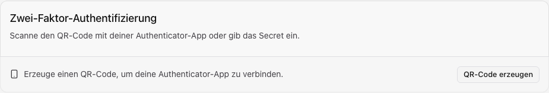

Öffne **Mein Profil → Sicherheit** oder im Profil **Authentifizierung**.
Du benötigst die jeweiligen Profilrechte. Extern verwaltete E-Mail- und
Passwortangaben änderst du gegebenenfalls beim Anmeldeanbieter.

## E-Mail-Adresse ändern

1. Wähle **E-Mail-Adresse ändern**.
2. Gib eine andere E-Mail-Adresse und dein aktuelles lokales Passwort ein.
3. Wähle **Bestätigungslink anfordern** und öffne den Link an der neuen Adresse.

Erst die Bestätigung ändert die Adresse. Fordere bei einem abgelaufenen oder
bereits verwendeten Link einen neuen an. Ohne lokales Passwort ist dieser Weg nicht verfügbar.

## Passwort ändern

1. Öffne **Passwort ändern** und lies die Passwortanforderungen.
2. Gib aktuelles Passwort, neues Passwort und dessen Bestätigung ein.
3. Wähle **Passwort speichern**.

Lade fehlgeschlagene Anforderungen erneut. Bei einem Speicherfehler korrigiere die
Eingaben entsprechend der Meldung im Dialog.

Testumgebung; für dich gelten die angezeigten Regeln deines Standorts.

## Zwei-Faktor-Anmeldung einrichten

1. Wähle unter **Zwei-Faktor-Authentifizierung** die Aktion **QR-Code erzeugen**.
2. Scanne den Code mit deiner Authenticator-App oder übernimm den manuellen Schlüssel.
3. Gib den aktuellen sechsstelligen Code ein und bestätige die Aktivierung.
4. Sichere die angezeigten Wiederherstellungscodes und bestätige ihre Sicherung.

Teile QR-Code, Schlüssel und Wiederherstellungscodes nicht. Bei ungültigen Codes
prüfe Kontoeintrag und Gerätezeit. Eine vorgeschriebene Einrichtung musst du vor
der Nutzung abschließen; sie lässt sich im Profil nicht deaktivieren.
Bei Verlust aller Faktoren benötigst du den Wiederherstellungsweg des Standorts.

Ansicht vor der Schlüsselerzeugung.

## Wiederherstellungscodes sichern

Du benötigst aktivierte Zwei-Faktor-Anmeldung. Öffne **Wiederherstellungscodes verwalten**.
Eine Neuerzeugung ersetzt den bisherigen Codesatz; alte Codes werden nicht erneut angezeigt.

Kopiere oder lade die neuen Codes herunter, bewahre sie getrennt vom Anmeldegerät
auf und bestätige die Sicherung. Jeder Code ist nur einmal verwendbar. Nach einer
Anmeldung damit musst du den Codesatz erneuern.

## Passkey hinzufügen oder deaktivieren

Du benötigst einen unterstützten Browser und Geräteschutz oder Sicherheitsschlüssel,
üblicherweise über HTTPS.

1. Wähle **Passkey hinzufügen**, dann **Passkey registrieren**.
2. Folge dem Browserdialog und prüfe anschließend den neuen Eintrag.

Ein Abbruch registriert keinen Passkey. Deaktiviere nicht mehr benötigte Einträge
über ihre Aktion und Bestätigung. Behalte vorher einen anderen nutzbaren Anmeldeweg.
Bei Ladefehlern wiederhole die Abfrage; bei unbekannten Anmeldungen prüfe auch
[Sitzungen](./profil-sitzungen.mdx).
