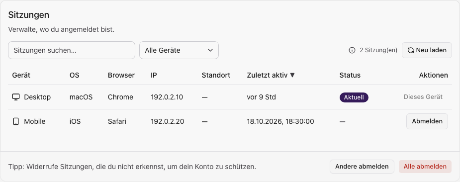

Öffne **Mein Profil → Aktive Sitzungen** oder im Profil **Sitzungen**.
Zum Lesen brauchst du Profil-Leserechte, zum Widerrufen Änderungsrechte.

## Sitzung erkennen

Prüfe Gerät, Betriebssystem, Browser, IP-Adresse und letzte Aktivität. Suche und
Gerätefilter grenzen die Liste ein. **Aktuell** kennzeichnet deine derzeitige Sitzung.
IP- und Ortsangaben allein belegen keine Identität oder Anwesenheit.

Fiktive Geräte und IP-Adressen.

## Einzelne oder andere Sitzungen widerrufen

Wähle **Abmelden** an einer nicht mehr benötigten Sitzung.
**Andere abmelden** erhält deine aktuelle Sitzung.
**Alle abmelden** beendet auch deine Anmeldung; verwende dies nur, wenn du dich
anschließend wieder anmelden kannst.

Ein Widerruf verhindert die Sitzungserneuerung; bereits ausgegebene Zugriffstoken
können bis zu ihrem Ablauf gelten. Zutrittsmedien werden dadurch nicht gesperrt.

## Unbekannte Anmeldung oder Ladefehler

Beende unbekannte Sitzungen und prüfe deine [Anmeldesicherheit](./profil-sicherheit.mdx).
Bei Ladefehlern wiederhole die Abfrage. Nach einem fehlgeschlagenen Widerruf lade
den Stand neu, bevor du die Sitzung als beendet betrachtest.
