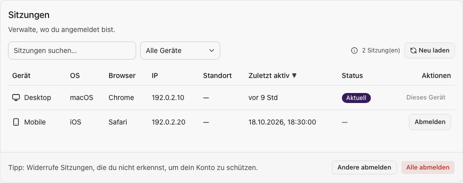

Öffne im Kontomenü **Aktive Sitzungen** oder **Kontoeinstellungen → Sitzungen**.
Zum Lesen brauchst du Profil-Leserechte, zum Widerrufen Änderungsrechte.
Die Liste zeigt deine aktiven Anmeldesitzungen beim aktuellen Mardu-Server.

## Sitzung erkennen

Prüfe Gerät, Betriebssystem, Browser, IP-Adresse und **Zuletzt aktiv**. Suche und
Gerätefilter grenzen die Liste ein. Eine leere Trefferliste kann an den Filtern
liegen; leere die Suche und wähle **Alle Geräte**.

**Aktuell** kennzeichnet deine derzeitige Sitzung. Dort ist **Dieses Gerät**
deaktiviert, damit du sie nicht versehentlich einzeln abmeldest.
Der Standort kann fehlen. IP- und Ortsangaben allein belegen keine Identität
oder Anwesenheit.

Auf großen Bildschirmen siehst du eine Tabelle; über die Spaltenüberschriften
kannst du sortieren. Auf dem Handy stehen die Angaben und Aktionen untereinander.

Fiktive Geräte und IP-Adressen.

## Einzelne oder andere Sitzungen widerrufen

Prüfe vor **Alle abmelden**, dass du dich anschließend wieder anmelden kannst:
Diese Aktion beendet auch deine aktuelle Anmeldung.

Wähle die passende Aktion und bestätige sie im Dialog:

| Aktion                                 | Wirkung                                                                                                                          |
| -------------------------------------- | -------------------------------------------------------------------------------------------------------------------------------- |
| **Abmelden** bei einer anderen Sitzung | Beendet diese Anmeldesitzung.                                                                                                    |
| **Andere abmelden**                    | Beendet die übrigen Anmeldesitzungen; deine aktuelle Sitzung bleibt erhalten. Ohne weitere Sitzungen ist die Aktion deaktiviert. |
| **Alle abmelden**                      | Beendet alle Anmeldesitzungen und führt dich zur Anmeldung zurück.                                                               |

Nach dem Widerruf einer anderen Sitzung oder aller anderen Sitzungen wird die
Liste neu geladen. Zum Abmelden nur deiner aktuellen Sitzung verwende
**Abmelden** im Kontomenü.

Ein Widerruf verhindert die Sitzungserneuerung. Der Server weist auch weitere
API-Anfragen der widerrufenen Sitzung zurück; eine bereits geöffnete Ansicht muss
deshalb nicht sofort verschwinden. Zutrittsmedien werden dadurch nicht gesperrt.

## Unbekannte Anmeldung oder Ladefehler

Beende unbekannte Sitzungen und prüfe deine [Anmeldesicherheit](./profil-sicherheit.mdx).
Bei Ladefehlern wiederhole die Abfrage. Nach einem fehlgeschlagenen Widerruf lade
den Stand neu, bevor du die Sitzung als beendet betrachtest.
