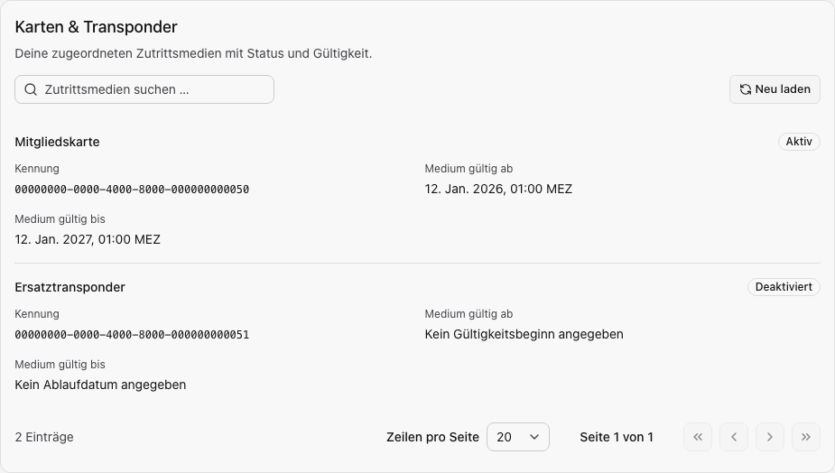

Öffne **Mein Profil → Profil → Meine Zutrittsmedien** beziehungsweise wähle auf
dem Handy den Bereich **Meine Zutrittsmedien** in der Profilübersicht.
Profil-Leserechte genügen. Auch Personen mit Verwaltungsrechten sehen hier nur
ihre eigenen zugeordneten Karten und Transponder.

## Medien finden und lesen

Verwende die Suche nach Name oder Kennung, um ein Medium zu finden. Prüfe Name, angezeigte
Kennung, gespeicherten Status und vorhandene Gültigkeitsdaten. Fehlende Namen,
unbekannte Statuswerte und nicht angegebene Zeitgrenzen werden ausdrücklich
gekennzeichnet. Technische Schlüssel werden nicht angezeigt.

| Status                 | Einordnung                                                                            |
| ---------------------- | ------------------------------------------------------------------------------------- |
| Einrichtung ausstehend | Die Einrichtung ist noch nicht vollständig abgeschlossen.                             |
| Eingerichtet           | Das Medium wurde provisioniert; prüfe seinen aktuellen Status und Zeitraum.           |
| Aktiv                  | Der gespeicherte Medienstatus ist aktiv. Weitere Zugangsbedingungen gelten weiterhin. |
| Deaktiviert            | Das Medium ist deaktiviert.                                                           |
| Status unbekannt       | Ein verlässlicher Status konnte nicht zugeordnet werden.                              |

Medienstatus und Gültigkeit sind getrennt: Ein als aktiv gespeichertes Medium
kann außerhalb seines Zeitraums liegen. Die Zuordnung zu deinem Konto ersetzt
keine [Ressourcenfreigabe](../benutzer/zutritt.mdx) oder erforderliche Einweisung.

Beispiel mit fiktiven Medien und Kennungen. Es werden keine technischen Schlüssel angezeigt.

## Fehlendes oder verlorenes Medium

Ein leerer Bereich bedeutet nach erfolgreichem Laden, dass keine passenden Medien
zugeordnet oder von der Suche erfasst sind. Ein Ladefehler bietet Wiederholung und
ist kein Beleg für eine fehlende Zuordnung. Prüfe bei einem vermissten Medium
zuerst die Suche und den gewählten Server.

Melde einen Verlust unmittelbar an die zuständige Stelle deines Standorts und
nenne die erkennbare Bezeichnung. Diese Profilansicht enthält keine Verlustsperre,
Ersatzbestellung, Löschung oder Vergabeaktion. Eine allgemeine Löschfunktion ist
kein gleichwertiger Sperrablauf. Die Verwaltung prüft das weitere Vorgehen.
