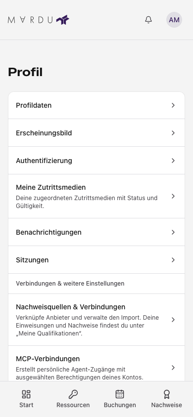
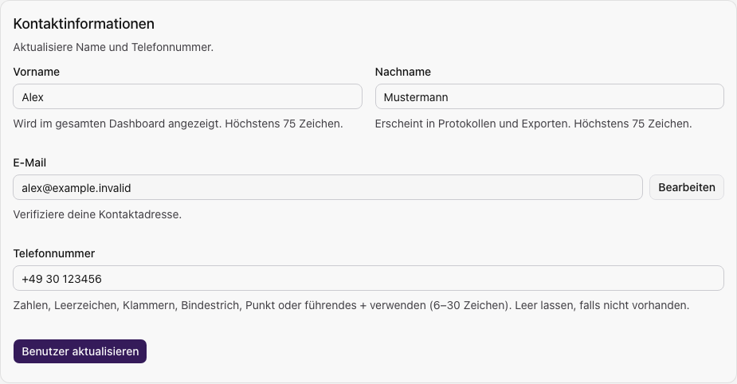
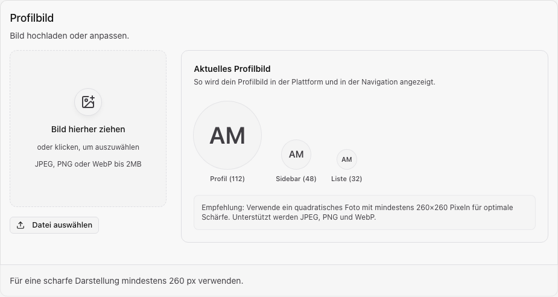

Über **Mein Profil → Profil** öffnest du dein eigenes Konto. Auf dem Handy siehst
du zunächst eine Bereichsliste; **Profildaten** öffnet die Angaben. Am Desktop
bleibt die Profilnavigation daneben sichtbar. Dieselben Formulare sind auch aus
der Verwaltung erreichbar. Rücksprünge bleiben im jeweils geöffneten Rahmen.

Zum Lesen brauchst du Profil-Leserechte, zum Ändern die entsprechenden
Profil-Änderungsrechte. Verwaltungsrechte erlauben in dieser Ansicht keine
Bearbeitung eines fremden Kontos.

Beispiel mit fiktiven Daten. Wähle einen Bereich aus der Liste; der Zurück-Link
der Unterseite führt wieder hierher. Technische Verbindungen stehen weiter unten.

## Kontodaten

1. Öffne **Profil** beziehungsweise **Profildaten**.
2. Prüfe die Kontaktdaten und persönlichen Angaben.
3. Ändere die erlaubten Werte und speichere den betroffenen Bereich.
4. Warte auf die Erfolgsmeldung. Das Speichern einer Karte speichert nicht
   automatisch ungespeicherte Änderungen anderer Karten.

| Angabe               | Wirkung und Grenzen                                                                    |
| -------------------- | -------------------------------------------------------------------------------------- |
| Vorname und Nachname | Kontonamen; erforderliche Namen dürfen nicht leer gespeichert werden.                  |
| Telefonnummer        | Optionale Kontaktangabe; eine gespeicherte Nummer ist kein Nachweis ihrer Bestätigung. |
| Anzeigename          | Persönliche Darstellung des Namens.                                                    |
| Geburtsdatum         | Persönliche Datumsangabe; verwende die angebotene Datumseingabe.                       |
| Sprache              | Im Konto gespeicherte Sprachvorgabe.                                                   |
| Kontozeitzone        | Zeitzone für serverseitige Abläufe und Benachrichtigungen.                             |

Optionale Werte können in den dafür angebotenen Eingaben geleert und gespeichert
werden. Ein ungültiger Wert wird mit Feldfehler abgelehnt. Vom Anmeldedienst
verwaltete Angaben sind gekennzeichnet oder schreibgeschützt; ändere sie beim
zuständigen Anbieter. Ein zwischenzeitlicher Wechsel der Verwaltung kann auch
beim Speichern zu einer Ablehnung führen.

Die E-Mail-Adresse änderst du über **Authentifizierung**, nicht durch Überschreiben
einer Kontaktanzeige.

Beispiel mit fiktiven Kontodaten.

## Profilbild

Wähle ein Bild im angebotenen Uploadfeld oder ziehe es hinein. Beachte die dort
angezeigten Dateiformate und Größenlimits: JPEG, PNG oder WebP bis 2 MB; SVG wird
nicht als Profilbild angenommen. Verschiebe den Ausschnitt durch Ziehen
oder mit den vier Richtungsschaltflächen und passe ihn am beschrifteten Zoom-Regler
an. Auf dem Handy steht eine große Vorschau im Vordergrund. Speichere das Ergebnis
mit der angebotenen Aktion; eine Vorschau allein ändert das Konto noch nicht.

**Bild entfernen** löscht das aktuelle Profilbild unmittelbar nach erfolgreicher
Ausführung; dafür ist kein weiteres Speichern der Kontodaten nötig.
**Zurücksetzen** verwirft dagegen die aktuelle Bildauswahl und ihren Ausschnitt.
Schlägt Upload oder Speichern fehl, bleibt der Fehler im Bereich sichtbar.

Beispiel ohne hochgeladenes Foto; die Vorschau verwendet die Initialen des fiktiven Kontos.

## Profil vervollständigen

Wenn erforderliche Angaben fehlen, führt dich der angebotene Vervollständigungsweg
zu den betreffenden Feldern. Prüfe die markierten Angaben, speichere sie und setze
danach den vorgesehenen Ablauf fort. Ein Ladefehler ist keine Aufforderung,
unbekannte Werte durch leere Standardangaben zu überschreiben.

## Anmeldesicherheit

[E-Mail, Passwort, Zwei-Faktor-Anmeldung, Wiederherstellungscodes und Passkeys](./profil-sicherheit.mdx)
haben eigene Abläufe. Sichere Einmalcodes vor dem Verlassen der Anzeige.

## Sitzungen

[Eigene Sitzungen](./profil-sitzungen.mdx) zeigt Anmeldungen und deren Widerruf.
Anmeldesitzungen sind keine Zutrittssitzungen an Türen oder Maschinen.

## Benachrichtigungen

Die Glocke öffnet den [Posteingang](../benutzer/benachrichtigungen.mdx).
[Benachrichtigungseinstellungen](./profil-benachrichtigungen.mdx) steuern die
angebotenen Versandoptionen. Lesen und Einstellungen sind unterschiedliche Aufgaben.

## Zutrittsmedien

[Meine Zutrittsmedien](./profil-zutrittsmedien.mdx) zeigt deine Karten und Transponder
mit Status und Gültigkeit. Dieser Bereich vergibt keine Ressourcenfreigabe.

## Externe Konten

[Nachweisquellen](./profil-nachweisquellen.mdx) verwaltet persönliche Verbindungen
und Importe. [MCP-Verbindungen](./profil-mcp.mdx) verbindet geeignete Agenten mit den
angebotenen Fähigkeiten, sofern der Standort dies aktiviert hat.

## Erscheinungsbild

[Darstellung und Formate](./profil-erscheinungsbild.mdx) erklärt Theme,
Anzeigezeitzone, Datums-/Zahlenformate und die vorhandenen Bedienhilfen.

## Bedienhilfen

Verwende Tab und Umschalt + Tab für den Fokuswechsel; aktivierte Steuerelemente
lassen sich über ihre üblichen Tastaturaktionen bedienen. Fehler erscheinen beim
betroffenen Bereich.

## Ungespeicherte Änderungen

Bei internen Wechseln, Abmeldung und Projektwechsel kannst du weiterarbeiten oder
Änderungen verwerfen. Neuladen und Tab-Schließen verwenden die Browserwarnung.
Der Schutz von Zurück/Vorwärts hängt davon ab, ob der Browser den Wechsel abbrechen
kann. Speichere Änderungen deshalb vor einem wichtigen Wechsel bewusst.
Passwörter und Einmalzugänge werden nicht als wiederherstellbarer Formularentwurf
im Browserspeicher abgelegt. Ein Rechteverlust oder Sitzungsablauf kann den Zugriff
beenden, bevor du einen Entwurf fertigstellen kannst.
