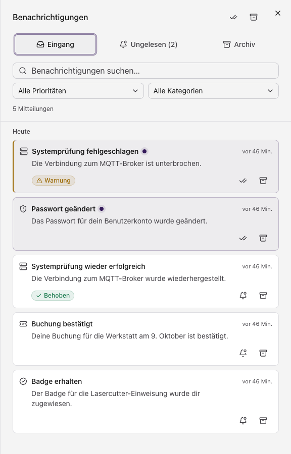

Diese Seite ist teilweise ausgearbeitet. Die Anleitung beschreibt das eigene Konto;
administrative Änderungen an anderen Konten stehen unter
[Benutzer und Rollen](../administration/benutzer-rollen.mdx).

## Kontodaten

- [ ] TODO: Tatsächlich bearbeitbare Angaben, Profilbild, Sprache und Zeitzone ändern; optionale Werte leeren, speichern und Fehler erklären. Lokale und vom Anbieter verwaltete Felder unterscheiden.
- [ ] TODO: E-Mail-Wechsel mit Passwort/Bestätigung und vorhandenem Kontoanbieter prüfen; gewünschte Adresse von bereits bestätigter Adresse unterscheiden.
- [ ] TODO: Angeforderte Pflichtangaben vervollständigen; Ergebnis und weiteren Anmelde-/Onboarding-Ablauf anhand vorhandener Bedingungen erklären.

## Anmeldesicherheit

- [ ] TODO: Passwort mit der wirksamen Richtlinie ändern; altes Passwort, Bestätigung, externe Konten und Fehler behandeln.
- [ ] TODO: Zwei-Faktor-Authentifizierung (2FA) einrichten, prüfen und deaktivieren; vorgeschriebene 2FA und administrative Wiederherstellung unterscheiden.
- [ ] TODO: Wiederherstellungscodes erzeugen, einmalige Anzeige, Verwendung und Neuerzeugung erklären; alte Codes und tatsächliche Vorgabe beim Anmelden prüfen.
- [ ] TODO: Passkey registrieren, benennen und entfernen/deaktivieren; HTTPS, unterstütztes Gerät und Serverrichtlinie prüfen.

## Sitzungen

- [ ] TODO: Eigene Anmeldesitzungen lesen und einzelne widerrufen; aktuelle Sitzung, Browser/IP, letzte Verwendung und Aussagegrenzen erklären.
- [ ] TODO: Alle eigenen Sitzungen beziehungsweise alle außer der aktuellen widerrufen; Wirkung auf Token-Erneuerung und bereits gültige Zugriffe belegen.
- [ ] TODO: Unbekannte Anmeldung prüfen und mit passenden Angaben melden; Anmeldehistorie von Zutrittssitzungen unterscheiden.

## Benachrichtigungen

Öffne die Glocke im Dashboard. **„Eingang“** zeigt nicht archivierte Mitteilungen, **„Ungelesen“** nur ungelesene und **„Archiv“** die archivierten Einträge. Mit Suche, Priorität und Kategorie grenzt du die Liste ein.

Klicke auf einen Eintrag, um den vollständigen Text und weitere Details zu sehen. Die Symbole rechts markieren ihn als gelesen oder ungelesen und archivieren ihn. Im Archiv kannst du ihn in den Eingang zurückholen. Oben markierst du alle Mitteilungen als gelesen oder archivierst die gelesenen. Nach dem Archivieren lässt sich die Aktion über **„Rückgängig“** zurücknehmen.

- [ ] TODO: Ereignis-/Kanaleinstellungen für App, E-Mail und Web-Push ändern; zulässige und verpflichtende Kanäle sowie Ausnahmen für Sicherheitsereignisse erklären.
- [ ] TODO: Ruhezeiten mit Zeitzone, Stummschaltung und Zusammenfassungen anhand der unterstützten Ereignisse erklären; erwartetes Ergebnis und Ausnahmen nennen.
- [ ] TODO: Push-Gerät anmelden, Browserberechtigung prüfen und entfernen; abgeschalteten Versand und fehlerhafte Zustellung behandeln.

## Externe Konten

- [ ] TODO: Persönlichen Badge-Anbieter verknüpfen, synchronisieren und trennen; einmal angezeigte Tokens, Identitätszuordnung und administrative Anbieter-Einrichtung unterscheiden.
- [ ] TODO: Eigene MCP-Agentenverbindung mit erlaubten Fähigkeiten und Laufzeit erstellen, Token einmal übernehmen, rotieren und widerrufen; Serverrichtlinie und fehlende Rechte erklären.

## Erscheinungsbild

- [ ] TODO: Tatsächlich angebotene Theme-/Anzeigeeinstellungen ändern; Speicherung, Systemvorgabe und persönliche Dashboard-Anordnung unterscheiden.
- [ ] TODO: Sprache und Zeitzone sowie daraus abgeleitete Formate erklären; eigenständige Datums-/Zahlenformatwahl nur bei vorhandener Einstellung beschreiben.

## Bedienhilfen

- [ ] TODO: Vorhandene Bedienhilfe-Einstellungen prüfen; Browserzoom, Kontrast und reduzierte Bewegung nicht als Produktregler versprechen, wenn nur Browser/System sie steuert.
- [ ] TODO: Tastaturbedienung für Navigation, Dialoge und Formularfehler mit vorhandener UI prüfen und beschreiben.
