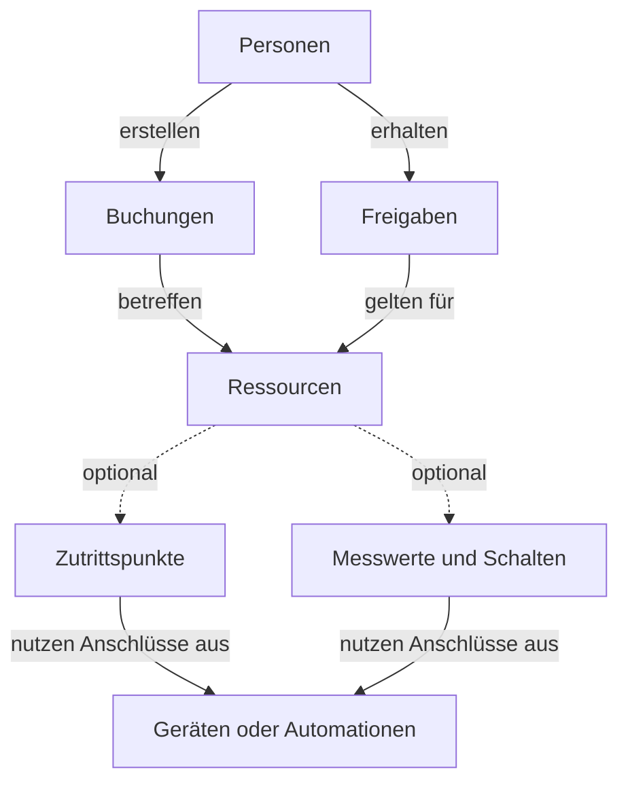
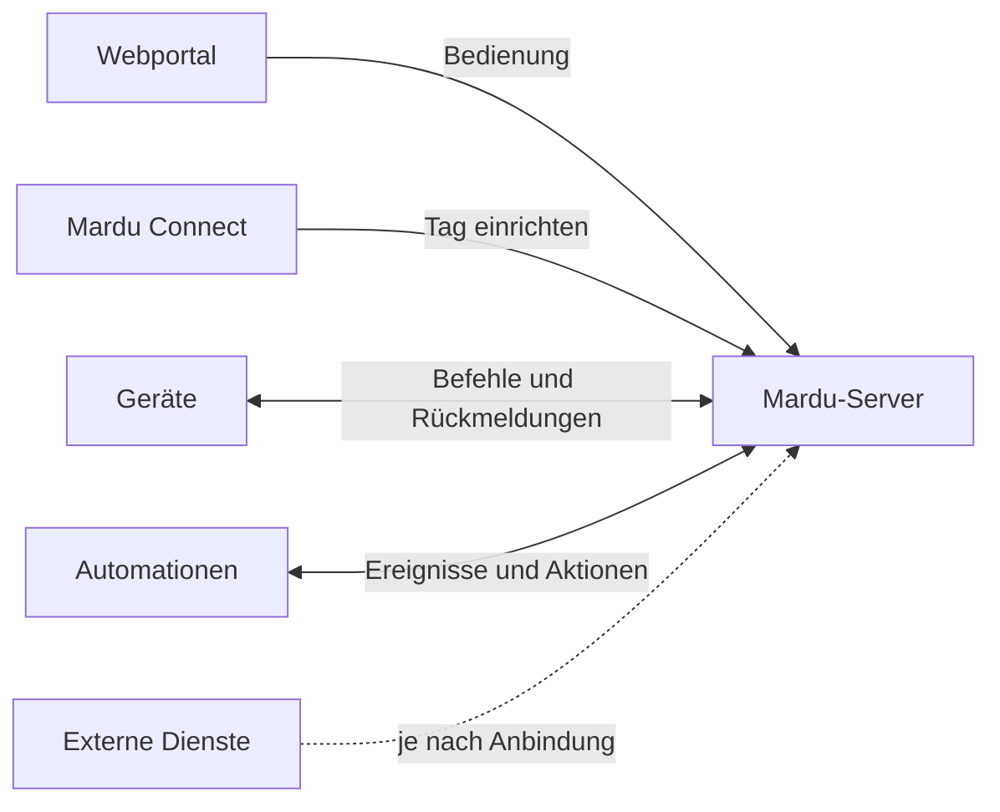

# Mardu verstehen

> Inhaltsentwurf vom 1. November 2026 für `/docs/ueberblick`.
> Noch nicht veröffentlicht. Bei Übernahme wird diese Überschrift zum Seitentitel
> im Frontmatter; die Entwurfsnotiz entfällt.
> Gerenderte Diagramme: [Ressourcenmodell](./bilder/mardu-ressourcen-modell.svg) und
> [Systembestandteile](./bilder/mardu-systembestandteile.svg). Quelle sind die Mermaid-Blöcke unten.

Mardu verbindet **Personen** mit **Ressourcen**: etwa mit Räumen, Maschinen oder
Werkzeugen. Es verwaltet, wer etwas nutzen darf, wann es reserviert ist und welche
Bedingungen dafür gelten. Welche Funktionen du siehst, hängt von der Einrichtung
eurer Installation und deinen Berechtigungen ab.

## Ressourcen sind der Ausgangspunkt

Eine Ressource beschreibt das, was ihr organisieren oder nutzen möchtet. Sie kann
für sich stehen oder Teil einer Struktur sein, etwa **Standort → Gebäude → Raum**.
Eine Maschine kann dem Raum zugeordnet sein, in dem sie steht.

Nicht jede Ressource braucht dieselbe Ausstattung:

| Beispiel                                                | Was ihr dafür einrichtet                                                                                                                     |
| ------------------------------------------------------- | -------------------------------------------------------------------------------------------------------------------------------------------- |
| Ein Besprechungsraum, den Mitglieder reservieren können | Ressource und Buchbarkeit mit verfügbaren Zeiten. Dafür ist kein Lesegerät erforderlich.                                                     |
| Ein Raum mit zwei kontrollierten Eingängen              | Ressource mit mehreren Zutrittspunkten und den zugeordneten technischen Anschlüssen.                                                         |
| Eine Maschine mit Einweisung und Freischaltung          | Ressource mit Nutzungsbedingungen, erforderlicher Kompetenz und passender Technik. Buchungen, Automationen und Messwerte können hinzukommen. |

Das Diagramm zeigt die Zusammenhänge aus Sicht der Nutzung. Die gestrichelten
Verbindungen sind optionale Ergänzungen. Eine Ressource kann ohne Technik
verwaltet und gebucht werden. Bei einer technischen Anbindung ordnest du ihr die
benötigten Anschlüsse zu; Ressource und Gerät werden dadurch nicht dasselbe.
Eine Automation kann beispielsweise einen externen Schalter bereitstellen.

Wie du eine Ressource aufbaust und ihre Buchbarkeit oder Technik ergänzt, steht
unter [Ressourcen verwalten](../docs/koordination/ressourcen.mdx).

## Personen, Rechte und Nutzungsbedingungen

Eine Person meldet sich mit ihrem Benutzerkonto an. Rollen und Benutzergruppen
bestimmen ihre Berechtigungen für Funktionen in Mardu, beispielsweise für die
Verwaltung von Geräten. Für die Nutzung einer Ressource gelten zusätzlich deren
eingestellte Bedingungen.

Dabei erfüllen die Zuordnungen unterschiedliche Aufgaben:

- Eine **Freigabe** ist eine Zuordnung für die Nutzung im festgelegten Umfang
  und Zeitraum. Weitere Bedingungen der Ressource, etwa eine Einweisung, müssen
  zusätzlich erfüllt sein.
- Eine **Buchung** reserviert einen Zeitraum. Ob sie auch als Nachweis für den
  Zugriff gilt, hängt von der eingerichteten Zuordnung und Ressourcenregel ab.
- Eine **Kompetenz oder ein Nachweis** kann eine erforderliche Einweisung belegen.
- Ein **Tag**, etwa eine NFC-Karte, identifiziert die Person am Leser. Seine
  Zuweisung erteilt allein keine Ressourcenfreigabe.

So kann eine Maschine sowohl eine Buchung als auch eine Einweisung erfordern.
Ein anderer Raum benötigt nur eine Reservierung. Das sind unterschiedliche
Konfigurationen derselben Installation.

[Benutzerkonten, Rollen und Zugänge](../docs/ueberblick/benutzerkonten.mdx)
erklärt diese Zuordnungen genauer. Einzelne Begriffe findest du im
[Begriffsverzeichnis](../docs/ueberblick/grundlagen-begriffe.mdx).

## Welche Teile gehören zum System?

Im **Webportal** erledigst du persönliche Aufgaben und, mit den entsprechenden
Rechten, Verwaltungsaufgaben. Der **Mardu-Server** verwaltet die Daten, prüft
Berechtigungen und verarbeitet die eingerichteten Abläufe.

**Mardu Connect** wird unter anderem zum Einrichten von NFC-Tags verwendet.
Geräte stellen technische Anschlüsse bereit, etwa Leser, Schaltausgänge oder
Messwerte. Automationen verarbeiten eingerichtete Abläufe und können externe
Anschlüsse bereitstellen. Ein gemeldeter Zustand und ein gesendeter Befehl sind
unterschiedliche Informationen; ein Befehl allein bestätigt keine Ausführung.

Externe Dienste sind optional: Eine Installation kann beispielsweise Personen
aus einem LDAP-Verzeichnis übernehmen oder eine Anmeldung über OpenID Connect
anbieten. Auch persönliche Nachweisquellen können angeboten werden. Welche
Anbieter und Prüfverfahren unterstützt werden, hängt von der jeweiligen
Anbindung ab; ein importierter Nachweis ist noch keine Anerkennung für eine
Ressource.

Die Einrichtung gehört zu [Integrationen](../docs/administration/integrationen.mdx).
Eigene Software verbindet sich über die angebotenen
[Schnittstellen](../docs/entwickeln/api-integration.mdx) mit dem Server. Für
Agenten gibt es einen [MCP-Zugang](../docs/administration/mcp-verwalten.mdx),
dessen Freigabe und persönliche Berechtigungen den nutzbaren Umfang begrenzen.

## Wo möchtest du anfangen?

| Deine Aufgabe                                       | Einstieg                                                        |
| --------------------------------------------------- | --------------------------------------------------------------- |
| Mardu zum ersten Mal selbst nutzen                  | [Benutzer: Erste Schritte](../docs/benutzer/erste-schritte.mdx) |
| Ressourcen, Buchungen oder Bewertungen organisieren | [Koordination](../docs/koordination/index.mdx)                  |
| Konten, Zutritt, Geräte oder den Server verwalten   | [Administration](../docs/administration/index.mdx)              |
| Server und Geräte vor Ort aufbauen                  | [Installieren](../docs/installieren/index.mdx)                  |
| Eigene Software anbinden                            | [Entwickeln](../docs/entwickeln/index.mdx)                      |

Du musst nicht alle Bereiche lesen, um Mardu zu nutzen. Wähle die Anleitung für
deine nächste Aufgabe; die benötigten Voraussetzungen stehen dort.
